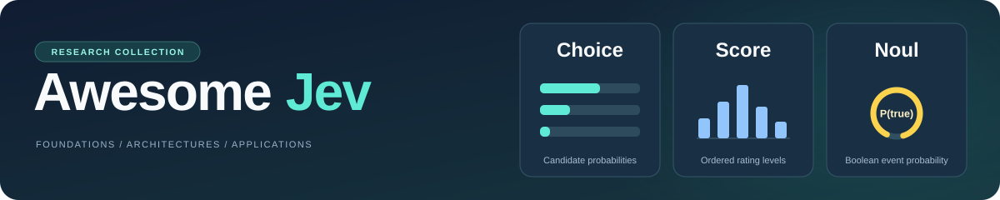

# Awesome Jev

  

> [!NOTE]
> **Survey paper: Coming soon...**
>
> A Survey of Jev-Style Decision Models: Foundations, Architectures, and Applications

------

### ✨Overview

[Jev](https://docs.typesafe.ai/introduction) is a decision model introduced by TypeSafe AI. Users provide content, questions, and evaluation criteria; the model returns choices, ratings, or probabilities for classification, filtering, ranking, and workflow control.

Awesome Jev brings together papers, models, APIs, and developer tools for Jev and other models with comparable decision interfaces. Resources are organized by research topic and application domain to help researchers find methods and evaluations, and developers select models and integration tools. The six main sections are:

- **[Closed-Source APIs](#closed-source-apis)**: Commercial APIs with capabilities relevant to structured decision tasks.
- **[Models & Architectures](#models--architectures)**: Decision-model architectures and implementations, including language probability readout, candidate-based scoring, and decision-native modeling.
- **[Training & Inference](#️training--inference)**: Training and adaptation, knowledge distillation, recurrent inference, search and cascades, state reuse, and serving optimization.
- **[Evaluation & Reliability](#evaluation--reliability)**: Benchmarks and analyses covering accuracy, calibration, answer-option design, robustness, privacy, latency, cost, and related topics.
- **[Applications](#applications)**: Research and projects grouped by domains such as retrieval, finance, security, medicine, recommendation, and industrial monitoring, describing how decision models are used in specific tasks.
- **[Agent Ecosystem & Tools](#agent-ecosystem--tools)**: Developer interfaces, Agent runtimes and routing, safety checks, business automation, and operational evaluation tools for integrating decision models into software systems.

[Other Surveys and Awesome Lists](#️other-surveys-and-awesome-lists) provides supplementary reading and further resource collections.

> [!IMPORTANT]
> **Authors: share your official description**
>
> - **What to submit**: Summarize the main contribution of your paper or project in **1–2 sentences**.
> - **Contact**: Email `hanboyu23z@ict.ac.cn`, **Issues**, or **Pull requests**.
> - **Entry updates**: We will update the description and add the  badge.
>
> Help readers understand your work accurately and discover research and projects worth following.

------

### 📚Contents

- [✨Overview](#overview)
- [🔧Closed-Source APIs](#closed-source-apis)
- [⭐Models & Architectures](#models--architectures)
  - [Language Probability Readout](#language-probability-readout-14)
  - [Candidate-Based Scoring](#candidate-based-scoring-14)
  - [Decision-Native Modeling](#decision-native-modeling-7)
- [🖥️Training & Inference](#️training--inference)
  - [Training and Adaptation](#training-and-adaptation-15)
  - [Recurrence and Sequential Decisions](#recurrence-and-sequential-decisions-9)
  - [Search and Cascades](#search-and-cascades-6)
  - [State Reuse and Serving](#state-reuse-and-serving-6)
- [📏Evaluation & Reliability](#evaluation--reliability)
  - [Benchmarks and General Capabilities](#benchmarks-and-general-capabilities-19)
  - [Candidate Semantics and Interface Sensitivity](#candidate-semantics-and-interface-sensitivity-26)
  - [Calibration, Bias, and Probability Coherence](#calibration-bias-and-probability-coherence-26)
  - [Efficiency and Deployment Measurements](#efficiency-and-deployment-measurements-7)
  - [Robustness and Privacy](#robustness-and-privacy-6)
- [🌐Applications](#applications)
  - [Retrieval and Structured Data](#retrieval-and-structured-data-27)
  - [LLM Judges and Verification](#llm-judges-and-verification-6)
  - [Agents, Tools, and Memory](#agents-tools-and-memory-40)
  - [Multimodal Perception and Embodied Decisions](#multimodal-perception-and-embodied-decisions-26)
  - [Medical and Clinical Decisions](#medical-and-clinical-decisions-18)
  - [Legal and Compliance Decisions](#legal-and-compliance-decisions-6)
  - [Recommendation and Personalization](#recommendation-and-personalization-5)
  - [Financial and Economic Decisions](#financial-and-economic-decisions-4)
  - [Security Screening and Authorization](#security-screening-and-authorization-33)
  - [Communication Control and Edge Services](#communication-control-and-edge-services-6)
  - [Time Series and Anomaly Detection](#time-series-and-anomaly-detection-5)
  - [Industrial Monitoring and Evidence Acquisition](#industrial-monitoring-and-evidence-acquisition-6)
  - [Social Simulation and Behavioral Analysis](#social-simulation-and-behavioral-analysis-8)
  - [Text Classification and Scientific Analysis](#text-classification-and-scientific-analysis-29)
- [🤖Agent Ecosystem & Tools](#agent-ecosystem--tools)
  - [Serving and Developer Interfaces](#serving-and-developer-interfaces-14)
  - [Agent Runtimes, Routing, and Memory](#agent-runtimes-routing-and-memory-13)
  - [Safety Gates and Execution Governance](#safety-gates-and-execution-governance-7)
  - [Domain Workflows and Business Automation](#domain-workflows-and-business-automation-13)
  - [Evaluation and Operational Observability](#evaluation-and-operational-observability-14)
- [✒️Other Surveys and Awesome Lists](#️other-surveys-and-awesome-lists)
  - [Other Surveys](#other-surveys-6)
  - [Other Awesome Lists](#other-awesome-lists-20)

------

### 🔧Closed-Source APIs

| Company | API | Capabilities |
|:---|:---|:---|
| TypeSafe AI | **[Jev](https://docs.typesafe.ai/introduction)** | Selects an answer from given options (Choice), rates content on a specified scale (Score), or assesses whether a statement is true (Noul), with corresponding probabilities. |
| OpenAI | **[Responses API](https://developers.openai.com/api/docs/guides/structured-outputs)** | Structured Outputs constrain generated decision fields using JSON Schema, including enums, numbers, and Boolean values. |
| Anthropic | **[Claude API](https://platform.claude.com/docs/en/build-with-claude/structured-outputs)** | JSON Schema-constrained responses support structured classification; strict tool use constrains tool arguments. |
| Google | **[Gemini API](https://ai.google.dev/gemini-api/docs/structured-output)** | Schema-constrained outputs support classification with enumerated categories and structured inputs for agent workflows. |

------

### ⭐Models & Architectures

#### Language Probability Readout (14)

| Title | Venue | Time | Description | Code |
|:---|:---:|:---:|:---|:---|
| **[The top ranked decision models in the world: mammoth-1 and elephant-1](https://baseten.co/blog/the-best-decision-models-in-the-world-mammoth-1-and-elephant-1)** | Blog | [2026-10-21](https://baseten.co/blog/the-best-decision-models-in-the-world-mammoth-1-and-elephant-1) | Introduces Mammoth-1 and Elephant-1 for single-pass typed decisions. | [Huggingface](https://huggingface.co/baselabs) |
| **[Intern-Decision: Efficient Multimodal Decision Making with Autoregressive Masked Language Modeling](https://arxiv.org/abs/2610.22131)** | arXiv | [2026-10-15](https://arxiv.org/abs/2610.22131v1) | Reads legal option-token logits in parallel and deterministically serializes multimodal decision fields. | [GitHub](https://github.com/InternLM/Intern-Decision)  |
| **[Prism-1: Position- and Rival-Independent Scoring for System One Models](https://arxiv.org/abs/2610.22066)** | arXiv | [2026-10-15](https://arxiv.org/abs/2610.22066v1) | Reads Yes/No probabilities from a language-model output head to score isolated candidate blocks. | — |
| **[StartLux-Decision: AutoThink Decision Models with Reinforcement Learning for Calibrated Deliberative Decisions](https://arxiv.org/abs/2610.17309)** | arXiv | [2026-10-12](https://arxiv.org/abs/2610.17309v1) | Combines immediate probability readout with selectively invoked deliberation. | [GitHub](https://github.com/StartLuxLabs/StartLux-Decision)  |
| **[LLM-as-Jev: LLMs Are Already Jev-Style Decision Models -- When and How to Fine-Tune Them](https://arxiv.org/abs/2610.02076)** | arXiv | [2026-10-01](https://arxiv.org/abs/2610.02076v1) | Computes typed decision probabilities from the likelihoods of prefix-free numeric candidate identifiers. | [GitHub](https://github.com/Athe-kunal/llm-as-jev)  |
| **[AnyJev Technical Report](https://arxiv.org/abs/2610.00831)** | arXiv | [2026-09-30](https://arxiv.org/abs/2610.00831v1) | Combines restricted label readout, prior correction, and cyclic option-layout aggregation. | [GitHub](https://github.com/nokia-applied-research/AnyJev)  |
| **[From Text Decisions to Pixels: An Study of Jev-Style Visual Choice Model](https://arxiv.org/abs/2609.29283)** | arXiv | [2026-09-24](https://arxiv.org/abs/2609.29283v1) | An investigation of JEV-style visual candidate selection. | — |
| **[OmniJev 技术报告](https://github.com/shapsider/OmniJev/blob/main/docs/TECHNICAL_REPORT.md)** | Technical Report | [2026-09-24](https://github.com/shapsider/OmniJev/commit/6cf572a2f440fe14bd43a29a7046eabfff36820e) | Option-letter readout with a corrective residual head, LoRA adaptation, and Brier training. | [GitHub](https://github.com/shapsider/OmniJev)  |
| **[Visual Jev: Accurate and Efficient Decisions from Shared Visual Context](https://arxiv.org/abs/2609.25845)** | arXiv | [2026-09-22](https://arxiv.org/abs/2609.25845v1) | Visual decision making with shared visual context and language-probability readout. | [GitHub](https://github.com/guanxuyu-sv/Visual-Jev)  |
| **[this-that-model-1.0: A typed decision model that decides in 30 ms, for a millionth of a cent](https://arxiv.org/abs/2609.23886)** | arXiv | [2026-09-20](https://arxiv.org/abs/2609.23886v1) | Uses shared state and trained answer slots to read option probabilities from single tokens. | [GitHub](https://github.com/FLock-io/this-that-model)  |
| **[Bespoke Nimble](https://github.com/bespokelabsai/nimble/blob/main/README.md)** | — | [2026-09-18](https://github.com/bespokelabsai/nimble/commit/95aa24c35865dfd91e9dbd31a3595afe6fa4fe19) | Adapts language models to answer-token decisions through LoRA and decision-task supervision. | [GitHub](https://github.com/bespokelabsai/nimble)  |
| **[decider: one-pass typed decisions with calibrated probabilities](https://github.com/Mapika/decider/blob/main/README.md)** | — | [2026-09-16](https://github.com/Mapika/decider/commit/325155771c77562ed362a2ca6bcae1f0499dd9c5) | Unifies typed decision readout from trained checkpoints and frozen instruction models. | [GitHub](https://github.com/Mapika/decider)  |
| **[SemIf (formerly OpenJev)](https://github.com/TheoLeeCJ/SemIf-OpenJev/blob/master/README.md)** | — | [2026-09-16](https://github.com/TheoLeeCJ/SemIf-OpenJev/commit/5508e7b0227bb4505e2a1d6ac88846760199f0e9) | Builds typed decision interfaces from option probabilities of frozen language models. | [GitHub](https://github.com/TheoLeeCJ/SemIf-OpenJev)  |
| **[Mammoth-1 and Elephant-1: frontier decision models](https://labs.baseten.co/articles/mammoth-1-and-elephant-1-frontier-decision-models)** | Technical Report | — | Option-letter language readout with block-structured attention and a reusable state prefix. | [Huggingface](https://huggingface.co/baselabs) |

#### Candidate-Based Scoring (14)

| Title | Venue | Time | Description | Code |
|:---|:---:|:---:|:---|:---|
| **[Improving JEV Entailment Reranking with Span Readouts and Selective Adaptation](https://arxiv.org/abs/2610.35654)** | arXiv | [2026-10-26](https://arxiv.org/abs/2610.35654v1) | Uses span readouts and selective adaptation for entailment-based reranking. | [GitHub](https://github.com/Mei-TN/Jev-reranking)  |
| **[RubriX: A Fast, Fine-Tunable Non-Autoregressive Rubric Judge](https://arxiv.org/abs/2610.34875)** | arXiv | [2026-10-26](https://arxiv.org/abs/2610.34875v1) | A nonautoregressive rubric judge with reusable level embeddings. | — |
| **[Decision-Native Recommendation with Large Language Models](https://arxiv.org/abs/2610.34124)** | arXiv | [2026-10-25](https://arxiv.org/abs/2610.34124v1) | Scores recommendation candidates with a shared head over candidate-local representations. | — |
| **[MJev-Spatial: System One Spatial Intelligence via Native Attention Matching](https://arxiv.org/abs/2610.22276)** | arXiv | [2026-10-15](https://arxiv.org/abs/2610.22276v1) | Reuses pretrained query and key projections to match hierarchical spatial candidates. | [GitHub](https://github.com/Fr0zenCrane/MJev-Spatial)  |
| **[Jeva: System One Models from First Principles](https://arxiv.org/abs/2610.18773)** | arXiv | [2026-10-13](https://arxiv.org/abs/2610.18773v1) | Separates semantic encoding, decision computation, and candidate-coverage checks in a typed decision architecture. | [GitHub](https://github.com/LiQiiiii/Jeva)  |
| **[FunDM: Cheap & Label-Free Decision Models from Frozen Language Models](https://arxiv.org/abs/2610.17175)** | arXiv | [2026-10-12](https://arxiv.org/abs/2610.17175v1) | Distills candidate-scoring projections from frozen intermediate language-model representations. | [GitHub](https://github.com/Ujjawal-K-Panchal/FunDM)  |
| **[MetaEncoder: Exploring the Limit of Bi-Encoders for Multimodal System One Decision Making with Natural Language Interface](https://arxiv.org/abs/2610.11316)** | arXiv | [2026-10-08](https://arxiv.org/abs/2610.11316v1) | Scores multimodal candidates through normalized state-candidate similarities in a bi-encoder. | [GitHub](https://github.com/meta/meta-encoder-eval)  |
| **[ufakzeka-karar: An Open Turkish Typed-Decision Model with Order-Invariant Option Scoring](https://arxiv.org/abs/2610.06744)** | arXiv | [2026-10-05](https://arxiv.org/abs/2610.06744v1) | Scores Turkish decision candidates using isolated candidate blocks and a shared scalar scorer. | [GitHub](https://github.com/ufakai/ufakzeka-karar)  |
| **[Bongard: Training Machine Intuition](https://arxiv.org/abs/2609.39111)** | arXiv | [2026-09-30](https://arxiv.org/abs/2609.39111v1) | Uses shared evidence encoding and learned candidate interactions for question-conditioned decisions. | [GitHub](https://github.com/AgentBull/bongard)  |
| **[JevAny: Toward General Decision Intelligence. A calibrated decision layer for models, agents, and environments](https://raw.githubusercontent.com/SimpleJev/JevAny/7832fd7ba3b0ba4205bf9f6d3457a7256e11e24e/reports/JevAny_Tech_Report.pdf)** | Technical Report | [2026-09-30](https://github.com/SimpleJev/JevAny/commit/b6a3780b6513e58bced10e95aae80272d77c5ba0) | A shared interface supporting residual pointer heads and direct token-readout configurations. | [GitHub](https://github.com/SimpleJev/JevAny)  |
| **[Can a Cacheable Decision Model Follow Rules?](https://arxiv.org/abs/2609.37832)** | arXiv | [2026-09-29](https://arxiv.org/abs/2609.37832v1) | Rule sensitivity and counterfactual training in a cacheable decision model. | — |
| **[Dyad: Extending Large Language Models with Native Typed Decision-Making](https://arxiv.org/abs/2609.36116)** | arXiv | [2026-09-28](https://arxiv.org/abs/2609.36116v1) | Adds a candidate-matching action branch to a pretrained language policy for decisions over available actions. | — |
| **[MoJev: Schema-Conditioned Causal Decision Learning with Large Language Models](https://raw.githubusercontent.com/molemo-lab/mojev/a74d58cd19ec573e83e8e27f9fecd837b8d830fb/paper/mojev-preprint.pdf)** | Technical Report | [2026-09-23](https://github.com/MoLeMo-Lab/mojev/commit/a74d58cd19ec573e83e8e27f9fecd837b8d830fb) | Shared typed heads, branching attention, option supervision, and preference training. | [GitHub](https://github.com/MoLeMo-Lab/mojev)  |
| **[Kev](https://github.com/jaredpalmer/kev/blob/main/README.md)** | — | [2026-09-17](https://github.com/jaredpalmer/kev/commit/a0cc50e8526e72fce6333f8b99182192403791f0) | Uses a trainable pointer readout to select among dynamically specified candidates. | [GitHub](https://github.com/jaredpalmer/kev)  |

#### Decision-Native Modeling (7)

| Title | Venue | Time | Description | Code |
|:---|:---:|:---:|:---|:---|
| **[Narrow Decision Models: A System-1 Architecture for Calibrated, Typed Decisions](https://arxiv.org/abs/2610.25553)** | arXiv | [2026-10-18](https://arxiv.org/abs/2610.25553v1) | Combines set-conditioned candidate scoring with an absolute-adequacy decision pathway. | — |
| **[Verdict: Encode Once, Decide Many](https://arxiv.org/abs/2610.20778)** | arXiv | [2026-10-14](https://arxiv.org/abs/2610.20778v1) | Combines shared state encoding with learned decision heads and optional candidate-set interactions. | — |
| **[Chinese-Jev: Bringing System One Model to Chinese-Language Tasks](https://arxiv.org/abs/2609.36965)** | arXiv | [2026-09-29](https://arxiv.org/abs/2609.36965v1) | Uses candidate-marker heads on encoders for Chinese-language typed decisions. | [GitHub](https://github.com/gulucaptain/Chinese-Jev)  |
| **[Decima: A Small, Calibrated, Permutation-Invariant Decision Model via Late-Interaction Distillation](https://github.com/amyrmahdy/decima/blob/main/docs/TECHNICAL-REPORT.md)** | Technical Report | [2026-09-27](https://github.com/amyrmahdy/decima/commit/4b0bea4ff327c0c81453102e50baf2ad343c9b75) | Trains an encoder-only decision model with late interaction and distillation while preserving candidate permutation equivariance. | [GitHub](https://github.com/amyrmahdy/decima)  |
| **[LAVOIR: Teaching a Single-Pass Decision Encoder When and What to Ask with Amortized Value of Information](https://arxiv.org/abs/2609.30706)** | arXiv | [2026-09-25](https://arxiv.org/abs/2609.30706v1) | Learning when and what missing information a decision encoder should request. | — |
| **[Laya](https://github.com/NandhaKishorM/laya/blob/main/README.md)** | — | [2026-09-18](https://github.com/NandhaKishorM/laya/commit/136910c549eb54b05112b806d4d92cbba39ceb57) | Trains encoder-only models with dedicated heads for typed probabilistic decisions. | [GitHub](https://github.com/NandhaKishorM/laya)  |
| **[WaterSheep 0.1.0: Typed Decisions with Calibrated Probabilities from a Single Encoder Pass](https://doi.org/10.13140/rg.2.2.28606.45122)** | ResearchGate | — | Adapts ModernBERT with a dedicated decision head for typed probabilistic prediction. | [GitHub](https://github.com/SamratDuttaOfficial/WaterSheep)  |

------

### 🖥️Training & Inference

#### Training and Adaptation (15)

| Title | Venue | Time | Description | Code |
|:---|:---:|:---:|:---|:---|
| **[Predict the Reward, Not the World: World Reward Models for ML Agents](https://arxiv.org/abs/2610.38439)** | arXiv | [2026-10-28](https://arxiv.org/abs/2610.38439v1) | A typed reward selector trained on executed program pairs. | — |
| **[Decision Model Factory: Building Specialized Sovereign Decision Models](https://arxiv.org/abs/2610.34956)** | arXiv | [2026-10-26](https://arxiv.org/abs/2610.34956v1) | Building specialized sovereign decision models from explicit requirements. | — |
| **[Jev-DLC: Decision-Level Continual Learning from Typed Feedback](https://arxiv.org/abs/2610.31521)** | arXiv | [2026-10-22](https://arxiv.org/abs/2610.31521v1) | Continual personalization from typed corrections using bounded preference state above a frozen scorer. | — |
| **[Our Own Jev: Typed Decisions in One Forward Pass, from an In-House Judge to Open LoRA Models](https://arxiv.org/abs/2610.29052)** | arXiv | [2026-10-21](https://arxiv.org/abs/2610.29052v1) | Adapts a judging model through LoRA for single-pass typed predictions. | — |
| **[Releasing the Inner Jev: A Simple Recipe for Open Decision Models](https://arxiv.org/abs/2610.17205)** | arXiv | [2026-10-12](https://arxiv.org/abs/2610.17205v1) | Compares decision-readout adaptation with backbone adaptation for typed decision modeling. | [GitHub](https://github.com/j-geuter/Jeff)  |
| **[Large Decision Models: Repurposing Large Language Models as Single-Pass Decision Makers](https://arxiv.org/abs/2610.15501)** | arXiv | [2026-10-11](https://arxiv.org/abs/2610.15501v1) | Trains single-pass option-token decisions from reasoning-model answer distributions. | [GitHub](https://github.com/JianhuiWei7/LDM)  |
| **[From Probabilities to Decisions: Search and Multi-Teacher Distillation with Jev](https://arxiv.org/abs/2610.09188)** | arXiv | [2026-10-06](https://arxiv.org/abs/2610.09188v1) | Search and multi-teacher distillation transfer Jev judgments offline. | — |
| **[From Retrieval to Typed Decisions: Calibrated System One Models from Biomedical Sentence Encoders](https://arxiv.org/abs/2610.02486)** | arXiv | [2026-10-01](https://arxiv.org/abs/2610.02486v1) | Adapts biomedical sentence encoders to typed decisions through probability-oriented training. | [GitHub](https://github.com/pritamdeka/sbert2s1)  |
| **[OpenJev-RLCD: A Working RLCD Implementation](https://arxiv.org/abs/2609.38850)** | arXiv | [2026-09-30](https://arxiv.org/abs/2609.38850v1) | Applies reinforcement learning to the calibration of typed decision probabilities. | [GitHub](https://github.com/ZimmyGao/openjev-rlcd)  |
| **[Koa-decision: Fast and Consistent Structured Decision Making with Generative LLMs](https://arxiv.org/abs/2609.36115)** | arXiv | [2026-09-28](https://arxiv.org/abs/2609.36115v1) | Compares structured decisions from generative backbones with Jev on matched tasks. | — |
| **[JET: Justification Evaluation in Transformer](https://arxiv.org/abs/2609.33874)** | arXiv | [2026-09-27](https://arxiv.org/abs/2609.33874v1) | Shared-prefix likelihood scoring for local candidate decisions. | — |
| **[You Only Edit Once: Incentivizing In-Context Capability of LLMs via Local Demonstration Refinement](https://arxiv.org/abs/2609.33609)** | arXiv | [2026-09-27](https://arxiv.org/abs/2609.33609v1) | Learns local demonstration edits from downstream task feedback. | — |
| **[PACT: Pairwise-Anchored Calibrated Tuning for Single-Token Typed Decisions](https://arxiv.org/abs/2609.35865)** | arXiv | [2026-09-26](https://arxiv.org/abs/2609.35865v1) | Uses pairwise relations, ordinal constraints, and perturbation supervision to calibrate single-token decisions. | [GitHub](https://github.com/BennyLinntu/PACT-Pairwise-Anchored-Calibrated-Tuning-for-Single-Token-Typed-Decisions)  |
| **[JevSoup: System-One Routing for Training-Free LoRA Composition](https://arxiv.org/abs/2609.30922)** | arXiv | [2026-09-25](https://arxiv.org/abs/2609.30922v1) | Jev selects described LoRA experts before training-free composition. | [GitHub](https://github.com/Leowang980/JevSoup)  |
| **[NeoHorse-1: Towards Recursive Self-Improvement via Agentic Post-Training with Routing Harness](https://arxiv.org/abs/2609.08183)** | arXiv | [2026-09-08](https://arxiv.org/abs/2609.08183v1) | Staged supervision and on-policy distillation for routing, including a prefill-only decision branch. | [GitHub](https://github.com/TokenRhythm/NeoHorse)  |

#### Recurrence and Sequential Decisions (9)

| Title | Venue | Time | Description | Code |
|:---|:---:|:---:|:---|:---|
| **[ThinkJev: One Thought, Every Budget for Calibrated Typed Decisions](https://arxiv.org/abs/2610.37732)** | arXiv | [2026-10-27](https://arxiv.org/abs/2610.37732v1) | One cached reasoning trace supports multiple typed-decision budgets. | — |
| **[Truncated Reasoning Under a Budget: Evaluating System-1 Models as Decision-Makers](https://arxiv.org/abs/2610.25768)** | arXiv | [2026-10-19](https://arxiv.org/abs/2610.25768v1) | Offline evaluation of decision models reading truncated reasoning traces. | — |
| **[LEV: Thinking Fast and Deep with Looped Decision Models](https://arxiv.org/abs/2610.20951)** | arXiv | [2026-10-14](https://arxiv.org/abs/2610.20951v1) | Combines looped computation, pointer readouts, and adaptive stopping in a decision model. | [GitHub](https://github.com/OpenLAIR/lev)  |
| **[Selective Reasoning for Typed Decision Models: When to Start, Read, and Stop](https://arxiv.org/abs/2610.19644)** | arXiv | [2026-10-14](https://arxiv.org/abs/2610.19644v1) | Separates policies for starting reasoning, requesting probability readouts, and accepting decisions. | — |
| **[JevCascade: Readout Stability and Inference-Time Compute Allocation for Prefill-Only Decision Models](https://arxiv.org/abs/2610.07716)** | arXiv | [2026-10-06](https://arxiv.org/abs/2610.07716v1) | Candidate-menu readout stability and inference-budget allocation. | [GitHub](https://github.com/rlisml/jev-cascade)  |
| **[SanSi: A Looped Typed Decision Model for System 1.5 Thinking](https://arxiv.org/abs/2610.07730)** | arXiv | [2026-10-06](https://arxiv.org/abs/2610.07730v1) | Uses recurrent decision computation with option-token readout and loop-specific probability corrections. | — |
| **[NumericJev: Jev-like LLM Numerical Decoding with Multiway Decision Trees](https://arxiv.org/abs/2609.28587)** | arXiv | [2026-09-23](https://arxiv.org/abs/2609.28587v1) | Numerical decoding through repeated multiway decisions. | [GitHub](https://github.com/Bring-AI/JevNext)  |
| **[Language Modeling without Generation: Decoding a System One Model](https://raw.githubusercontent.com/adhyaay-karnwal/jev-chat/fb92fd33ddd6603aa544fe4988dd8e918f91d6ca/paper/main.pdf)** | Technical Report | [2026-09-17](https://github.com/adhyaay-karnwal/jev-chat/commit/fb92fd33ddd6603aa544fe4988dd8e918f91d6ca) | Constructing language output by repeatedly querying a non-generative decision model. | [GitHub](https://github.com/adhyaay-karnwal/jev-chat)  |
| **[Generation is Classification: a conversational agent built from a model that can only choose](https://doi.org/10.5281/zenodo.22940945)** | Zenodo | [2026-09](https://doi.org/10.5281/zenodo.22940945) | A conversational system assembled from repeated finite-choice decisions. | — |

#### Search and Cascades (6)

| Title | Venue | Time | Description | Code |
|:---|:---:|:---:|:---|:---|
| **[SOMA: Continuous Monitoring and Intervention for System Two Reasoning with System One Models](https://arxiv.org/abs/2610.26793)** | arXiv | [2026-10-19](https://arxiv.org/abs/2610.26793v1) | System One monitoring and interventions during System Two reasoning. | — |
| **[P(Yes): 15$\\times$ Improvements via Test-Time Scaling of Decision Models](https://arxiv.org/abs/2610.25474)** | arXiv | [2026-10-18](https://arxiv.org/abs/2610.25474v1) | Uses decision probabilities as candidate-scoring energies in test-time search. | [GitHub](https://github.com/tear-labs/pyes-search)  |
| **[System Switch: When Should a Fast Decision Model Stop and Think?](https://arxiv.org/abs/2610.09683)** | arXiv | [2026-10-07](https://arxiv.org/abs/2610.09683v1) | Studies model deferral through offline and closed-loop Doom control evaluations. | — |
| **[JEV-as-a-Judge: Accept When Confident, Escalate When Unsure](https://arxiv.org/abs/2609.26550)** | arXiv | [2026-09-22](https://arxiv.org/abs/2609.26550v1) | Uses confidence thresholds to route judgments between Jev and a fallback evaluator. | — |
| **[REFLEX with Jev for Efficient Selective Control in LLM Agents](https://arxiv.org/abs/2609.26532)** | arXiv | [2026-09-22](https://arxiv.org/abs/2609.26532v1) | Combines bounded action selection with generative fallback for selective Agent control. | — |
| **[ChoiceSpec 验证报告 v3：Qwen3.8-27B（bf16 / FP8 / NVFP4）与 MTP、DFlash2 联用](https://github.com/genai-craft/openvons/blob/main/docs/jevpick/phase3_27b_report.md)** | Technical Report | [2026-09-19](https://github.com/genai-craft/openvons/commit/28a0f2bfbf19a3300569c6867e7013d781590744) | Decision-based speculative selection evaluated with quantization and speculative-decoding configurations. | [GitHub](https://github.com/genai-craft/openvons)  |

#### State Reuse and Serving (6)

| Title | Venue | Time | Description | Code |
|:---|:---:|:---:|:---|:---|
| **[DFIP: Decision-Focused Inference Path for System One Models](https://arxiv.org/abs/2610.36804)** | arXiv | [2026-10-27](https://arxiv.org/abs/2610.36804v1) | Candidate projection, graph replay, and batching for decision inference. | [GitHub](https://github.com/superagent-ai/dfip)  |
| **[System X: An LLM Decision Model That Replies from Its Own KV Cache](https://arxiv.org/abs/2610.25456)** | arXiv | [2026-10-18](https://arxiv.org/abs/2610.25456v1) | Reuses a shared KV cache for typed decision scoring and subsequent language responses. | [GitHub](https://github.com/Turinglogicuk/system-x)  |
| **[FastJEV: Understanding Redundancy for Compact JEV Inference](https://arxiv.org/abs/2610.11379)** | arXiv | [2026-10-08](https://arxiv.org/abs/2610.11379v1) | Context and candidate redundancy reduction for compact Jev inference. | [GitHub](https://github.com/JieMaMagic/FastJEV)  |
| **[SharedKV-BT: Node-Local Typed Decisions for Behavior-Tree Agents](https://arxiv.org/abs/2610.07327)** | arXiv | [2026-10-05](https://arxiv.org/abs/2610.07327v1) | Shared KV states and node-local questions for behavior-tree agents. | — |
| **[OpenJev-Fast: 6× Faster Open-Jev-27B Inference with Specialized CUDA Kernels](https://raw.githubusercontent.com/lyuyiqi/open-jev-fast/c52b8bb958c1f0d241d4eb7fce4ecd8d885bf1e4/docs/report.pdf)** | Technical Report | [2026-09-27](https://github.com/lyuyiqi/open-jev-fast/commit/6a5d7488407606accf768f5b0c809b5cc7346c7b) | Optimizes typed-decision inference using specialized GPU kernels and shared prefixes. | [GitHub](https://github.com/lyuyiqi/open-jev-fast)  |
| **[Nemotron diffusion decision-serving optimization](https://github.com/pst2154/Nemotron_Jev/blob/perf/nemotron-diffusion-8b/OPTIMIZATION_REPORT.md)** | Technical Report | [2026-09-22](https://github.com/pst2154/Nemotron_Jev/commit/66b19e885e2f330711f69983ab9f5d182630ca26) | Studies inference configurations for diffusion-based typed decision serving. | [GitHub](https://github.com/pst2154/Nemotron_Jev)  |

------

### 📏Evaluation & Reliability

#### Benchmarks and General Capabilities (19)

| Title | Venue | Time | Description | Code |
|:---|:---:|:---:|:---|:---|
| **[Jev, job by job: what it does, what it doesn't, and when to reach for it](https://github.com/WeBuildDatabases/jev-job-by-job/blob/main/ARTICLE.md)** | Technical Report | [2026-10-29](https://github.com/WeBuildDatabases/jev-job-by-job/commit/1d3c485af1c5b38f56450b608cdc2d3d32318955) | A locked-example audit of official cookbook workflows with explicit version and evaluation caveats. | [GitHub](https://github.com/WeBuildDatabases/jev-job-by-job)  |
| **[Which Differences Matter? Controlled Tests of Rule Transfer, Joint Reliability, and Information Use in Decision Models](https://arxiv.org/abs/2610.30045)** | arXiv | [2026-10-21](https://arxiv.org/abs/2610.30045v1) | Controlled evaluation of rule transfer, joint reliability, and information use. | — |
| **[DecisionPivot: A Diagnostic Benchmark for Decision Models in LLM Systems](https://arxiv.org/abs/2610.28522)** | arXiv | [2026-10-20](https://arxiv.org/abs/2610.28522v1) | A diagnostic benchmark for decision models embedded in language-model systems. | [GitHub](https://github.com/StartLuxLabs/DecisionPivot)  |
| **[System1-Arena: Which Decisions Can Be Left to System 1?](https://arxiv.org/abs/2610.21244)** | arXiv | [2026-10-15](https://arxiv.org/abs/2610.21244v1) | Introduces a benchmark covering static, closed-loop, and real-time decision tasks. | [GitHub](https://github.com/TianyuCodings/S1-Arena)  |
| **[Typed Decision Models on Tabular Data](https://arxiv.org/abs/2610.19536)** | arXiv | [2026-10-14](https://arxiv.org/abs/2610.19536v1) | Evaluation of typed decision models on tabular inputs. | — |
| **[Jev-ToM: Evaluating Theory of Mind in Typed Decision Models](https://arxiv.org/abs/2610.18610)** | arXiv | [2026-10-13](https://arxiv.org/abs/2610.18610v1) | Theory-of-mind evaluation through typed semantic decisions. | [GitHub](https://github.com/HKUST-KnowComp/Jev-ToM)  |
| **[Scoring Explanations Without Reading Them: Structural Shortcuts in Automated-Interpretability Evaluation Data](https://arxiv.org/abs/2610.37676)** | arXiv | [2026-10-10](https://arxiv.org/abs/2610.37676v1) | Jev interpretability scoring compared with explanation-free shortcut baselines. | — |
| **[Modular Decision Models: Typed Interfaces, Orchestration, and Reproducible Evaluation. Evidence from CPU Baselines, Partial Local Model Studies, and a Hosted Capability Pilot](https://raw.githubusercontent.com/docxology/daf-jev/b8523b9ceaefa5e46fee29c39517c1d7d38cded7/output/pdf/daf-jev-0.7.2-manuscript.pdf)** | Technical Report | [2026-10-09](https://github.com/docxology/daf-jev/commit/46cc9f76b898845c00f9da7f29b501b7a3764750) | Defines typed requests and orchestration protocols for tracing probability provenance and execution costs. | [GitHub](https://github.com/docxology/daf-jev)  |
| **[Specialized Decision Models vs. General-Purpose LLMs: Benchmarking Jev Across Knowledge, Reasoning, and Multilingual Tasks](https://arxiv.org/abs/2610.11978)** | arXiv | [2026-10-08](https://arxiv.org/abs/2610.11978v1) | Comparing Jev on knowledge, reasoning, and multilingual tasks. | — |
| **[TypedBench: A Benchmark for Calibration, Framing Sensitivity, and Cost in System One Decision Models](https://arxiv.org/abs/2610.11392)** | arXiv | [2026-10-08](https://arxiv.org/abs/2610.11392v1) | Diagnostics for probability calibration, framing sensitivity, and decision cost. | — |
| **[JevBench: An Open Evaluation Framework for Typed Decision Models](https://www.preprints.org/manuscript/202610.0181)** | Preprints.org | [2026-10-05](https://www.preprints.org/manuscript/202610.0181/v1) | Provides a common evaluation framework for typed decision models across task domains. | [GitHub](https://github.com/Leanmcp/jevbench)  |
| **[General Decision Models: Benchmarking and Insights Beyond Jev](https://arxiv.org/abs/2610.03935)** | arXiv | [2026-10-02](https://arxiv.org/abs/2610.03935v1) | JEVal cross-domain benchmarking, system-level evaluations, and reasoning-to-readout self-distillation. | [GitHub](https://github.com/amazingljy1206/SII-Decision)  |
| **[Benchmarking System One decision models against trained classifiers and language models for automated decision gates](https://arxiv.org/abs/2610.00346)** | arXiv | [2026-09-29](https://arxiv.org/abs/2610.00346v1) | Decision-gate comparisons against trained classifiers and language models. | — |
| **[Evaluating and Benchmarking the System One Model Jev](https://arxiv.org/abs/2609.37647)** | arXiv | [2026-09-29](https://arxiv.org/abs/2609.37647v1) | Evaluates Jev task accuracy, probability behavior, and inference efficiency. | [GitHub](https://github.com/AppliedMachineLearning-Lab/jev-benchmarking)  |
| **[MAD-Guard: Controlled Study of Autoregressive Generation versus Direct Decision Interfaces for Closed Multimodal Forensic Tasks](https://arxiv.org/abs/2609.33683)** | arXiv | [2026-09-27](https://arxiv.org/abs/2609.33683v1) | Compares generation, label readout, dedicated decision heads, and contrastive scoring on a shared multimodal backbone. | [GitHub](https://github.com/moyuan10086/MAD-Guard)  |
| **[Jev v4 规范报告（公开版）](https://github.com/lexingtonhibiki/judgekit/blob/main/docs/jev-v4-report.md)** | Technical Report | [2026-09-23](https://github.com/lexingtonhibiki/judgekit/commit/a16c92c635650e41caae8d21796d483634d356c2) | Defines a Jev judging protocol with controls for label leakage and evaluation cost. | [GitHub](https://github.com/lexingtonhibiki/judgekit)  |
| **[Jev evaluation report](https://github.com/willkelly/jev-evaluation/blob/main/runs/full-20260919/report.md)** | Technical Report | [2026-09-20](https://github.com/willkelly/jev-evaluation/commit/103147fd646a276ec1c158ecbbd3bf7c5c559176) | Evaluates Jev decision behavior through experiments specified before data collection. | [GitHub](https://github.com/willkelly/jev-evaluation)  |
| **[发明 RLHF 的人，这次做了个不会说话的模型：两千多万人围观的 Jev，我用中文测了 50 条。便宜 200 倍，代价是什么](https://raw.githubusercontent.com/hacksing/jev-report/3e630a6c8d4d1b3b030f810ae7026d2b7a1d8424/%E5%8F%91%E6%98%8ERLHF%E7%9A%84%E4%BA%BA%E8%BF%99%E6%AC%A1%E5%81%9A%E4%BA%86%E4%B8%AA%E4%B8%8D%E4%BC%9A%E8%AF%B4%E8%AF%9D%E7%9A%84%E6%A8%A1%E5%9E%8B.pdf)** | Technical Report | [2026-09-17](https://github.com/HackSing/jev-report/commit/1f582b08e6ecf16dc62bd82790552e78ccef6c54) | Evaluates Jev across Chinese-language decision scenarios. | [GitHub](https://github.com/HackSing/jev-report)  |
| **[Artificial Analysis Decision Index Benchmarking Methodology](https://artificialanalysis.ai/methodology/decision-index)** | Blog | — | Defines task coverage and aggregation for a composite decision-model evaluation index. | — |

#### Candidate Semantics and Interface Sensitivity (26)

| Title | Venue | Time | Description | Code |
|:---|:---:|:---:|:---|:---|
| **[When the Top Answer Decides: Gender Bias in Decision Models](https://arxiv.org/abs/2610.39747)** | arXiv | [2026-10-29](https://arxiv.org/abs/2610.39747v1) | Gender effects on probabilities, top answers, and confidence-selected decisions. | — |
| **[Cross-Primitive Consistency in Jev](https://arxiv.org/abs/2610.38623)** | arXiv | [2026-10-28](https://arxiv.org/abs/2610.38623v1) | Consistency between equivalent Choice, Score, and Noul formulations. | [GitHub](https://github.com/67L1/PrimaCons-CRPR)  |
| **[Understanding Jev-Style System One Models: Does Structure Reduce Selection Bias?](https://arxiv.org/abs/2610.35826)** | arXiv | [2026-10-26](https://arxiv.org/abs/2610.35826v1) | Structural choices and selection bias in JEV-style models. | [GitHub](https://github.com/nick7nlp/Jev-Selection-Bias)  |
| **[When Multiple Choices Are Correct: Asymmetric Probability Allocation in Jev and Other Decision Models](https://arxiv.org/abs/2610.29217)** | arXiv | [2026-10-21](https://arxiv.org/abs/2610.29217v1) | Studies probability allocation when several supplied candidate answers are correct. | — |
| **[JevBench Multilingual: Do Typed Decision Models Keep Their Safety Decisions Across Languages?](https://github.com/Leanmcp/jevbench/blob/main/paper_multilingual/latex/main.pdf)** | Technical Report | [2026-10-16](https://github.com/Leanmcp/jevbench/commit/6954ce9d98d81210d043ca0e94bc72bff6443140) | Cross-language consistency of typed safety judgments. | [GitHub](https://github.com/Leanmcp/jevbench)  |
| **[Literal Lock-In: How Test Language Shifts Literal Attraction in Typed Decision Models on Bengali Idioms](https://arxiv.org/abs/2610.22526)** | arXiv | [2026-10-15](https://arxiv.org/abs/2610.22526v1) | Language-dependent literal attraction in Bengali-idiom decisions. | [GitHub](https://github.com/sakhadib/literal-lock-in)  |
| **[Lost in the Fallback: How Reliably Do Typed Decision Models Use Fallback Options?](https://arxiv.org/abs/2610.19856)** | arXiv | [2026-10-14](https://arxiv.org/abs/2610.19856v1) | Reliability of fallback-option selection in typed decision models. | — |
| **[Consider, Then Choose: Order-Invariant Decisions in System One Models](https://arxiv.org/abs/2610.18233)** | arXiv | [2026-10-13](https://arxiv.org/abs/2610.18233v1) | Uses pointwise evaluations to build canonical shortlists for candidate aggregation. | — |
| **[Correct Choices, Failed Sequences: Choice2Seq Benchmarks Correctness Retention Across Output Interfaces](https://arxiv.org/abs/2610.16191)** | arXiv | [2026-10-12](https://arxiv.org/abs/2610.16191v1) | Correctness retention when candidate choices are composed into output sequences. | — |
| **[Does a Hosted Decision Model Respect Irrelevant Alternatives? A Pre-Registered Test of Option-Set Dependence in Jev](https://arxiv.org/abs/2610.16655)** | arXiv | [2026-10-12](https://arxiv.org/abs/2610.16655v1) | Tests how irrelevant alternatives affect answer odds under a preregistered option-set protocol. | — |
| **[Jev vs OpenAI Decisions vs Microsoft Decision-1](https://github.com/kartikanand73/decision-api-benchmark/blob/1ffa4d5b95de29c1d42602a63e25566d6b152ddd/README.md)** | — | [2026-10-10](https://github.com/kartikanand73/decision-api-benchmark/commit/5aa68aeb543f5c9448c4bc219fe7c7ce0a6ae989) | Comparing three typed APIs under every ordering of routing options. | [GitHub](https://github.com/kartikanand73/decision-api-benchmark)  |
| **[Luna Decisions vs Jev: the same 1,000 questions](https://github.com/etsabary/luna-decisions-benchmark/blob/7a5ea1371905c1e680f936d0a2ac1862b9039ca8/README.md)** | — | [2026-10-10](https://github.com/etsabary/luna-decisions-benchmark/commit/136860bf25f455042608cdcbe06142a766dcdb44) | Compares Luna Decisions and Jev on a fixed set of logic questions. | [GitHub](https://github.com/etsabary/luna-decisions-benchmark)  |
| **[SubQ Snap vs Jev](https://github.com/jcarlosrodicio/subq-vs-jev/blob/c0379052376f3531b54d49350365ed07fe6424c5/README.md)** | — | [2026-10-10](https://github.com/jcarlosrodicio/subq-vs-jev/commit/5bf1d7316b873b2405469e6339ab5b5a06c5d11b) | Long-context event-log tests of Jev and SubQ Snap. | [GitHub](https://github.com/jcarlosrodicio/subq-vs-jev)  |
| **[The Company a Question Keeps: Auditing Open Jev-Style Models for Retrieval](https://arxiv.org/abs/2610.14631)** | arXiv | [2026-10-10](https://arxiv.org/abs/2610.14631v1) | Effects of neighboring questions on retrieval-oriented decision requests. | — |
| **[Adversarial Cues in Decision Models Used as Judges: The Role of Request Presentation](https://arxiv.org/abs/2610.11436)** | arXiv | [2026-10-08](https://arxiv.org/abs/2610.11436v1) | Adversarial presentation cues in decision-model judging. | — |
| **[Benchmarking candidate coverage and rejection policy transfer in typed decision models](https://arxiv.org/abs/2610.03387)** | arXiv | [2026-10-02](https://arxiv.org/abs/2610.03387v1) | Candidate coverage and cross-task transfer of rejection policies. | [GitHub](https://github.com/luckykevvv/Decision_Model_Benchmark)  |
| **[Labels Override Definitions in Jev-Style Typed Decision Models](https://arxiv.org/abs/2610.02586)** | arXiv | [2026-10-01](https://arxiv.org/abs/2610.02586v1) | Label-versus-definition conflicts in typed decision models. | — |
| **[Permutation-Robust Decision Modeling with Candidate-Independent Block-Causal Attention](https://arxiv.org/abs/2610.01601)** | arXiv | [2026-10-01](https://arxiv.org/abs/2610.01601v1) | Uses candidate-independent block-causal attention to address option-order sensitivity. | [GitHub](https://github.com/guyAmit/ci-decision-models)  |
| **[More Choices, Fewer Decisions: Ordinal-Scale Bias in JEV-like Direct-Decision Models](https://arxiv.org/abs/2609.38827)** | arXiv | [2026-09-30](https://arxiv.org/abs/2609.38827v1) | Ordinal-scale and level-count effects in direct decision models. | — |
| **[When the Right Answer Is Missing: An Arithmetic-Dependent Rejection Bottleneck in Jev](https://arxiv.org/abs/2609.39496)** | arXiv | [2026-09-30](https://arxiv.org/abs/2609.39496v1) | Rejection behavior when an arithmetic task's correct answer is absent. | — |
| **[The Argument and the Letterhead: Source-Position Coherence in AI Evaluation](https://arxiv.org/abs/2609.35286)** | arXiv | [2026-09-28](https://arxiv.org/abs/2609.35286v1) | Examines the influence of source attribution on model judgments. | — |
| **[Jev Black-Box Research Archive — Master Report](https://github.com/g0runmezadam/jev-architecture-research/blob/main/docs/MASTER_REPORT.md)** | Technical Report | [2026-09-22](https://github.com/g0runmezadam/jev-architecture-research/commit/76858556ca171474927505c0fceee1e863b7e1d2) | Studies Jev decision behavior and probability outputs through black-box experiments. | [GitHub](https://github.com/g0runmezadam/jev-architecture-research)  |
| **[Type-Safe Is Not Error-Free: Typed Decision Models Follow the Option Name, Not the Definition Bound to It](https://arxiv.org/abs/2609.26758)** | arXiv | [2026-09-22](https://arxiv.org/abs/2609.26758v1) | Tests how candidate names and supplied definitions influence typed decisions when they conflict. | — |
| **[Jev 1.13.0 behavior study: wording, prerequisites, and long context](https://github.com/RINNECODER/jev-behavior-study/blob/main/JEV_BEHAVIOR_REPORT.md)** | Technical Report | [2026-09-16](https://github.com/RINNECODER/jev-behavior-study/commit/866d136c284bcdd10992768bcef7bb5c03802603) | Sensitivity to wording, prerequisites, and long context in JEV 1.13.0. | [GitHub](https://github.com/RINNECODER/jev-behavior-study)  |
| **[Jev 1.13.0: everyday reasoning and exactness extension](https://github.com/RINNECODER/jev-behavior-study/blob/main/EVERYDAY_REASONING_REPORT.md)** | Technical Report | [2026-09-16](https://github.com/RINNECODER/jev-behavior-study/commit/fe0693af32cda15f3e2fa1008aff1fd97dcfe0b7) | Everyday-reasoning and exactness tests extending a versioned behavior study. | [GitHub](https://github.com/RINNECODER/jev-behavior-study)  |
| **[Jev: decision workflows, answer order and reasoning limits](https://github.com/RINNECODER/jev-behavior-study/blob/main/DECISION_AND_LIMITS_REPORT.md)** | Technical Report | [2026-09-16](https://github.com/RINNECODER/jev-behavior-study/commit/3c04eb143dcc2ecd09b1627bfd9f97f0159f95dd) | Workflow composition, answer ordering, and reasoning-limit experiments. | [GitHub](https://github.com/RINNECODER/jev-behavior-study)  |

#### Calibration, Bias, and Probability Coherence (26)

| Title | Venue | Time | Description | Code |
|:---|:---:|:---:|:---|:---|
| **[Confidence Is Not a Promise: A Reference Audit of Typed Decision Models](https://arxiv.org/abs/2610.36311)** | arXiv | [2026-10-26](https://arxiv.org/abs/2610.36311v1) | Reference-based audits of confidence thresholds under task and input changes. | — |
| **[SHIFT-JEV: Certified Abstention and Gain-Gated Continual Adaptation for LLM-Based Decision Models under Distribution Shift](https://arxiv.org/abs/2610.34329)** | arXiv | [2026-10-25](https://arxiv.org/abs/2610.34329v1) | Combines abstention, risk certification, and continual adaptation for decision models under distribution shift. | — |
| **[What does Jev assume about people? A counterfactual bias audit of TypeSafe's jev-1.13.0 and jev-1.14.0](https://github.com/isaacbitran/jev-bias-audit/blob/main/REPORT.md)** | Technical Report | [2026-10-20](https://github.com/isaacbitran/jev-bias-audit/commit/337ea261189f5f4f478b5e0112b3c9c8b0700043) | Counterfactual bias auditing of JEV 1.13.0 and 1.14.0. | [GitHub](https://github.com/isaacbitran/jev-bias-audit)  |
| **[Teacher Supervision, Fixed Representations and Calibration: Exact Risk Calculations for Candidate-Scoring Decision Models](https://arxiv.org/abs/2610.26797)** | arXiv | [2026-10-19](https://arxiv.org/abs/2610.26797v1) | Analyzes risk relationships among teacher bias, representations, and probability calibration. | — |
| **[Typed Decision Models under Prevalence Shift: Decision Training, Calibration, and Implicit Priors](https://arxiv.org/abs/2610.26325)** | arXiv | [2026-10-19](https://arxiv.org/abs/2610.26325v1) | Studies the effects of prevalence shifts on decision training, implicit priors, and probability calibration. | [GitHub](https://github.com/AbdulRahmanIqbal/tdm-prevalence-shift)  |
| **[One Confidence Threshold, Unequal Coverage: Language Gaps in Typed Decision Interfaces and How Translating Inputs Reduces Them](https://arxiv.org/abs/2610.37688)** | arXiv | [2026-10-17](https://arxiv.org/abs/2610.37688v1) | Language gaps in automation coverage under one confidence threshold. | — |
| **[Are AI Decision Models Biased? A Case Study of Jev](https://arxiv.org/abs/2610.19619)** | arXiv | [2026-10-14](https://arxiv.org/abs/2610.19619v1) | A case study of bias in JEV decisions. | — |
| **[Calibration and Risk-Budgeted Decisions with System One Models](https://arxiv.org/abs/2610.19811)** | arXiv | [2026-10-14](https://arxiv.org/abs/2610.19811v1) | Calibration and explicit risk budgets for System One decision policies. | — |
| **[PRISM: Calibrating Black-Box Judges with Counterfactual Probes](https://arxiv.org/abs/2610.18389)** | arXiv | [2026-10-13](https://arxiv.org/abs/2610.18389v1) | Counterfactual probes and human labels correct black-box judge scores. | — |
| **[Recalibrating Many Questions with Few Labels: Minimax Rates and Identification Limits](https://arxiv.org/abs/2610.18488)** | arXiv | [2026-10-13](https://arxiv.org/abs/2610.18488v1) | Analyzes statistical conditions for pooling calibration labels across related questions. | — |
| **[ProbabilityBench: Model Evaluation and Calibration with Exact Ground-Truth Uncertainty](https://arxiv.org/abs/2610.17016)** | arXiv | [2026-10-12](https://arxiv.org/abs/2610.17016v1) | Introduces an exact-probability benchmark for evaluating uncertainty and calibrating decision models. | [GitHub](https://github.com/ishida-lab/ProbabilityBench)  |
| **[DoubtBench](https://github.com/deeplearningguy/doubtbench/blob/main/README.md)** | — | [2026-10-04](https://github.com/deeplearningguy/doubtbench/commit/d5345eef7848bdd29de81db216414005f7ff0623) | Evaluates decision probabilities against distributions of human annotations. | [GitHub](https://github.com/deeplearningguy/doubtbench)  |
| **[Maximum Effort, Minimum Reward](https://maximumeffort.substack.com/p/jev-is-poorly-calibrated)** | Blog | [2026-10-02](https://maximumeffort.substack.com/p/jev-is-poorly-calibrated) | Task-specific reliability analysis of Jev probability outputs. | — |
| **[Beyond Answer Confidence: A Controlled Audit of Self-Knowledge in a Black-Box Decision Model](https://arxiv.org/abs/2610.01006)** | arXiv | [2026-10-01](https://arxiv.org/abs/2610.01006v1) | Tests Jev's self-knowledge through queries beyond answer confidence. | [GitHub](https://github.com/Syntheme/beyond-answer-confidence)  |
| **[Calibrated to Whom? Persona and Language Effects on Cultural Values in JEV](https://arxiv.org/abs/2609.36399)** | arXiv | [2026-09-28](https://arxiv.org/abs/2609.36399v1) | Persona and language effects on cultural-value judgments. | — |
| **[Jev thinks "I don't know'', but doesn't say it: Introducing Sys1Cal-v1 Dataset for Probability Calibration](https://arxiv.org/abs/2609.35342)** | arXiv | [2026-09-28](https://arxiv.org/abs/2609.35342v1) | Introduces Sys1Cal-v1 to study probability calibration across typed decision interfaces. | — |
| **[Beyond Calibration: Do a Typed-Decision Model's Probabilities Obey the Probability Axioms?](https://arxiv.org/abs/2609.33209)** | arXiv | [2026-09-27](https://arxiv.org/abs/2609.33209v1) | Tests negation, aggregation, and other probability relations across typed decision questions. | — |
| **[Do System One Decisions Add Up? A Study of Probabilistic Coherence](https://arxiv.org/abs/2609.33971)** | arXiv | [2026-09-27](https://arxiv.org/abs/2609.33971v1) | Examines probabilistic coherence across direct and hierarchical decision queries. | [GitHub](https://github.com/samanjoy2/system-one-coherence)  |
| **[Laya as a Typed Probabilistic Assessor: An Independent Reproduction and a Preregistered Study of Calibration and Selective Escalation](https://arxiv.org/abs/2609.33843)** | arXiv | [2026-09-27](https://arxiv.org/abs/2609.33843v1) | Evaluates Laya calibration and selective escalation under a preregistered protocol. | — |
| **[Probability Contracts: Accuracy, Coherence, and Decisions Across LLM Interfaces](https://arxiv.org/abs/2609.37470)** | arXiv | [2026-09-27](https://arxiv.org/abs/2609.37470v1) | Accuracy, coherence, and decision behavior across probability interfaces. | — |
| **[Confident Where People Disagree: A preregistered, bias-corrected test of whether TypeSafe AI's Jev lowers its confidence when humans disagree, on ChaosNLI](https://doi.org/10.5281/zenodo.23032384)** | Zenodo | [2026-09-26](https://doi.org/10.5281/zenodo.23032384) | Preregistered confidence analysis on human-disagreement examples from ChaosNLI. | — |
| **[Jev 1.13.0 域校准实测报告：自报置信 vs 实际能力，七域扫描](https://raw.githubusercontent.com/chunxiaoxx/nautilus-compass/bba5afc0fccc6e7f3f09fec14b555b595883568d/docs/marketing/jev_calibration_report_20260926.pdf)** | Technical Report | [2026-09-26](https://github.com/chunxiaoxx/nautilus-compass/commit/f7f44ab276a3ead572e788940a90922e18c3d130) | Examines the correspondence between Jev confidence and task accuracy across domains. | [GitHub](https://github.com/chunxiaoxx/nautilus-compass)  |
| **[Jev on finite-horizon Bayesian decisions](https://github.com/TomRichner/can-jev-bayes/blob/main/research_report.md)** | Technical Report | [2026-09-21](https://github.com/TomRichner/can-jev-bayes/commit/b972ba107070dfe908514477f2b7c66f8b61e3a1) | Finite-horizon Bayesian decision experiments. | [GitHub](https://github.com/TomRichner/can-jev-bayes)  |
| **[Does Jev know when it doesn't know?](https://github.com/scienthoon/jev-ood-calibration/blob/main/README.md)** | — | [2026-09-19](https://github.com/scienthoon/jev-ood-calibration/commit/601db6ef9d3dbcb104363a3a13229723ff315776) | Examines out-of-distribution confidence using benchmark tasks and synthetic rules. | [GitHub](https://github.com/scienthoon/jev-ood-calibration)  |
| **[Getting Calibrated Confidence from Jev](https://github.com/AnthusAI/Jev-Calibration/blob/main/README.md)** | — | [2026-09-19](https://github.com/AnthusAI/Jev-Calibration/commit/50a6483fd3d2f77eb0b17097acb1fb2ff9a910a1) | Held-out sentiment calibration with Platt and isotonic corrections. | [GitHub](https://github.com/AnthusAI/Jev-Calibration)  |
| **[Calibration Does Not Compose, Types Destroy Vagueness: The Hidden-Markov and Fuzzy Primitives Missing from System-One Decision Models](https://raw.githubusercontent.com/dnakhoa/jev-deferred-crispification/076669e4c02068e528e1561a4f0944d7097f9695/paper.pdf)** | Technical Report | [2026-09-16](https://github.com/dnakhoa/jev-deferred-crispification/commit/2b6eba280fcab5611c5c52703ae9e1248f2cb514) | A proposal for delayed commitment and stateful uncertainty in composed decision systems. | [GitHub](https://github.com/dnakhoa/jev-deferred-crispification)  |

#### Efficiency and Deployment Measurements (7)

| Title | Venue | Time | Description | Code |
|:---|:---:|:---:|:---|:---|
| **[Agent in a Bottle: Can LLM Agents Turn Their Capabilities Into Cheap, Scalable Artifacts?](https://arxiv.org/abs/2610.08775)** | arXiv | [2026-10-06](https://arxiv.org/abs/2610.08775v1) | Comparing reusable agent-built artifacts with repeated Jev inference. | [GitHub](https://github.com/aktsonthalia/bottled)  |
| **[Jev (TypeSafe) vs Laya (laya-mlx): speed and accuracy on synthetic typed-decision tasks](https://github.com/harrymunro/jev-laya-benchmark/blob/main/REPORT.md)** | Technical Report | [2026-09-21](https://github.com/harrymunro/jev-laya-benchmark/commit/0f977d20641e347bffee05745fed265858930489) | Synthetic-task speed and accuracy comparisons between hosted JEV and local Laya. | [GitHub](https://github.com/harrymunro/jev-laya-benchmark)  |
| **[Jev Engineering: Typed Decision Systems for Reliable Agent Workflows](https://raw.githubusercontent.com/codejunkie99/jev-engineering/d938c516df5d82f1492501902ed8c434cd91158c/jev-engineering.pdf)** | Technical Report | [2026-09-21](https://github.com/codejunkie99/jev-engineering/commit/d938c516df5d82f1492501902ed8c434cd91158c) | Connects typed decisions with execution rules, authorization, and workflow verification. | [GitHub](https://github.com/codejunkie99/jev-engineering)  |
| **[Jev plugin effectiveness: an A/B pilot on real DeepSWE tasks](https://github.com/zhangxaochen/dsh-jev/blob/master/docs/pier-ab-report.md)** | Technical Report | [2026-09-20](https://github.com/zhangxaochen/dsh-jev/commit/5e83a0afb42342f7f14849dd78969553a5ecfb70) | An A/B pilot of a JEV plugin on real DeepSWE tasks. | [GitHub](https://github.com/zhangxaochen/dsh-jev)  |
| **[JEV-CPU: Running Semantic-If Decisions on a CPU](https://leesk212.github.io/JEV-CPU/)** | Technical Report | [2026-09-19](https://leesk212.github.io/JEV-CPU/) | Studies CPU inference for semantic decisions through single-token candidate readout. | [GitHub](https://github.com/leesk212/JEV-CPU)  |
| **[jev-measured](https://github.com/WallerChen/jev-measured)** | Technical Report | [2026-09-19](https://github.com/WallerChen/jev-measured/commit/1524ee2963aef8d9f9441aad70110d397695880f) | Evaluates Jev decision quality, latency, and cost against structured-output baselines. | [GitHub](https://github.com/WallerChen/jev-measured)  |
| **[When a Judgment Layer's Self-Reported Fields Lie: Cost, Latency and the Failure Boundary of Three Judgment Layers on the Same Items](https://doi.org/10.5281/zenodo.22901853)** | Zenodo | — | Audits judgment services' self-reported cost and latency through independent measurements. | — |

#### Robustness and Privacy (6)

| Title | Venue | Time | Description | Code |
|:---|:---:|:---:|:---|:---|
| **[FlipJev: Fast Black-Box Red Teaming Finds Universal Adversarial Suffixes for Typed Decision Models](https://arxiv.org/abs/2610.38895)** | arXiv | [2026-10-28](https://arxiv.org/abs/2610.38895v1) | Adaptive black-box suffix attacks on typed decision endpoints. | [GitHub](https://github.com/SaFo-Lab/FlipJev)  |
| **[TUPLE-Bench: Evaluating and Mitigating Privacy-Utility Trade-offs in Typed Decision Models](https://arxiv.org/abs/2610.23668)** | arXiv | [2026-10-16](https://arxiv.org/abs/2610.23668v1) | Privacy-utility tradeoffs in typed decision interfaces. | [GitHub](https://github.com/qiaoyuan667/tuple-bench)  |
| **[DecisionRobust: Benchmarking Robustness for JEV Style Decision Models Across Text and Vision](https://arxiv.org/abs/2610.19118)** | arXiv | [2026-10-13](https://arxiv.org/abs/2610.19118v1) | Introduces a robustness benchmark spanning textual, structured, and visual decision inputs. | [GitHub](https://github.com/Yifan-Lan/DecisionRobust)  |
| **[DICE: Tilting the Odds through Interface Attacks on System One Model](https://arxiv.org/abs/2610.14404)** | arXiv | [2026-10-09](https://arxiv.org/abs/2610.14404v1) | Studies interface-level attacks on typed decision probabilities. | — |
| **[JevOut: Natural Context Can Flip Decision Models](https://arxiv.org/abs/2609.30243)** | arXiv | [2026-09-24](https://arxiv.org/abs/2609.30243v1) | Studies typed decision models' sensitivity to adversarial contextual content. | [GitHub](https://github.com/xzx34/JevOut)  |
| **[Decision Hijacking: Prompt Injection Attacks on Jev's Typed Probabilistic Decisions](https://arxiv.org/abs/2609.28613)** | arXiv | [2026-09-23](https://arxiv.org/abs/2609.28613v1) | Studies prompt-injection attacks on typed probabilistic decision interfaces. | — |

------

### 🌐Applications

#### Retrieval and Structured Data (27)

| Title | Venue | Time | Description | Code |
|:---|:---:|:---:|:---|:---|
| **[Predicting What Answer Engines Cite: Open Decision Models, Rerankers and a Distilled 4B Student on Ten Engines under Controlled Retrieval](https://arxiv.org/abs/2610.38090)** | arXiv | [2026-10-28](https://arxiv.org/abs/2610.38090v1) | Decision models and rerankers predict citations under controlled retrieval. | — |
| **[Do We Need an LLM to Know Why Sources Conflict? Decision Models for Knowledge-Conflict Typing in RAG](https://arxiv.org/abs/2610.36915)** | arXiv | [2026-10-27](https://arxiv.org/abs/2610.36915v1) | Decision models classify why retrieved knowledge sources conflict. | [GitHub](https://github.com/Parv17k/decision-models-conflict-typing)  |
| **[Can System-1-Style Decision Models Replace Dedicated Rerankers in RAG? A Systems Evaluation](https://arxiv.org/abs/2610.34816)** | arXiv | [2026-10-26](https://arxiv.org/abs/2610.34816v1) | Systems comparisons of System One models and dedicated RAG rerankers. | — |
| **[Retriever-Free Retrieval: Navigating Documents with Decision Models](https://arxiv.org/abs/2610.35868)** | arXiv | [2026-10-26](https://arxiv.org/abs/2610.35868v1) | Uses decision-model judgments to navigate document branches during retrieval. | — |
| **[Entity Matching using Decision Models](https://arxiv.org/abs/2610.34626)** | arXiv | [2026-10-25](https://arxiv.org/abs/2610.34626v1) | Direct probabilistic decisions for entity matching. | [GitHub](https://github.com/wbsg-uni-mannheim/decision-models-4-entity-matching)  |
| **[System One models Are Not Better Rerankers](https://arxiv.org/abs/2610.32318)** | arXiv | [2026-10-23](https://arxiv.org/abs/2610.32318v1) | Task quality and cost comparisons with dedicated rerankers. | [GitHub](https://github.com/KanishkaGD/decision-rerank)  |
| **[Multimodal Reranking Is a System One Decision](https://arxiv.org/abs/2610.28435)** | arXiv | [2026-10-20](https://arxiv.org/abs/2610.28435v1) | Multimodal reranking through direct System One candidate judgments. | [GitHub](https://github.com/Ryenhails/rerank-as-decision)  |
| **[Scan or Index? large Evidence Coverage, Answer Quality, and Cost in Long-Document RAG](https://arxiv.org/abs/2610.28957)** | arXiv | [2026-10-20](https://arxiv.org/abs/2610.28957v1) | Evidence retention, answer quality, and reuse cost in long-document retrieval. | — |
| **[Jev-as-a-Judge for Brazilian Portuguese Information Retrieval: Relevance Assessment and Reranking](https://arxiv.org/abs/2610.23346)** | arXiv | [2026-10-16](https://arxiv.org/abs/2610.23346v1) | Brazilian Portuguese information-retrieval relevance assessment and reranking. | — |
| **[SAG2: Embedding-Free Multi-Hop Retrieval with BM25 and JEV](https://arxiv.org/abs/2610.22588)** | arXiv | [2026-10-15](https://arxiv.org/abs/2610.22588v1) | BM25 retrieval and Jev evidence decisions for embedding-free multi-hop search. | [GitHub](https://github.com/Zleap-AI/SAG-Benchmark)  |
| **[Jev handed our LLM the wrong page a tenth as often as our embeddings](https://sayora.ai/many-hands/jev-vs-embeddings)** | Blog | [2026-10-12](https://sayora.ai/many-hands/jev-vs-embeddings) | Page-selection experiments in a deployed retrieval workflow. | — |
| **[When Plans Change Answers: Formalizing Cost-Accuracy Optimization for Semantic Queries](https://arxiv.org/abs/2610.08089)** | arXiv | [2026-10-06](https://arxiv.org/abs/2610.08089v1) | Formal cost-accuracy optimization for queries using decision-model probabilities. | — |
| **[Pseudo-relevances with Jev](https://iwhalen.com/jev-pseudo-relevance)** | Blog | [2026-10-05](https://iwhalen.com/) | Using Jev pseudo-relevance judgments to evaluate retrieval. | [GitHub](https://github.com/iwhalen/relevance-bench)  |
| **[SearchJev: A Calibrated System-1 Model for Search Agents](https://arxiv.org/abs/2610.05107)** | arXiv | [2026-10-04](https://arxiv.org/abs/2610.05107v1) | Calibrated relevance and search-action decisions for research agents. | [GitHub](https://github.com/EvoScientist/SearchJev)  |
| **[Jev Pulse: can a decision model replace an LLM?](https://github.com/mugunthank7/jev-pulse/blob/a1e796f834b37a81e42e7135db8be852c87e9646/README.md)** | — | [2026-10-02](https://github.com/mugunthank7/jev-pulse/commit/23c1a30fe1862e03bf2e0149af8895f3b5bf0b7a) | Evaluates Jev relevance judgments for shopping search against human annotations. | [GitHub](https://github.com/mugunthank7/jev-pulse)  |
| **[Prune First, Decide Fast: Scalable Semantic Query Processing with JEVDB](https://arxiv.org/abs/2610.02046)** | arXiv | [2026-10-01](https://arxiv.org/abs/2610.02046v1) | Prunes database candidates before semantic judgments for SQL query processing. | — |
| **[Evaluating TypeSafe Jev on SciFact scientific claim verification](https://github.com/cjgunase/jev-scifact-eval/blob/main/README.md)** | — | [2026-09-29](https://github.com/cjgunase/jev-scifact-eval/commit/924843ee54f673f83572d696bf5aa8a5b51ce00c) | Preregistered scientific claim verification with Jev on SciFact. | [GitHub](https://github.com/cjgunase/jev-scifact-eval)  |
| **[Decide, Don’t Generate: Grounded Information Extraction with Typed Decisions, and What It Costs in Quality](https://raw.githubusercontent.com/gabazureus/jevextract/b13a30a4741e75b7c24e65bc8f6b81afee2d2314/paper/main.pdf)** | Technical Report | [2026-09-25](https://github.com/gabazureus/jevextract/commit/7d3b4b50014c188c1e8d322302fccbf77aea84ec) | Formulates grounded information extraction as selection among source-linked candidates. | [GitHub](https://github.com/gabazureus/jevextract)  |
| **[Reranking benchmark results](https://github.com/lancedb/research/blob/4616259eb0c5a266c9c03bc133ff3600e05c19a3/reranking/benchmark/results/README.md)** | — | [2026-09-25](https://github.com/lancedb/research/commit/b2cced35cb81cde0f762dcd3f0a14cf9f87810ff) | Evaluates Jev reranking under different first-stage retrieval configurations. | [GitHub](https://github.com/lancedb/research)  |
| **[Jev vs. LLM-as-a-Judge: Accuracy and cost benchmarks](https://arize.com/blog/jev-as-a-judge)** | Blog | [2026-09-23](https://arize.com/blog/jev-as-a-judge) | Comparing Jev and generative judges with separately fitted thresholds. | — |
| **[Calibrated Decisions at Scale: Converting Police Crash Narratives into Probabilistic Crash Variables with a System One Model (Jev)](https://arxiv.org/abs/2609.24052)** | arXiv | [2026-09-21](https://arxiv.org/abs/2609.24052v1) | Converts crash narratives into Boolean, categorical, and ordinal decision questions. | — |
| **[jev-reranker: Relevance Filtering & Reranking for RAG](https://github.com/hotchpotch/jev-reranker/blob/d58594b393b29b7ee6398cc9337dc5e9d6c6691e/README.md)** | — | [2026-09-19](https://github.com/hotchpotch/jev-reranker/commit/eccf036e0a2e4a38e12fcfa40b1972f54943686d) | Combines Jev relevance filtering and reranking within a retrieval pipeline. | [GitHub](https://github.com/hotchpotch/jev-reranker)  |
| **[# Testing out Jev: real-world developer experience](https://parallel.ai/blog/testing-jev)** | Blog | [2026-09-18](https://parallel.ai/blog/testing-jev) | Developer-workload comparisons of Jev, rerankers, and embeddings. | — |
| **[Jev graph synthesis: current research map](https://github.com/Jev-Engineering/paper-package/blob/main/manuscript/paper-current.md)** | Technical Report | [2026-09-18](https://github.com/Jev-Engineering/paper-package/commit/51c81dae35910f662e8b7161160b7c7cadd5bb75) | Studies entity matching, relation judgments, and structural constraints in Jev-based graph synthesis. | [GitHub](https://github.com/Jev-Engineering/paper-package)  |
| **[Jev vs Claude: Who Wins?](https://dev.to/bengreenberg/jev-vs-claude-who-wins-4mln)** | Blog | [2026-09-18](https://dev.to/bengreenberg/jev-vs-claude-who-wins-4mln) | An evidence-sufficiency gate inside a human review workflow. | — |
| **[jev-rerank-bench](https://github.com/anessbelbati/jev-rerank-bench/blob/fecba75a443c580a8979ce2587e2d452d4d8e511/README.md)** | — | [2026-09-16](https://github.com/anessbelbati/jev-rerank-bench/commit/0dfc408c649d8b33667d19133577ed5769ec6cd8) | Comparing rubric, Boolean, and listwise Jev reranking requests. | [GitHub](https://github.com/anessbelbati/jev-rerank-bench)  |
| **[Jev is NOT a state-of-the-art reranker (but it's close)](https://kapa.ai/blog/jev-reranker-benchmark)** | Blog | — | Comparing Jev reranking with dedicated models on company knowledge. | — |

#### LLM Judges and Verification (6)

| Title | Venue | Time | Description | Code |
|:---|:---:|:---:|:---|:---|
| **[Decision Models as Judges for Hallucination Detection](https://arxiv.org/abs/2610.37229)** | arXiv | [2026-10-27](https://arxiv.org/abs/2610.37229v1) | Evaluates decision models for hallucination judgment, confidence estimation, and model cascades. | — |
| **[Cheap, Consistent, Calibrated, but Biased? Typed Decision Models as Judges](https://arxiv.org/abs/2610.18122)** | arXiv | [2026-10-13](https://arxiv.org/abs/2610.18122v1) | Bias, consistency, calibration, and cost in typed-model judging. | [GitHub](https://github.com/fabian-lu/TDM_as_a_Judge)  |
| **[Judges Follow the Reference: The Derivation Gap in Verifying Tool-Call Arguments](https://arxiv.org/abs/2610.18497)** | arXiv | [2026-10-13](https://arxiv.org/abs/2610.18497v1) | Studies how reference information and derivation requirements affect tool-argument verification. | [GitHub](https://github.com/SarielMa/DeRef_release)  |
| **[CLM-as-a-Judge: Evaluating an Open Contrastive Decision Model on Public Judge Benchmarks](https://arxiv.org/abs/2610.07177)** | arXiv | [2026-10-05](https://arxiv.org/abs/2610.07177v1) | Evaluates a contrastive decision model on reference-labeled judgment tasks. | — |
| **[Jev-as-a-Judge for RAG Claim Verification: Confidence-Gated Cascading Between a Non-Generative Verifier and a Frontier LLM](https://arxiv.org/abs/2610.20634)** | arXiv | [2026-09-30](https://arxiv.org/abs/2610.20634v1) | Combines Jev and a language-model verifier through confidence-based escalation. | — |
| **[Decision Models vs. LLMs as Rubric Judges: Cheaper, Faster, and Wrong in the Same Places](https://arxiv.org/abs/2609.29769)** | arXiv | [2026-09-24](https://arxiv.org/abs/2609.29769v1) | Compares decision models and generative language models as ordinal rubric judges. | — |

#### Agents, Tools, and Memory (40)

| Title | Venue | Time | Description | Code |
|:---|:---:|:---:|:---|:---|
| **[OneCodeReviewBench: Typed Decisions for Code Review and Search](https://arxiv.org/abs/2610.33389)** | arXiv | [2026-10-24](https://arxiv.org/abs/2610.33389v1) | Synthetic typed-decision benchmarks for multilingual code review and search. | — |
| **[Claim Laundering: When Agent Decision Models Trust Records Over Reality](https://arxiv.org/abs/2610.25947)** | arXiv | [2026-10-19](https://arxiv.org/abs/2610.25947v1) | Studies misleading execution records as an attack channel for Agent decisions. | — |
| **[NIOCIS: Typed-Decision Next-Hop Routing with Node-Conditioned Option Spaces for Tool-Use Agents](https://arxiv.org/abs/2610.25985)** | arXiv | [2026-10-19](https://arxiv.org/abs/2610.25985v1) | Next-hop decisions over node-conditioned action graphs. | [GitHub](https://github.com/geilihan/niocis)  |
| **[What Can't Jev Decide? Probing the Limits of One-Pass Decision Models](https://arxiv.org/abs/2610.24929)** | arXiv | [2026-10-18](https://arxiv.org/abs/2610.24929v1) | Probes one-pass decision models through controlled changes to state updates and interfering records. | — |
| **[Good Judgment, Bad Advice: Decision-Model Controllers Raise Agent Cost Without Improving Success](https://arxiv.org/abs/2610.24649)** | arXiv | [2026-10-17](https://arxiv.org/abs/2610.24649v1) | Studies how decision controllers affect Agent task completion and total workflow cost. | [GitHub](https://github.com/namanvats/decision-model-controllers)  |
| **[Jarvis: Coordination Deserves a Brain of Its Own in Agentic Interactive Models](https://arxiv.org/abs/2610.23804)** | arXiv | [2026-10-16](https://arxiv.org/abs/2610.23804v1) | Typed coordination decisions over live tasks in interactive audio and vision systems. | [GitHub](https://github.com/JensenYX/Jarvis)  |
| **[Jev-LiteMAS: Separating Decisions from Generation in Multi-Agent Workflows](https://arxiv.org/abs/2610.21411)** | arXiv | [2026-10-15](https://arxiv.org/abs/2610.21411v1) | Separating bounded coordination from generation in multi-agent workflows. | — |
| **[JevAgentHarness: Benchmarking, Deploying and Training Decision Models That Share Control with LLMs](https://arxiv.org/abs/2610.21412)** | arXiv | [2026-10-15](https://arxiv.org/abs/2610.21412v1) | Studies decision-model roles in Agent replacement, assistance, guardrails, and cascades. | [GitHub](https://github.com/JevAgentHarness/JevAgentHarness)  |
| **[JevCoder: When Does Decision Delegation Pay Off in Code Repair?](https://arxiv.org/abs/2610.19596)** | arXiv | [2026-10-14](https://arxiv.org/abs/2610.19596v1) | Studies decision delegation to Jev within code-repair workflows. | — |
| **[Prune the Summary, Not the History: Source-Judged Compaction for Long-Horizon Agents](https://arxiv.org/abs/2610.20927)** | arXiv | [2026-10-14](https://arxiv.org/abs/2610.20927v1) | Jev filters unsupported summary entries during agent context compaction. | [GitHub](https://github.com/GuanghuiMin/sjc)  |
| **[The World Won't Wait: Evaluating and Teaching Agents Under a Live Clock](https://arxiv.org/abs/2610.20665)** | arXiv | [2026-10-14](https://arxiv.org/abs/2610.20665v1) | Evaluates and trains Agents under time constraints in continuously running environments. | — |
| **[BLADE: Auditing Information Use for Failure Attribution in LLM Multi-Agent Systems](https://arxiv.org/abs/2610.18780)** | arXiv | [2026-10-13](https://arxiv.org/abs/2610.18780v1) | Jev audits source use to locate failures in multi-agent trajectories. | [GitHub](https://github.com/GXG-CS/BLADE)  |
| **[JevGPT: Thinking Fast and Slow in Autonomous Research](https://arxiv.org/abs/2610.18272)** | arXiv | [2026-10-13](https://arxiv.org/abs/2610.18272v1) | Combines decision-model judgments and deliberative reasoning in autonomous research workflows. | — |
| **[Reading Right, Acting Wrong: Diagnosing Decision Failures of System One Models in Agent Loops](https://arxiv.org/abs/2610.18579)** | arXiv | [2026-10-13](https://arxiv.org/abs/2610.18579v1) | Pairs factual and action-selection questions to diagnose decision errors in Agent loops. | — |
| **[codeforces-tags](https://github.com/msobroza/codeforces-tag-prediction/blob/main/README.md)** | — | [2026-10-12](https://github.com/msobroza/codeforces-tag-prediction/commit/82df6e647e12dbf623047d2f74fb20363eb24aaf) | Multi-label Codeforces tagging with Jev and trained or zero-shot baselines. | [GitHub](https://github.com/msobroza/codeforces-tag-prediction)  |
| **[Decision Layer Benchmark](https://github.com/GOhaike/decision-layer-benchmark/blob/main/README.md)** | — | [2026-10-12](https://github.com/GOhaike/decision-layer-benchmark/commit/fba769b5508970649996c1c59b8a0316bf749774) | Accounting for the cost of bounded decisions in agent workflows. | [GitHub](https://github.com/GOhaike/decision-layer-benchmark)  |
| **[snap-vs-jev-swe](https://github.com/kprzybys/snap-vs-jev-swe/blob/b754c446986aacb14ea5857c75ad2db2c739f6e7/README.md)** | — | [2026-10-12](https://github.com/kprzybys/snap-vs-jev-swe/commit/b754c446986aacb14ea5857c75ad2db2c739f6e7) | Decision-model comparisons on file selection and software-engineering tasks. | [GitHub](https://github.com/kprzybys/snap-vs-jev-swe)  |
| **[Suggested Is Not Superseded: A Pre-Registered Evaluation of a System-One Model as a Memory-Retirement Gate](https://arxiv.org/abs/2610.15710)** | arXiv | [2026-10-11](https://arxiv.org/abs/2610.15710v1) | Tests Jev judgments about memory supersession under a preregistered protocol. | — |
| **[jev-judge — cheap, calibrated LLM evaluation with a one-pass decision model](https://github.com/arghya05/jev-boundary-study/blob/main/README.md)** | — | [2026-10-10](https://github.com/arghya05/jev-boundary-study/commit/bfaf1246df0cfdf2cc90fb3f6735af629d89b496) | A cost-accounted study of when a one-pass judge can replace reasoning. | [GitHub](https://github.com/arghya05/jev-boundary-study)  |
| **[When Faster Decisions Do Not Make Better Agents: An Empirical Study of Jev in Agent Workflows](https://arxiv.org/abs/2610.13092)** | arXiv | [2026-10-09](https://arxiv.org/abs/2610.13092v1) | Examines the relationship between decision latency and end-to-end Agent task performance. | — |
| **[Can Jev be Your Q or Policy in Reinforcement Learning?](https://arxiv.org/abs/2610.11692)** | arXiv | [2026-10-08](https://arxiv.org/abs/2610.11692v1) | Studies Jev as a reference policy, exploration judge, and replay rater in reinforcement learning. | — |
| **[Token-Efficient Multi-Agent Collaboration via System One-Guided Computational Division of Labor](https://arxiv.org/abs/2610.08155)** | arXiv | [2026-10-06](https://arxiv.org/abs/2610.08155v1) | System One coordination and evidence reading in multi-agent collaboration. | — |
| **[Evaluating Non-Generative Decision Models in Sequential Gridworld Tasks](https://raw.githubusercontent.com/exemocaro/system-one-control-bench/6e2efa8ab91e5a70ac13f538e28634c5cff6edcb/paper/main.pdf)** | Technical Report | [2026-10-04](https://github.com/Exemocaro/System-One-Control-Bench/commit/7f2b222ea83fa3f028ca2d37ad68711a639d61fe) | Sequential gridworld evaluation of non-generative decision controllers. | [GitHub](https://github.com/Exemocaro/System-One-Control-Bench)  |
| **[Code Owns the Simulation, Jev Owns the Evaluation](https://arxiv.org/abs/2610.01834)** | arXiv | [2026-10-01](https://arxiv.org/abs/2610.01834v1) | Separating external simulation and search from Jev evaluation. | — |
| **[Fast Models, Slow Evidence: A Paired and Self-Audited Evaluation of System-1 Decision Models for LLM Agent Harnesses](https://arxiv.org/abs/2610.02267)** | arXiv | [2026-10-01](https://arxiv.org/abs/2610.02267v1) | Uses paired comparisons and self-auditing to evaluate decision models in Agent harnesses. | [GitHub](https://github.com/David-DL-Space/sys1-eval)  |
| **[JevSpawn: Adaptive Agentic Inference through Compositional Action Spaces](https://arxiv.org/abs/2610.00437)** | arXiv | [2026-09-30](https://arxiv.org/abs/2610.00437v1) | Composing finite action fields for adaptive agent inference. | [GitHub](https://github.com/Hoyant-Su/JevSpawn)  |
| **[jev-router](https://github.com/rishirajFS/jev-router/blob/main/README.md)** | — | [2026-09-29](https://github.com/rishirajFS/jev-router/commit/b4ec9dbe146db472ad4884c0ef8d2ba075d6fc79) | Evaluates cost-aware model routing through Jev difficulty judgments on task samples. | [GitHub](https://github.com/rishirajFS/jev-router)  |
| **[Mnemon: Raw Records, Fast Judgments, Slow Thoughts](https://arxiv.org/abs/2609.36059)** | arXiv | [2026-09-28](https://arxiv.org/abs/2609.36059v1) | Combines raw-record memory with Jev judgments and language-model search planning. | — |
| **[SeLMRoute: Probabilistic Semantic Evidence for Large Language Model Routing](https://arxiv.org/abs/2609.34736)** | arXiv | [2026-09-28](https://arxiv.org/abs/2609.34736v1) | Combines semantic probability features and candidate-performance estimates for cost-aware model routing. | [GitHub](https://github.com/Indigma-Innovations/SeLMRoute)  |
| **[When Does Selection Replace Extraction? A Pre-Registered Test of Agent Memory with a Typed Decision Model](https://arxiv.org/abs/2609.34227)** | arXiv | [2026-09-28](https://arxiv.org/abs/2609.34227v1) | Preregistered comparisons of raw-turn selection and extracted agent memories. | — |
| **[Harness Tokenomics: A Router for the Enterprise Agentic Control Plane](https://arxiv.org/abs/2609.28919)** | arXiv | [2026-09-24](https://arxiv.org/abs/2609.28919v1) | Jev routing at cache-aware boundaries in enterprise coding harnesses. | — |
| **[Jev-Mobile: Jev as an Executor for Mobile GUI Agents](https://arxiv.org/abs/2609.30186)** | arXiv | [2026-09-24](https://arxiv.org/abs/2609.30186v1) | Uses Jev to select mobile GUI actions within an Agent execution workflow. | — |
| **[JEV-Star: Fast, Low-Cost StarCraft II Control with Language-Model Planning](https://arxiv.org/abs/2609.27331)** | arXiv | [2026-09-23](https://arxiv.org/abs/2609.27331v1) | Combines Jev action selection with language-model planning for StarCraft II control. | [GitHub](https://github.com/sc2musa/Jev_Star)  |
| **[Jev-Mem: System-One-Controlled Agentic Memory for Efficient AI Agents](https://arxiv.org/abs/2609.23986)** | arXiv | [2026-09-21](https://arxiv.org/abs/2609.23986v1) | Uses System One decisions to control memory operations in an Agent workflow. | [GitHub](https://github.com/libingzheren/Jev-Mem)  |
| **[Classic Snake: diagnosing Jev, improving the controller, and testing the limits](https://github.com/RINNECODER/jev-behavior-study/blob/main/snake_demo/research/REPORT.md)** | Technical Report | [2026-09-17](https://github.com/RINNECODER/jev-behavior-study/commit/99b1e97bbbece5645ca6c31cb5136c736c0d06df) | Controller changes and diagnostics for JEV-assisted Snake play. | [GitHub](https://github.com/RINNECODER/jev-behavior-study)  |
| **[Improving unassisted Jev at Classic Snake](https://github.com/RINNECODER/jev-behavior-study/blob/main/snake_demo/unassisted/REPORT.md)** | Technical Report | [2026-09-17](https://github.com/RINNECODER/jev-behavior-study/commit/0b8fc8d2f5e97792f9290ba0d61ec32fdda38985) | Examines Jev action selection in Snake without auxiliary planning. | [GitHub](https://github.com/RINNECODER/jev-behavior-study)  |
| **[Jev as an LLM router on RouterArena](https://github.com/TokenTrim/jev-routing-experiment/blob/main/README.md)** | — | [2026-09-17](https://github.com/TokenTrim/jev-routing-experiment/commit/29326b44ff3f99043d5454be568e6661744ce6ab) | Uses routing ablations to assess the contribution of Jev difficulty judgments. | [GitHub](https://github.com/TokenTrim/jev-routing-experiment)  |
| **[Jev City lab: exploratory driving results](https://github.com/RINNECODER/jev-behavior-study/blob/main/city_demo/REPORT.md)** | Technical Report | [2026-09-17](https://github.com/RINNECODER/jev-behavior-study/commit/e4a1d7ec691a91f33d3b5879a780e6f27328f173) | Exploratory driving-control experiments in a simulated city. | [GitHub](https://github.com/RINNECODER/jev-behavior-study)  |
| **[Jev plays Snake: what actually happened](https://github.com/RINNECODER/jev-behavior-study/blob/main/snake_demo/SNAKE_REPORT.md)** | Technical Report | [2026-09-17](https://github.com/RINNECODER/jev-behavior-study/commit/20b76a64a3e2ccd6e6cff9eb2d745389757a0ced) | Examines Jev action selection in the Snake game. | [GitHub](https://github.com/RINNECODER/jev-behavior-study)  |
| **[Redundant or Necessary? A Benchmark for Detecting Redundant Steps in Agent Trajectories](https://arxiv.org/abs/2605.29893)** | arXiv | [2026-05-28](https://arxiv.org/abs/2605.29893v1) | Benchmarking Jev and LLMs as redundant-step detectors for agent trajectories. | — |

#### Multimodal Perception and Embodied Decisions (26)

| Title | Venue | Time | Description | Code |
|:---|:---:|:---:|:---|:---|
| **[Learning to Formalize: Bridging Open-Ended Workloads and Fast Decision Models](https://arxiv.org/abs/2610.36595)** | arXiv | [2026-10-27](https://arxiv.org/abs/2610.36595v1) | Learns task formalizations for execution by typed decision models. | — |
| **[JevVLA: Jev-Inspired Energy-Based Adaptation for Vision-Language-Action Policies](https://arxiv.org/abs/2610.35010)** | arXiv | [2026-10-26](https://arxiv.org/abs/2610.35010v1) | Uses conditional energy scoring to adapt vision-language-action policies for discrete and continuous decisions. | [GitHub](https://github.com/ZJU4EmbodiedAI/JevVLA)  |
| **[RoboJev: An Open Vision-Language Judge for Robot Success Detection](https://arxiv.org/abs/2610.33718)** | arXiv | [2026-10-24](https://arxiv.org/abs/2610.33718v1) | Uses vision-language judgments to detect robot task completion. | [GitHub](https://github.com/josefchen/robojev)  |
| **[Seeing the Options: Typed Decisions over Visual Candidates with Reusable Option Memory](https://arxiv.org/abs/2610.33702)** | arXiv | [2026-10-24](https://arxiv.org/abs/2610.33702v1) | Combines reusable visual-option memory with candidate scoring and coverage checks. | — |
| **[EditJev: System One Routing for Image Editing Models](https://arxiv.org/abs/2610.32635)** | arXiv | [2026-10-23](https://arxiv.org/abs/2610.32635v1) | System One routing among candidate image-editing models. | — |
| **[CovNav: Conformal Prediction-Guided Adaptive Inference for Object Goal Navigation](https://arxiv.org/abs/2610.27677)** | arXiv | [2026-10-20](https://arxiv.org/abs/2610.27677v1) | Uses conformal uncertainty to route navigation judgments between spatial and reasoning models. | — |
| **[UniJev: Separating Accuracy from Calibration in Trimodal System One Decision Models](https://arxiv.org/abs/2610.25784)** | arXiv | [2026-10-19](https://arxiv.org/abs/2610.25784v1) | Studies accuracy supervision and probability calibration in trimodal decision models. | [GitHub](https://github.com/wjnwjnwj/UniJev)  |
| **[Qwen-Audio-Jev: A Unified Interface for Audio Decisions](https://arxiv.org/abs/2610.21614)** | arXiv | [2026-10-15](https://arxiv.org/abs/2610.21614v1) | A unified interface for audio-conditioned decisions. | — |
| **[Audio System One Model: Typed Probabilistic Perception of Emotion in Speech](https://arxiv.org/abs/2610.22401)** | arXiv | [2026-10-14](https://arxiv.org/abs/2610.22401v1) | Runtime choice, score, and Boolean questions about speech emotion. | — |
| **[VideoJev: System One Model for Video Understanding and Interaction](https://arxiv.org/abs/2610.18615)** | arXiv | [2026-10-13](https://arxiv.org/abs/2610.18615v1) | Uses candidate projections and task-specific event normalization for video decisions. | [GitHub](https://github.com/MCG-NJU/VideoJev)  |
| **[Decision Model Arena](https://github.com/dante01yoon/decision-model-arena/blob/285c8036e1e40696fd3be7ceadc141e0635a80d6/README.md)** | — | [2026-10-12](https://github.com/dante01yoon/decision-model-arena/commit/fa6d7b3d5f9fed38df600c68cdfa1b4315d9d596) | A shared evaluation arena for hosted and local decision models. | [GitHub](https://github.com/dante01yoon/decision-model-arena)  |
| **[Embodied Skill Bench: Benchmarking How Well Agents with Embodied Skills Perform on Physical Tasks](https://arxiv.org/abs/2610.16238)** | arXiv | [2026-10-12](https://arxiv.org/abs/2610.16238v1) | Evaluating Jev motion and gripper decisions within embodied skills. | [GitHub](https://github.com/HanZhi306/EmbodiedSkill-Bench)  |
| **[Proactive Physical AI through Continuous Observation and Timely Intervention](https://arxiv.org/abs/2610.16967)** | arXiv | [2026-10-12](https://arxiv.org/abs/2610.16967v1) | StreamingJev decides when a physical agent should intervene. | — |
| **[RSAJEV: Training-Free Abstaining Prototype Memory for Eliminating Silent Hallucination in JEV-Based Remote Sensing Classification](https://arxiv.org/abs/2610.15742)** | arXiv | [2026-10-11](https://arxiv.org/abs/2610.15742v1) | Combines prototype memory and abstention for remote-sensing candidate judgments. | — |
| **[LLM Invaders](https://github.com/alexcpn/llm-invaders/blob/main/README.md)** | — | [2026-10-10](https://github.com/alexcpn/llm-invaders/commit/c324385c546eb4c7ba65429b2741b7bab76a2a8d) | Compares decision-model control in a real-time Space Invaders environment. | [GitHub](https://github.com/alexcpn/llm-invaders)  |
| **[Jev vs Decisions API: NPCs that show their hesitation](https://github.com/komzweb/jev-vs-decisions-rpg/blob/f81c004d85c4b1dc240bd00e1c10d17476f040ba/README.md)** | — | [2026-10-09](https://github.com/komzweb/jev-vs-decisions-rpg/commit/f81c004d85c4b1dc240bd00e1c10d17476f040ba) | Jev and a decision API control NPC choices in a turn-based game. | [GitHub](https://github.com/komzweb/jev-vs-decisions-rpg)  |
| **[Visual Jev Rewards: Reference-Bound Verification for Multi-Subject Image Generation](https://arxiv.org/abs/2610.09328)** | arXiv | [2026-10-07](https://arxiv.org/abs/2610.09328v1) | Reference-bound visual decision rewards for multi-subject image generation. | — |
| **[JevMan](https://github.com/opper-ai/jevman-benchmark/blob/fd465f02bc0066688f57b02ab5df7ec0245e0fa2/README.md)** | — | [2026-10-04](https://github.com/opper-ai/jevman-benchmark/commit/c395b3f601e0820e9f0f08a9ac0c266bba6248e5) | A real-time Pac-Man benchmark for decision models. | [GitHub](https://github.com/opper-ai/jevman-benchmark)  |
| **[Decision Readouts for Text-Mediated Video Anomaly Detection: An Exploratory Evaluation of Jev and Qwen](https://arxiv.org/abs/2609.34180)** | arXiv | [2026-09-28](https://arxiv.org/abs/2609.34180v1) | Text-mediated video anomaly judgments with Jev and alternative readouts. | — |
| **[NavJev: Efficient Vision-Language Navigation via Action-Centric Visual Compression and Discriminative Action-Semantic Memory](https://arxiv.org/abs/2609.34969)** | arXiv | [2026-09-28](https://arxiv.org/abs/2609.34969v1) | Visual compression and action-semantic memory for Jev navigation. | — |
| **[RoboICL: Embodied In-Context Learning with GPT-6 Astra](https://arxiv.org/abs/2609.34261)** | arXiv | [2026-09-28](https://arxiv.org/abs/2609.34261v1) | Jev-gated action reuse in an embodied in-context learning system. | [GitHub](https://github.com/Mosi-AI/RoboICL)  |
| **[LeJudge: Natural-Language Constraints for Latent World-Model Planning. A pre-registered study on PushT with LeWorldModel and the Jev decision model](https://raw.githubusercontent.com/abdelstark/lejudge-jev-jepa/b2e578fb4d0ca0826ca1669bbd4bd73cdbca8ec5/paper/LeJudge-natural-language-constraints-for-latent-world-model-planning.pdf)** | Technical Report | [2026-09-23](https://github.com/AbdelStark/lejudge-jev-jepa/commit/656515d7debd3dd2581d8e3b2cfa1fa5cbed6fc0) | Natural-language constraints for latent world-model planning. | [GitHub](https://github.com/AbdelStark/lejudge-jev-jepa)  |
| **[JEV 是否能直接理解 GUI 截图？awesome-jev 中的“多模态应用”实际怎样接入？递归切图 Harness 应如何分工、拒绝和验收？](https://github.com/ZihuaEvan/GUI_JEV/blob/main/docs/technical-report.zh-CN.md)** | Technical Report | [2026-09-21](https://github.com/ZihuaEvan/GUI_JEV/commit/c58578c56c2f05f3e38655d503b384281ecca4e8) | GUI screenshot experiments and recursive-crop harness design. | [GitHub](https://github.com/ZihuaEvan/GUI_JEV)  |
| **[JEVQA - Video Quality from Metadata, Bitstream, and Pixel Features with a General-Purpose Decision Model](https://arxiv.org/abs/2609.24395)** | arXiv | [2026-09-21](https://arxiv.org/abs/2609.24395v1) | Video-quality judgments from metadata, bitstream information, and pixel features. | — |
| **[Jev vs LLM: robot arm control](https://github.com/FazalAAli/jev-robotics-demo/blob/531de61a75f386b0847f5f6f809a11424a75c29b/README.md)** | — | [2026-09-19](https://github.com/FazalAAli/jev-robotics-demo/commit/531de61a75f386b0847f5f6f809a11424a75c29b) | A simulated robot-arm comparison of Jev and generative control. | [GitHub](https://github.com/FazalAAli/jev-robotics-demo)  |
| **[imajev 1.0: Typed Decisions from Photos and App State](https://mohit67890.github.io/imajev/report/)** | Technical Report | — | Typed decisions conditioned on photographs and application state. | [GitHub](https://github.com/mohit67890/imajev)  |

#### Medical and Clinical Decisions (18)

| Title | Venue | Time | Description | Code |
|:---|:---:|:---:|:---|:---|
| **[Decision and System One models in rheumatology: accuracy and calibration on specialty-training examination questions and diagnostic case vignettes](https://arxiv.org/abs/2610.40318)** | arXiv | [2026-10-29](https://arxiv.org/abs/2610.40318v1) | Accuracy and calibration on rheumatology examinations and diagnostic vignettes. | — |
| **[Radiology Guideline-derived Decision Graph for Efficient Clinical Decision Support](https://arxiv.org/abs/2610.40327)** | arXiv | [2026-10-29](https://arxiv.org/abs/2610.40327v1) | Localized System One judgments with deterministic clinical-guideline traversal. | — |
| **[Benchmarking decision models against generative large language models on medical multiple-choice questions](https://arxiv.org/abs/2610.38448)** | arXiv | [2026-10-28](https://arxiv.org/abs/2610.38448v1) | Comparing decision and generative models on matched MedQA questions. | — |
| **[Can JEV Support Clinical Trial Criteria Assessment?](https://arxiv.org/abs/2610.35721)** | arXiv | [2026-10-26](https://arxiv.org/abs/2610.35721v1) | Native Jev probabilities for clinical-trial eligibility criteria. | — |
| **[MedJev: Evaluating Zero-Shot System-One Decision Making in Medicine](https://arxiv.org/abs/2610.36006)** | arXiv | [2026-10-26](https://arxiv.org/abs/2610.36006v1) | Evaluates zero-shot System One decision making across medical tasks. | [GitHub](https://github.com/Simonlee711/MedJev)  |
| **[RetiJev: Fast and Source-Grounded Ophthalmic Decision Models](https://arxiv.org/abs/2610.30947)** | arXiv | [2026-10-22](https://arxiv.org/abs/2610.30947v1) | Source-grounded, direct candidate scoring for ophthalmic decisions. | [GitHub](https://github.com/Awenbocc/RetiJev)  |
| **[The Value of System 1 Models in Medicine](https://arxiv.org/abs/2610.31315)** | arXiv | [2026-10-22](https://arxiv.org/abs/2610.31315v1) | Medical task and language comparisons separating knowledge, text understanding, clinical judgment, and imaging. | — |
| **[Decision language models as affordable and rapid alternatives to LLM judges of clinical generative AI](https://arxiv.org/abs/2610.28826)** | arXiv | [2026-10-20](https://arxiv.org/abs/2610.28826v1) | Clinical-output judging across applications with physician-, jury-, and generator-based reference standards. | — |
| **[A general-purpose System One decision model for clinical records](https://arxiv.org/abs/2610.27099)** | arXiv | [2026-10-19](https://arxiv.org/abs/2610.27099v1) | Clinical-record reading and trial screening with patient-held-out and external evaluation. | — |
| **[Native Probability Outputs for Clinical Triage: An Evaluation of Calibration and Decision Accuracy](https://arxiv.org/abs/2610.24692)** | arXiv | [2026-10-17](https://arxiv.org/abs/2610.24692v1) | Calibration and action accuracy for clinical triage probabilities. | — |
| **[How Reliable Are System-One Decisions in Medicine? A Comparative Study of Jev, Jev-like Models, and LLMs](https://arxiv.org/abs/2610.18529)** | arXiv | [2026-10-13](https://arxiv.org/abs/2610.18529v1) | Comparative reliability evaluation of JEV, open decision models, and medical LLMs. | — |
| **[Can Multimodal Decision Models Classify Breast Ultrasound Images? Benchmarking CLEF and CLEF-Flash Across Prompts and Datasets](https://arxiv.org/abs/2610.13675)** | arXiv | [2026-10-09](https://arxiv.org/abs/2610.13675v1) | CLEF and CLEF-Flash evaluation across breast-ultrasound prompts and datasets. | — |
| **[OmniMed-Jev: Calibrating LVLM Confidence for Trustworthy Medical Multimodal Decisions via System One](https://arxiv.org/abs/2610.00381)** | arXiv | [2026-09-30](https://arxiv.org/abs/2610.00381v1) | Medical multimodal models with runtime typed candidates and probabilities. | [GitHub](https://github.com/lytang63/OmniMed-Jev)  |
| **[TITAN-SR 外部验证：TypeSafe jev-1.13.0](https://github.com/youkiti/tiab-review-plugin/blob/main/experiments/typesafe-jev/titan-external/report.md)** | Technical Report | [2026-09-30](https://github.com/youkiti/tiab-review-plugin/commit/12e33d89fff4dac87177a24bcab2493736d82b81) | External title-and-abstract screening validation on TITAN-SR. | [GitHub](https://github.com/youkiti/tiab-review-plugin)  |
| **[Jev in Medicine: A Benchmark Evaluation](https://arxiv.org/abs/2609.34024)** | arXiv | [2026-09-27](https://arxiv.org/abs/2609.34024v1) | An initial benchmark of Jev on medical multiple-choice questions. | — |
| **[Jev Matches 7B Language Models for Speech-Neuroprosthesis Rescoring](https://arxiv.org/abs/2609.33538)** | arXiv | [2026-09-27](https://arxiv.org/abs/2609.33538v1) | Jev rescoring of speech-neuroprosthesis candidate transcripts. | [GitHub](https://github.com/gabrycina/how-much-language-model)  |
| **[Can Jev Judge Radiology Reports? Evaluating a System One Model for Clinical Factuality](https://arxiv.org/abs/2609.27607)** | arXiv | [2026-09-23](https://arxiv.org/abs/2609.27607v1) | Clinical factuality assessment of radiology reports. | — |
| **[TypeSafe jev-1.14.0 基准评测](https://github.com/youkiti/tiab-review-plugin/blob/main/experiments/typesafe-jev/report.md)** | Technical Report | [2026-09-17](https://github.com/youkiti/tiab-review-plugin/commit/b6acdcb0a149adf4c6176e6c9dab876fea28a5e3) | Version-specific JEV evaluation for title-and-abstract literature screening. | [GitHub](https://github.com/youkiti/tiab-review-plugin)  |

#### Legal and Compliance Decisions (6)

| Title | Venue | Time | Description | Code |
|:---|:---:|:---:|:---|:---|
| **[Commit or Abstain? System One Decision Models, LLMs, and Missing Legal Authority](https://arxiv.org/abs/2610.29961)** | arXiv | [2026-10-21](https://arxiv.org/abs/2610.29961v1) | Legal decisions and abstention when relevant authority is missing. | — |
| **[DKnown-Jev: Fine-Tuning and Evaluation of a JEV-Style Model for Tasks Involving Normative Knowledge](https://arxiv.org/abs/2610.24358)** | arXiv | [2026-10-17](https://arxiv.org/abs/2610.24358v1) | Adapting Jev-style models to decisions requiring normative knowledge. | — |
| **[Law as a Verifiable Domain: Using Real-World Judicial Outcomes to Evaluate AI Legal Reasoning](https://www.legalforecastbench.org/paper/)** | Technical Report | [2026-10-13](https://www.legalforecastbench.org/paper/) | Uses judicial outcomes to evaluate legal reasoning, including Jev judgments over document summaries. | [GitHub](https://github.com/johnhughes3/LegalForecastBench)  |
| **[An Independent Evaluation of TypeSafe's Jev](https://vals.ai/blogs/independent-evaluation-of-jev)** | Blog | [2026-10-06](https://vals.ai/blogs/independent-evaluation-of-jev) | An independent Jev evaluation on legal evidence tasks. | — |
| **[Same Scores, Different Decisions: Evaluating JEV and Language Models for Legal Document Understanding](https://arxiv.org/abs/2609.27678)** | arXiv | [2026-09-23](https://arxiv.org/abs/2609.27678v1) | Evaluates legal-document understanding through rubric scores and final decisions. | [GitHub](https://github.com/ZF-Utokyo/Jev-Benchmark)  |
| **[Jev versus LLMs generativos na anotação de sentenças judiciais: Qualidade, tempo e custo de outputs estruturados em 120 sentenças do TJSP](https://raw.githubusercontent.com/lab-dados/jev-anotacao-sentencas/fe10f3347ed7220d11321aab94f9206fdc21eddf/docs/relatorio.pdf)** | Technical Report | [2026-09-16](https://github.com/lab-dados/jev-anotacao-sentencas/commit/fe10f3347ed7220d11321aab94f9206fdc21eddf) | Evaluates typed decision models for structured annotation of Brazilian judicial documents. | [GitHub](https://github.com/lab-dados/jev-anotacao-sentencas)  |

#### Recommendation and Personalization (5)

| Title | Venue | Time | Description | Code |
|:---|:---:|:---:|:---|:---|
| **[JevRec: Linguistic Encoding with Jev-like Decision Modeling for LLM-based Generative Recommendation](https://arxiv.org/abs/2610.36937)** | arXiv | [2026-10-27](https://arxiv.org/abs/2610.36937v1) | Adds a Jev-inspired identifier-length decision head to a generative recommender. | — |
| **[A Cue's Hidden Price: Auditing Seller Influence on AI Shoppers](https://arxiv.org/abs/2610.25843)** | arXiv | [2026-10-19](https://arxiv.org/abs/2610.25843v1) | Audits the influence of seller-provided cues on AI shopping decisions. | [GitHub](https://github.com/Flexxbo/price-equivalent-auditing)  |
| **[Decision4Rec: A Jev-Inspired Framework of Decision Models on Knowledge and Active Graphs for Multi-Agent Recommender Systems](https://arxiv.org/abs/2610.26035)** | arXiv | [2026-10-19](https://arxiv.org/abs/2610.26035v1) | Combines graph-based recommendation and residual ranking with typed semantic selection. | [GitHub](https://github.com/marcopoli/decision4rec)  |
| **[Decision-Oriented Recommendation Reranking: An Empirical Study of Its Promise and Limitations](https://arxiv.org/abs/2609.40241)** | arXiv | [2026-09-30](https://arxiv.org/abs/2609.40241v1) | Studies recommendation reranking under controlled candidate construction and decision readout. | — |
| **[Whom Do AI Agents Serve? Role-Induced Sponsorship Bias in Decision Models and Generative LLMs](https://arxiv.org/abs/2609.17989)** | arXiv | [2026-09-16](https://arxiv.org/abs/2609.17989v1) | Sponsorship and principal-role effects in shopping decisions. | — |

#### Financial and Economic Decisions (4)

| Title | Venue | Time | Description | Code |
|:---|:---:|:---:|:---|:---|
| **[Decision-model ratings of 8-K filings and short-term stock returns](https://github.com/magilliam27/sec-8k-filings-and-decision-models/blob/main/docs/REPORT.md)** | Technical Report | [2026-10-18](https://github.com/magilliam27/sec-8k-filings-and-decision-models/commit/05bbea3d01806e928b0928be258c865a464b04aa) | Decision-model ratings of SEC 8-K filings and short-term return analysis. | [GitHub](https://github.com/magilliam27/sec-8k-filings-and-decision-models)  |
| **[jev-polymarket-test](https://github.com/truongxxxx/jev-polymarket-test/blob/main/README.md)** | — | [2026-10-10](https://github.com/truongxxxx/jev-polymarket-test/commit/641432176efedf267620fb67388fbd64036f439b) | Testing Jev judgments against prediction-market prices. | [GitHub](https://github.com/truongxxxx/jev-polymarket-test)  |
| **[A Thermometer, Not an Analyst: Lawful Uses of a Text Judge in a Live Trading Lab](https://alexvidovich.com/papers/text-judge)** | Technical Report | [2026-10-09](https://alexvidovich.com/papers/text-judge) | Operational limits and uses of a text judge in a live trading laboratory. | — |
| **[Same-Number Citation Swaps: Stress-Testing Jev as a Financial Evidence Judge](https://arxiv.org/abs/2610.08675)** | NeurIPS 2026 Workshop | [2026-10-06](https://arxiv.org/abs/2610.08675v1) | Financial evidence judgments tested through same-number citation substitutions. | — |

#### Security Screening and Authorization (33)

| Title | Venue | Time | Description | Code |
|:---|:---:|:---:|:---|:---|
| **[ReDence: A Hybrid Agentic and Decision-Model Framework for Rapid, Evidence-Grounded Detection of Modern Social Engineering Scams](https://arxiv.org/abs/2610.30963)** | arXiv | [2026-10-22](https://arxiv.org/abs/2610.30963v1) | Combines evidence-gathering Agents with decision models for social-engineering scam detection. | — |
| **[Diagnose Before You Refine: Multi-Dimensional Judge Feedback for Query-Efficient Jailbreak Attacks](https://arxiv.org/abs/2610.19971)** | arXiv | [2026-10-14](https://arxiv.org/abs/2610.19971v1) | Probabilistic Jev feedback guides query-budgeted jailbreak refinement. | — |
| **[From Detection to Decision: Calibration and Deferral for Prompt-Injection Detection](https://arxiv.org/abs/2610.20907)** | arXiv | [2026-10-14](https://arxiv.org/abs/2610.20907v1) | Prompt-injection detection with calibration and deferral policies. | — |
| **[Decision models as AI safety gates — a benchmark](https://github.com/golipraneetha/decision-model-safety-gates/blob/main/README.md)** | — | [2026-10-13](https://github.com/golipraneetha/decision-model-safety-gates/commit/eb50b2905990e69b4e8ce098473dde455e8df1ae) | Evaluating decision models as pre-execution safety gates. | [GitHub](https://github.com/golipraneetha/decision-model-safety-gates)  |
| **[Jev-Guard: Fast Routing and Auditing Agent Actions over Editable Policy Trees](https://arxiv.org/abs/2610.18326)** | arXiv | [2026-10-13](https://arxiv.org/abs/2610.18326v1) | Audits and routes Agent actions over editable policy trees. | — |
| **[Nudge the Judge: Uncovering Program Decision Hijacking in Real-World Jev Applications](https://arxiv.org/abs/2610.18612)** | arXiv | [2026-10-13](https://arxiv.org/abs/2610.18612v1) | Examines program-decision hijacking attacks in Jev-based applications. | [GitHub](https://github.com/xiaoxiaohg8d/JevProbe-)  |
| **[Same Attack, Different Judge: A First Controlled Adversarial Comparison of Jev, LLM Judges, and Purpose-Built Safety Classifiers](https://arxiv.org/abs/2610.17820)** | arXiv | [2026-10-13](https://arxiv.org/abs/2610.17820v1) | Compares Jev, generative judges, and dedicated safety classifiers under controlled attacks. | — |
| **[SkillScreen: High-Recall Screening of Malicious Agent Skills with Decision Models](https://arxiv.org/abs/2610.17727)** | arXiv | [2026-10-13](https://arxiv.org/abs/2610.17727v1) | Screens malicious Agent skills using entailment-based decisions and fixed review thresholds. | — |
| **[Poisoned into Action: Context Attacks on Typed Decision Workflows](https://arxiv.org/abs/2610.15537)** | arXiv | [2026-10-11](https://arxiv.org/abs/2610.15537v1) | Studies how retrieval contamination affects persistent state and typed decisions in Agents. | [GitHub](https://github.com/WuXixiong/jev-poisoning-bench)  |
| **[One Word Opens the Gate: The Option-Channel Attack on Typed Decision Models as Agent Guardrails](https://arxiv.org/abs/2610.12292)** | arXiv | [2026-10-08](https://arxiv.org/abs/2610.12292v1) | Studies attacks on Agent guardrails through the candidate-option channel. | [GitHub](https://github.com/ArminAzizi98/option-channel-attack)  |
| **[Probabilistic Sensing, Deterministic Authority: Admitting Model-Produced Observations into Sufficiency-Checked Governance Contracts](https://arxiv.org/abs/2610.10978)** | arXiv | [2026-10-07](https://arxiv.org/abs/2610.10978v1) | Integrates model-produced probabilistic observations with deterministic authorization contracts. | — |
| **[Benchmarking System One Models in Online Moderation](https://arxiv.org/abs/2610.07953)** | arXiv | [2026-10-06](https://arxiv.org/abs/2610.07953v1) | Accuracy, latency, and automation tradeoffs in online moderation. | — |
| **[Hidden Risks of Jev: An Empirical Study of Security, Privacy, and Dual Use](https://arxiv.org/abs/2610.04985)** | arXiv | [2026-10-04](https://arxiv.org/abs/2610.04985v1) | Application manipulation, training-supply-chain attacks, and leakage through restricted outputs. | [GitHub](https://github.com/shihe98/Security_Privacy_Jev)  |
| **[system-one-security](https://github.com/ankushchadha/system-one-security/blob/main/README.md)** | — | [2026-10-04](https://github.com/ankushchadha/system-one-security/commit/ecdda3654cb86a029c3dfb319ec3512245e184de) | Evaluates security judgments over state inputs using Jev and CLEF-style decision models. | [GitHub](https://github.com/ankushchadha/system-one-security)  |
| **[Benchmarking AI decision models against traditional guardrails](https://developers.redhat.com/articles/2026/10/02/benchmarking-ai-decision-models-against-traditional-guardrails)** | Blog | [2026-10-02](https://developers.redhat.com/articles/2026/10/02/benchmarking-ai-decision-models-against-traditional-guardrails) | Comparing decision models with traditional guardrail systems. | [GitHub](https://github.com/sheltoncyril/NeMo-Guardrails/tree/feat/jev-rail)  |
| **[SecJev: Bringing Security Expertise to System One Decision Models](https://arxiv.org/abs/2610.03073)** | arXiv | [2026-10-02](https://arxiv.org/abs/2610.03073v1) | Specializing System One decision models for cybersecurity judgments. | [GitHub](https://github.com/UESTC1010/SecJev)  |
| **[To Jev or Not? Evaluating the Accuracy and Efficiency of Structured Decision Models for Hate-Speech Moderation](https://arxiv.org/abs/2610.03324)** | arXiv | [2026-10-02](https://arxiv.org/abs/2610.03324v1) | Comparing structured decision models for hate-speech moderation. | — |
| **[Jev-IDS: System One Models for Network Intrusion Detection](https://arxiv.org/abs/2610.01079)** | arXiv | [2026-10-01](https://arxiv.org/abs/2610.01079v1) | Jev-based network intrusion detection under limited labels. | — |
| **[A First Glance at Jev for Network Traffic Classification: Accuracy, Processing Time, and Cost](https://arxiv.org/abs/2610.00376)** | arXiv | [2026-09-30](https://arxiv.org/abs/2610.00376v1) | Network traffic classification from early-packet features using Jev. | — |
| **[decision-models-as-guardrails](https://github.com/raxITlabs/decision-models-as-guardrails)** | Technical Report | [2026-09-28](https://github.com/raxITlabs/decision-models-as-guardrails/commit/26b578fea60ce1b755066d39c75637af2e639287) | Multi-suite guardrail evaluation with fixed thresholds and follow-up stress tests. | [GitHub](https://github.com/raxITlabs/decision-models-as-guardrails)  |
| **[JEV as a Judge for Agent Trace Security: An Empirical Comparison with Generative LLM Judges](https://arxiv.org/abs/2609.34862)** | arXiv | [2026-09-28](https://arxiv.org/abs/2609.34862v1) | Retrospective security judgments over agent execution traces. | — |
| **[Jev vs. Claude vs. GPT: Your “Critical” Findings Are Stealing Your Sprint](https://casco.com/blog/jev-cvss-benchmark)** | Blog | [2026-09-28](https://casco.com/blog/jev-cvss-benchmark) | Jev, Claude, and GPT comparisons for CVSS severity assessment. | — |
| **[JevVibe: Efficient Classification-Guided Secure Code Generation](https://arxiv.org/abs/2609.34963)** | arXiv | [2026-09-28](https://arxiv.org/abs/2609.34963v1) | Classification-guided code security with direct Jev vulnerability judgments. | — |
| **[Evaluating System One Models for Agent Security Decisions: Reliability, Calibration, and Selective Automation](https://arxiv.org/abs/2609.33401)** | arXiv | [2026-09-27](https://arxiv.org/abs/2609.33401v1) | Evaluates security detection, probability calibration, and selective automation in Agent workflows. | — |
| **[JevAdvBench: A Benchmark and Black-Box Attacks for Reinforcement Learning for Calibrated Decisions Models](https://arxiv.org/abs/2609.31142)** | arXiv | [2026-09-25](https://arxiv.org/abs/2609.31142v1) | Introduces a decision-model robustness benchmark and black-box attacks that preserve task facts. | — |
| **[Auditing System-1 Models on Biosecurity-Relevant Benchmarks: Calibration, Selective Prediction, and Permutation Instability in a Non-Generative Model](https://arxiv.org/abs/2609.30454)** | arXiv | [2026-09-24](https://arxiv.org/abs/2609.30454v1) | Biosecurity-relevant evaluation with selective prediction and option-permutation checks. | — |
| **[Calibrated Decision Models for Autonomous Penetration-Testing Harnesses: JEV and Laya as System One Decision Layers for LLM-Driven Pentest Agents](https://arxiv.org/abs/2609.28940)** | arXiv | [2026-09-24](https://arxiv.org/abs/2609.28940v1) | Integrates typed verification, pruning, and severity judgments into autonomous penetration-testing workflows. | — |
| **[Just Ask Jev: Reinforcement Learning for Calibrated Decisions as a Zero-Shot Detector of AI Alignment Failures](https://arxiv.org/abs/2609.29429)** | arXiv | [2026-09-24](https://arxiv.org/abs/2609.29429v1) | Uses typed decision outputs for zero-shot detection of AI alignment failures. | [GitHub](https://github.com/sumleo/RLCDAlignBench)  |
| **[Open-Jev Judgments on CallScreenBench: Calibrated One-Pass Scam Screening with a Small Language Model](https://arxiv.org/abs/2609.23959)** | arXiv | [2026-09-21](https://arxiv.org/abs/2609.23959v1) | One-pass scam-call screening with an open decision model. | — |
| **[Jev Choice with richer email evidence](https://github.com/bitnovus/jev-spam-eval/blob/main/experiments/jev-context/REPORT.md)** | Technical Report | [2026-09-18](https://github.com/bitnovus/jev-spam-eval/commit/a3757a1b3412177a686c1b4d95227b50a8f73537) | Email spam decisions with richer evidence supplied to JEV. | [GitHub](https://github.com/bitnovus/jev-spam-eval)  |
| **[Matched-evidence comparison: Jev versus logistic regression](https://github.com/bitnovus/jev-spam-eval/blob/main/experiments/jev-context/REGRESSION_REPORT.md)** | Technical Report | [2026-09-18](https://github.com/bitnovus/jev-spam-eval/commit/a3757a1b3412177a686c1b4d95227b50a8f73537) | JEV and logistic-regression spam comparisons under matched evidence. | [GitHub](https://github.com/bitnovus/jev-spam-eval)  |
| **[Agent Tool-Call Firewall — Shadow-Mode Validation Report](https://github.com/AnshChoudhary/typesafe-ai-firewall/blob/main/report.md)** | Technical Report | [2026-09-17](https://github.com/AnshChoudhary/typesafe-ai-firewall/commit/d7082b4febb393ffd044aa201f252251956fff19) | Shadow-mode validation of an agent tool-call firewall. | [GitHub](https://github.com/AnshChoudhary/typesafe-ai-firewall)  |
| **[Evaluating Jev, a Non-Generative System One Model, as a Monitor for Agent Sabotage in SHADE-Arena](https://raw.githubusercontent.com/nican2018/shade-arena-jev-monitor/9db4d741ecb8431e3da671f00d8dd7ae40dd2682/docs/report/jev_monitor_report.pdf)** | Technical Report | [2026-09-17](https://github.com/nican2018/shade-arena-jev-monitor/commit/928b222702460a7610da55517d2c91f158235d38) | A non-generative monitor for sabotage attempts in SHADE-Arena. | [GitHub](https://github.com/nican2018/shade-arena-jev-monitor)  |

#### Communication Control and Edge Services (6)

| Title | Venue | Time | Description | Code |
|:---|:---:|:---:|:---|:---|
| **[SatOps-Decision: Low-Latency Discriminative Decisions for Onboard Satellite Communication Operations](https://arxiv.org/abs/2610.38697)** | arXiv | [2026-10-28](https://arxiv.org/abs/2610.38697v1) | Discriminative decisions for latency-constrained satellite communication operations. | — |
| **[System One Models for Wireless Decision-Making:Applications and Performance Evaluation](https://arxiv.org/abs/2610.04345)** | arXiv | [2026-10-03](https://arxiv.org/abs/2610.04345v1) | System One decision models for wireless control and resource allocation. | — |
| **[Type-Safe Decision Frameworks for Agentic 5G Control: A Theory-Driven Testbed Characterization of Where They Can Be Applied](https://arxiv.org/abs/2609.33689)** | arXiv | [2026-09-27](https://arxiv.org/abs/2609.33689v1) | Hosted, open, and retrofitted decision interfaces in an agentic 5G testbed. | — |
| **[Universal Fractal Natural Language Decision Map: Real-Time Edge Triage Across Heterogeneous Domains](https://arxiv.org/abs/2609.25498)** | arXiv | [2026-09-21](https://arxiv.org/abs/2609.25498v1) | Presents a non-neural semantic decision engine with a typed interface for heterogeneous domains. | [GitHub](https://github.com/pCwOrM/werr)  |
| **[Intent Interpretation at RIC Timescales: Jev Decision Models versus Large Language Models in 6G Open RAN](https://arxiv.org/abs/2609.23136)** | arXiv | [2026-09-19](https://arxiv.org/abs/2609.23136v1) | Evaluates typed intent interpretation for radio-control decisions at Open RAN timescales. | [GitHub](https://github.com/OniReimu/6G-JEV)  |
| **[Replacing Large Language Models with Jev Decision Models for Low-Latency Edge Service Orchestration](https://arxiv.org/abs/2609.22753)** | arXiv | [2026-09-19](https://arxiv.org/abs/2609.22753v1) | Studies typed intent interpretation for edge-service orchestration under shared scheduling logic. | [GitHub](https://github.com/OniReimu/Edge-Computing-JEV)  |

#### Time Series and Anomaly Detection (5)

| Title | Venue | Time | Description | Code |
|:---|:---:|:---:|:---|:---|
| **[Benchmarking System One Models for Time-Series Decision Making: A Case Study of Jev](https://arxiv.org/abs/2610.33410)** | arXiv | [2026-10-24](https://arxiv.org/abs/2610.33410v1) | Benchmarking Jev on time-series decisions and input representations. | — |
| **[One Pretrained Decision Model Is Enough for Training-Free Generalist Graph Anomaly Detection](https://arxiv.org/abs/2610.30777)** | arXiv | [2026-10-22](https://arxiv.org/abs/2610.30777v1) | Graph anomaly detection with a frozen general-purpose decision model. | — |
| **[TimesJev: Thinking Fast on Time Series with System 1 Sufficiency](https://arxiv.org/abs/2610.26002)** | arXiv | [2026-10-19](https://arxiv.org/abs/2610.26002v1) | Uses feature compression and representation-sufficiency analysis for time-series decisions. | [GitHub](https://github.com/coenliu/TimesJev)  |
| **[GraphDecisionBench: Benchmarking System One Models on Graph Tasks](https://arxiv.org/abs/2610.06354)** | arXiv | [2026-10-05](https://arxiv.org/abs/2610.06354v1) | Typed-decision evaluation on graph understanding and reasoning tasks. | [GitHub](https://github.com/VictorYXL/GraphDecisionBench)  |
| **[More Features Are Not More Evidence: Limits of Training-Free Human Activity Recognition with Jev](https://arxiv.org/abs/2609.36154)** | arXiv | [2026-09-28](https://arxiv.org/abs/2609.36154v1) | Testing feature sufficiency in training-free Jev human-activity recognition. | — |

#### Industrial Monitoring and Evidence Acquisition (6)

| Title | Venue | Time | Description | Code |
|:---|:---:|:---:|:---|:---|
| **[Lev-3B: A Data Recipe for Compact Probabilistic Log Decision Models](https://arxiv.org/abs/2610.38915)** | arXiv | [2026-10-28](https://arxiv.org/abs/2610.38915v1) | Data recipes for a compact probabilistic log-decision model. | — |
| **[AgriJev: Efficient Agricultural Candidate Scoring with Multi-Scale Adapted Models](https://arxiv.org/abs/2610.19478)** | arXiv | [2026-10-14](https://arxiv.org/abs/2610.19478v1) | Adapted candidate scorers for agricultural decision tasks. | — |
| **[JevForest: Path Voting for Budgeted Feature Acquisition](https://arxiv.org/abs/2610.10615)** | arXiv | [2026-10-07](https://arxiv.org/abs/2610.10615v1) | Tree-path voting chooses which semantic features to acquire from Jev. | [GitHub](https://github.com/qzqdz/jevforest)  |
| **[Where Can a Decision Model Diagnose HVAC Faults? Reasoning Demand, Physical Representation, and Robustness Under Shift](https://arxiv.org/abs/2610.09937)** | arXiv | [2026-10-07](https://arxiv.org/abs/2610.09937v1) | HVAC fault decisions under reasoning, representation, and distribution changes. | — |
| **[HydroJEV: A one-second, training-free screen for cyber-attack and fault attribution in water distribution networks](https://arxiv.org/abs/2610.02048)** | arXiv | [2026-10-01](https://arxiv.org/abs/2610.02048v1) | Training-free Jev screening for water-network attacks and faults. | — |
| **[Jev versus Large Language Models for Energy-Audit Recommendations: Accuracy, Calibration, and Cost](https://papers.ssrn.com/sol3/papers.cfm?abstract_id=7612779)** | SSRN | — | Jev versus LLMs and building-level baselines for energy-audit recommendations. | — |

#### Social Simulation and Behavioral Analysis (8)

| Title | Venue | Time | Description | Code |
|:---|:---:|:---:|:---|:---|
| **[PsyJev: Psychological Analysis via System-1 Judgment](https://arxiv.org/abs/2610.36689)** | arXiv | [2026-10-27](https://arxiv.org/abs/2610.36689v1) | Direct answer distributions for psychological analysis. | — |
| **[WorldStream: Streaming Interactive 3D Worlds with Hierarchical Planning and Persistent State](https://arxiv.org/abs/2610.28827)** | arXiv | [2026-10-20](https://arxiv.org/abs/2610.28827v1) | Typed hierarchical planning with persistent state for interactive 3D worlds. | — |
| **[Towards Adaptive and Real-Survey-Aligned Simulated Urban Mobility Behaviour of Generative Agents](https://arxiv.org/abs/2610.22407)** | arXiv | [2026-10-14](https://arxiv.org/abs/2610.22407v1) | Comparing Jev and generative agents against real travel-survey behavior. | — |
| **[Jevolution: A Framework for Studying Communication and Collective Dynamics in AI Agents](https://arxiv.org/abs/2610.14449)** | arXiv | [2026-10-10](https://arxiv.org/abs/2610.14449v1) | Jev-controlled experiments on agent communication and collective dynamics. | [GitHub](https://github.com/utkarshg20-org/jevolution)  |
| **[Probable but Not Valid: A Psychometric Audit of Decision Models as Synthetic Survey Respondents](https://arxiv.org/abs/2610.14912)** | arXiv | [2026-10-10](https://arxiv.org/abs/2610.14912v1) | Psychometric validity of decision models as synthetic survey respondents. | — |
| **[Estimating Uncoded Crash Factors with Tabular Foundation and System One Models: Kumo Tabular and Jev](https://arxiv.org/abs/2610.10321)** | arXiv | [2026-10-07](https://arxiv.org/abs/2610.10321v1) | Combining tabular models, Jev narrative judgments, and human recalibration. | [GitHub](https://github.com/pozapas/kumo-jev-crash-records)  |
| **[KITE: Scaling Jev Population Experiments with Sparse Flagship Calibration](https://arxiv.org/abs/2609.27535)** | arXiv | [2026-09-23](https://arxiv.org/abs/2609.27535v1) | Cached Jev behavioral kernels for population-scale simulation. | — |
| **[Counting the Uncounted: Population-Level Surveillance of Documented Pregnancy and Fetal Harm in Police Crash Narratives with a System One Model (Jev)](https://arxiv.org/abs/2610.00213)** | arXiv | [2026-09-21](https://arxiv.org/abs/2610.00213v1) | Typed Jev extraction of pregnancy and fetal-harm evidence from crash narratives. | [GitHub](https://github.com/pozapas/pregnancy-crash-narratives)  |

#### Text Classification and Scientific Analysis (29)

| Title | Venue | Time | Description | Code |
|:---|:---:|:---:|:---|:---|
| **[Measure Before You Train: Typed Decision Models vs. a Classical Baseline vs. a Generative LLM for Routing a Personal Multilingual Inbox](https://arxiv.org/abs/2610.32955)** | arXiv | [2026-10-23](https://arxiv.org/abs/2610.32955v1) | Matched multilingual inbox comparisons against classical and generative baselines. | — |
| **[How Well Do Decision Models Transfer to Vietnamese? An Empirical Study of Text Classification](https://arxiv.org/abs/2610.31422)** | arXiv | [2026-10-22](https://arxiv.org/abs/2610.31422v1) | Empirical transfer of decision models to Vietnamese text classification. | — |
| **[Decision bench](https://github.com/gbolask24/decision-bench/blob/e5b72020617bf08958813fa3ee54e4384d66b69b/README.md)** | — | [2026-10-16](https://github.com/gbolask24/decision-bench/commit/028bcb826265d76d0b772f7f9cdd663db2a7d2b1) | Five public-data tests of decision APIs and a generative baseline. | [GitHub](https://github.com/gbolask24/decision-bench)  |
| **[Business Classifier Benchmark](https://github.com/EduardoMoraga/business-classifier-benchmark/blob/main/README.md)** | — | [2026-10-12](https://github.com/EduardoMoraga/business-classifier-benchmark/commit/e8ce6874dda0181981c98f71a8a1d90ab40c570d) | Classical and typed-decision baselines for business classification. | [GitHub](https://github.com/EduardoMoraga/business-classifier-benchmark)  |
| **[Jev vs open models: benchmark artifacts (6 Oct 2026)](https://github.com/Shreetej/jev-open-bench/blob/main/README.md)** | — | [2026-10-12](https://github.com/Shreetej/jev-open-bench/commit/fef713c0ea56f7eb8a98c4905fe2b031f6010e40) | Compares Jev and alternative decision models using matched evaluation items. | [GitHub](https://github.com/Shreetej/jev-open-bench)  |
| **[llm-as-decision-model](https://github.com/Suryals/llm-as-decision-model/blob/main/README.md)** | — | [2026-10-12](https://github.com/Suryals/llm-as-decision-model/commit/ae4e99d6577fc4439f1381b60fa1908044bbdb45) | Restricted-logit decisions from a frozen Qwen on synthetic alerts. | [GitHub](https://github.com/Suryals/llm-as-decision-model)  |
| **[Microsoft-Decision-1 vs Jev](https://github.com/egarim/decision-1-vs-jev/blob/main/README.md)** | — | [2026-10-12](https://github.com/egarim/decision-1-vs-jev/commit/14e0b93b0e4fc67909df033930f16feea8c8ca8f) | Compares Microsoft-Decision-1, Jev, and open-jev on support-ticket classification. | [GitHub](https://github.com/egarim/decision-1-vs-jev)  |
| **[Jev vs Laya vs Vega vs OpenAI — Typed-Decision Benchmark](https://github.com/janagarajsn/jev-vs-laya-vs-vega/blob/main/README.md)** | — | [2026-10-10](https://github.com/janagarajsn/jev-vs-laya-vs-vega/commit/984f6262f1634857e0956ff02698967b0379875e) | Four typed-decision models tested on common reference-labeled datasets. | [GitHub](https://github.com/janagarajsn/jev-vs-laya-vs-vega)  |
| **[Laya × Jev · Ticket Classification](https://github.com/Mike-Animal-Counseling/laya-jev-lab/blob/main/README.md)** | — | [2026-10-10](https://github.com/Mike-Animal-Counseling/laya-jev-lab/commit/a936c22c561ee530a535346b7a8b4dbb70b302e5) | Jev and Laya support-ticket classification comparisons. | [GitHub](https://github.com/Mike-Animal-Counseling/laya-jev-lab)  |
| **[classifier-bench](https://github.com/CMaintz/classifier-bench/blob/2bc596522f6c3a11852b79427067f5d13ebc974f/README.md)** | — | [2026-10-09](https://github.com/CMaintz/classifier-bench/commit/782e7eca6fa40fbbfabf655e347c7b8ef8919eb7) | Compares classifiers across predictive accuracy, latency, and uncertainty measures. | [GitHub](https://github.com/CMaintz/classifier-bench)  |
| **[Does System One Transfer? Calibrated Typed-Decision Models, Label Budgets, and Translation for Indonesian Regional Languages](https://arxiv.org/abs/2610.14112)** | arXiv | [2026-10-09](https://arxiv.org/abs/2610.14112v1) | Typed-decision transfer, translation, and labeling budgets for Indonesian regional languages. | — |
| **[Can a System-One LLM Perform Knowledge Tracing When Few or No Learners Are Logged?](https://arxiv.org/abs/2610.11135)** | arXiv | [2026-10-08](https://arxiv.org/abs/2610.11135v1) | Decision-model knowledge tracing with scarce learner histories. | — |
| **[Can Decision Models Understand Stance? Evaluating Jev Against General-Purpose LLMs](https://arxiv.org/abs/2610.11901)** | arXiv | [2026-10-08](https://arxiv.org/abs/2610.11901v1) | Tests Jev's dependence on stance and topic cues in classification. | — |
| **[Classifier bakeoff](https://github.com/alpersonalwebsite/classifier-bakeoff/blob/4a1c4a020679817246c64d441ec8a5ae1bb897b4/README.md)** | — | [2026-10-07](https://github.com/alpersonalwebsite/classifier-bakeoff/commit/4a392198b26033f49900691700348c71a5c54f34) | Matched synthetic lead-triage tests of three decision backends. | [GitHub](https://github.com/alpersonalwebsite/classifier-bakeoff)  |
| **[DecisionBench](https://github.com/KizitoNaanma/decisionbench/blob/196e424b942155e5b1c3322638d078130c6be031/README.md)** | — | [2026-10-07](https://github.com/KizitoNaanma/decisionbench/commit/196e424b942155e5b1c3322638d078130c6be031) | A harness comparing typed and generative decisions on structured workflows. | [GitHub](https://github.com/KizitoNaanma/decisionbench)  |
| **[openai-decisions-vs-jev-vs-laya](https://github.com/mateusfonsek/openai-decisions-vs-jev-vs-laya/blob/160e1120ab96d28926d0baca5a2e30b095e4bcf1/README.md)** | — | [2026-10-07](https://github.com/mateusfonsek/openai-decisions-vs-jev-vs-laya/commit/c1714c1209e4aafbe37e7b024234912cc28fc2c5) | Matched Portuguese comparisons of hosted and open decision APIs. | [GitHub](https://github.com/mateusfonsek/openai-decisions-vs-jev-vs-laya)  |
| **[JEV versus LLMs: Accuracy, Cost and Calibration on Seven Political Science Replications](https://arxiv.org/abs/2610.06625)** | arXiv | [2026-10-05](https://arxiv.org/abs/2610.06625v1) | Accuracy, calibration, and cost across seven political-science replications. | — |
| **[Traditional Chinese Evaluation and Adversarial Verification of Jev-style Decision Models](https://github.com/wuchengwei1996/jev-zh-tw-eval/blob/fe49a4a8a24004ec13b0d30de1d71322621ef1dc/README.md)** | — | [2026-10-04](https://github.com/wuchengwei1996/jev-zh-tw-eval/commit/53c709913f4f58513059f12b435addd86f79e800) | Traditional-Chinese evaluation of a Jev-compatible open model. | [GitHub](https://github.com/wuchengwei1996/jev-zh-tw-eval)  |
| **[Your Language Model Is Not-So-Secretly a System 1 Model](https://ivnle.github.io/blog/2026/jev-vs-open-models)** | Blog | [2026-10-04](https://ivnle.github.io/blog/2026/jev-vs-open-models) | Frozen language models used directly as System One candidate scorers. | — |
| **[HakemBench: A Turkish Benchmark of Typed Decisions](https://arxiv.org/abs/2610.02293)** | arXiv | [2026-10-01](https://arxiv.org/abs/2610.02293v1) | Introduces a Turkish benchmark for candidate selection, ordinal scoring, and Boolean judgments. | [GitHub](https://github.com/ufakai/hakembench)  |
| **[A DIY Jev: typed decisions from gpt-6-luna logprobs, benchmarked head-to-head](https://dev.to/kgluszczyk/a-diy-jev-typed-decisions-from-gpt-6-luna-logprobs-benchmarked-head-to-head-1fd8)** | Blog | [2026-09-28](https://dev.to/kgluszczyk/a-diy-jev-typed-decisions-from-gpt-6-luna-logprobs-benchmarked-head-to-head-1fd8) | Constructs a typed decision adapter from generative-model log probabilities. | — |
| **[Decide, Don't Generate: Competitive Dimensional ABSA with Jev's Typed Decisions](https://arxiv.org/abs/2609.35293)** | arXiv | [2026-09-28](https://arxiv.org/abs/2609.35293v1) | Typed Jev judgments and supervised calibration for dimensional sentiment analysis. | [GitHub](https://github.com/ZhangYiqun018/jev-dimabsa)  |
| **[Jeff](https://github.com/firelex/jeff/blob/main/README.md)** | — | [2026-09-28](https://github.com/firelex/jeff/commit/5b98b326cc62bb8c3c870db84f1403c54faa5962) | Introduces task-specific adapters for a shared typed-decision model. | [GitHub](https://github.com/firelex/jeff)  |
| **[Emo-Jev: Probabilistic Reasoning for Emotion Classification with Jev](https://arxiv.org/abs/2610.08829)** | arXiv | [2026-09-27](https://arxiv.org/abs/2610.08829v1) | Atomic and multi-path Jev judgments for emotion classification. | — |
| **[Jev vs Kev](https://github.com/opper-ai/jev-vs-kev/blob/main/README.md)** | — | [2026-09-24](https://github.com/opper-ai/jev-vs-kev/commit/9d24fa0d640fcbca71541123006969fbf52c0e8b) | Compares Jev and Kev on matched typed-decision tasks. | [GitHub](https://github.com/opper-ai/jev-vs-kev)  |
| **[Jev Alternatives Benchmarked: laya vs openjev vs NanoJev on Three Public Datasets](https://sotaaz.com/post/jev-alternatives-bench-en)** | Blog | [2026-09-23](https://sotaaz.com/post/jev-alternatives-bench-en) | Matched-hardware tests of Laya, OpenJev, and NanoJev. | — |
| **[Evaluating Decision Models for Text Annotation in Computational Social Science](https://arxiv.org/abs/2609.24574)** | arXiv | [2026-09-21](https://arxiv.org/abs/2609.24574v1) | Evaluates decision models for text annotation in computational social science. | — |
| **[Jev for Scientific Decisions: Evaluating Semantic Choices and Their Consequences](https://arxiv.org/abs/2609.24965)** | arXiv | [2026-09-21](https://arxiv.org/abs/2609.24965v1) | Scientific-choice evaluation linking semantic judgments to downstream consequences. | [GitHub](https://github.com/bydeng01/scientific-decision-eval)  |
| **[We Benchmarked Jev Directly: More Accurate, Not Cheaper, and Calibration Isn't the Moat](https://navyaai.com/blog/jev-typesafe-limitations-production)** | Blog | [2026-09-21](https://navyaai.com/blog/jev-typesafe-limitations-production) | A human-labeled comparison of dedicated, local, and DIY classification. | — |

------

### 🤖Agent Ecosystem & Tools

#### Serving and Developer Interfaces (14)

| Title | Venue | Time | Description | Code |
|:---|:---:|:---:|:---|:---|
| **[New in llama.cpp: Decision Models](https://huggingface.co/blog/ggml-org/decision-models-in-llamacpp)** | Blog | [2026-10-02](https://huggingface.co/blog/ggml-org/decision-models-in-llamacpp) | llama.cpp support for typed decision models through a System One endpoint. | [GitHub](https://github.com/ggml-org/llama.cpp/pull/29818)  |
| **[Spring Blog](https://spring.io/blog/2026/10/02/spring-ai-modular-rag-typesafe-jev)** | Blog | [2026-10-02](https://spring.io/blog/2026/10/02/spring-ai-modular-rag-typesafe-jev) | Spring AI integration for retrieval followed by Jev relevance filtering. | — |
| **[Introducing ai\_decide: make fast decisions on your governed data](https://databricks.com/blog/introducing-aidecide-make-fast-decisions-your-governed-data)** | Blog | [2026-09-30](https://databricks.com/blog/introducing-aidecide-make-fast-decisions-your-governed-data) | Integrates typed semantic decisions into governed-data workflows through ai\_decide. | — |
| **[ollaya](https://github.com/ollaya-dev/ollaya)** | — | [2026-09-23](https://github.com/ollaya-dev/ollaya/commit/a5311e67ca912919cea948c4cec7d7c4104cad01) | Local open-decision-model management with a JEV-compatible interface. | [GitHub](https://github.com/ollaya-dev/ollaya)  |
| **[Jev in 25 lines of Python](https://nobodywho.ai/posts/jev-in-25-lines)** | Blog | [2026-09-22](https://nobodywho.ai/posts/jev-in-25-lines) | Constructs typed decisions by reading candidate-token probabilities from a frozen language model. | — |
| **[AnyDecisionModel](https://github.com/mattt/AnyDecisionModel)** | — | [2026-09-21](https://github.com/mattt/AnyDecisionModel/commit/3d91bb111a80a22a676c166f58ed0a4542490055) | Swift types for hosted and local choice, score, and Boolean decision backends. | [GitHub](https://github.com/mattt/AnyDecisionModel)  |
| **[Jev for RAG: reranking, passage filters, and citation checks](https://refix.ai/news/jev-rag-reranking-citation-checks)** | Blog | [2026-09-18](https://refix.ai/news/jev-rag-reranking-citation-checks) | Separate Jev questions for retrieval relevance and citation verification. | — |
| **[jev-mcp](https://github.com/blakestone-x/jev-mcp)** | — | [2026-09-16](https://github.com/blakestone-x/jev-mcp/commit/983b69444593d27be0c99d4ab134041929e5a55a) | Finite-choice and score judgments exposed as MCP tools. | [GitHub](https://github.com/blakestone-x/jev-mcp)  |
| **[TypeSafe AI's Jev now available on AI Gateway](https://vercel.com/changelog/typesafe-ai-jev-now-available-on-ai-gateway)** | — | [2026-09-16](https://vercel.com/changelog/typesafe-ai-jev-now-available-on-ai-gateway) | AI Gateway integration for forwarding typed JEV evaluation requests. | — |
| **[System One Adapter](https://github.com/typesafe-ai/system-one-adapter-python)** | — | [2026-09-15](https://github.com/typesafe-ai/system-one-adapter-python/commit/1ed45b2b057030fc54ecfa515d2561e78c7016db) | Exposes language-model judgments through Jev-compatible decision interfaces for model comparison. | [GitHub](https://github.com/typesafe-ai/system-one-adapter-python)  |
| **[TypeSafe AI JavaScript SDK](https://github.com/typesafe-ai/typesafe-sdk-js)** | — | [2026-09-12](https://github.com/typesafe-ai/typesafe-sdk-js/commit/dc2f0611592acfacf23fac857ab77217157c3ea3) | Provides typed Jev request interfaces for JavaScript and TypeScript applications. | [GitHub](https://github.com/typesafe-ai/typesafe-sdk-js)  |
| **[TypeSafe AI Python SDK](https://github.com/typesafe-ai/typesafe-sdk-python)** | — | [2026-09-11](https://github.com/typesafe-ai/typesafe-sdk-python/commit/4e2be3e8ed9edaedcb1ae6ea514caa0883f969c2) | Provides Python interfaces for Choice, Score, and Noul decisions. | [GitHub](https://github.com/typesafe-ai/typesafe-sdk-python)  |
| **[Jev](https://developers.cloudflare.com/ai/models/typesafe/jev/)** | — | — | Provides hosted Jev inference over state inputs and typed questions. | — |
| **[Jev-as-a-Judge for Agent Evaluations](https://academy.dair.ai/resources/jev-as-a-judge)** | Blog | — | A practical guide to Jev-based agent evaluation. | — |

#### Agent Runtimes, Routing, and Memory (13)

| Title | Venue | Time | Description | Code |
|:---|:---:|:---:|:---|:---|
| **[Inside Halv’s 57.1% cost reduction: the SWE-rebench data](https://halv.ai/blog/halv-swe-rebench-astra-42-pairs)** | Blog | [2026-09-30](https://halv.ai/blog/halv-swe-rebench-astra-42-pairs) | Evaluates Jev-based Agent selection on software-engineering tasks. | — |
| **[JevLoop](https://github.com/parkavenue9639/jevloop)** | — | [2026-09-22](https://github.com/parkavenue9639/jevloop/commit/4726badcd745ce70fecbe2126ffba3839398eb73) | Organizes observations, guards, execution, and logging within a Python Agent runtime. | [GitHub](https://github.com/parkavenue9639/jevloop)  |
| **[Typed Judgments or Agentic Loops? Benchmarking Jev Against a GPT Agent](https://blog.r6i.it/typesafe-jev-vs-agentic-loop.html)** | Blog | [2026-09-21](https://blog.r6i.it/typesafe-jev-vs-agentic-loop.html) | Comparing typed judgments and agentic loops on authored categories. | — |
| **[fast-jev-compaction-pi](https://github.com/joslynsmall/fast-jev-compaction-pi)** | — | [2026-09-20](https://github.com/joslynSmall/fast-jev-compaction-pi/commit/35e882b2c31d5785807ea0dc85ed76296206f2e4) | Selectively retains or truncates tool-call content under a context budget. | [GitHub](https://github.com/joslynSmall/fast-jev-compaction-pi)  |
| **[JevLoop](https://github.com/zjunlp/JevLoop)** | — | [2026-09-20](https://github.com/zjunlp/JevLoop/commit/681369b603a3dff6bbe49f5a1871e38151616521) | ZJUNLP's agent framework connecting tool selection, checks, and completion judgments. | [GitHub](https://github.com/zjunlp/JevLoop)  |
| **[Pi Jev Router](https://github.com/win4r/pi-jev-router)** | — | [2026-09-20](https://github.com/win4r/pi-jev-router/commit/53da43386091813de79c328c8d85a607368e4b3d) | Pi routing with task-boundary switching, caching, and continuation handling. | [GitHub](https://github.com/win4r/pi-jev-router)  |
| **[pi-jev-router: a minimal Pareto-optimal OpenRouter model router for pi, based on Jev](https://github.com/philippdubach/pi-jev-router)** | — | [2026-09-20](https://github.com/philippdubach/pi-jev-router/commit/45f5e8f541a7cd42f232f1e85057da65b0a7303e) | Pi model selection using quality, price, latency, and availability criteria. | [GitHub](https://github.com/philippdubach/pi-jev-router)  |
| **[Jev × WebMCP Chrome Extension](https://github.com/sdras/jev-webmcp-extension)** | — | [2026-09-19](https://github.com/sdras/jev-webmcp-extension/commit/f227ba9655562d8ca27af63d70c168985b2c379a) | Tool-schema fields converted into typed questions for browser-side tool use. | [GitHub](https://github.com/sdras/jev-webmcp-extension)  |
| **[Building a Harness with Jev](https://langchain.com/blog/building-a-harness-with-jev)** | Blog | [2026-09-18](https://langchain.com/blog/building-a-harness-with-jev) | LangChain patterns for putting Jev decisions inside an agent harness. | — |
| **[Jev Context for Pi](https://github.com/kevinpita/pi-jev-context)** | — | [2026-09-18](https://github.com/kevinpita/pi-jev-context/commit/3a6bad9e96ab68c994c4f5679c178d870841edf8) | Relevance-based hiding of older context while preserving session history. | [GitHub](https://github.com/kevinpita/pi-jev-context)  |
| **[fastbrowse](https://github.com/agent-labs-dev/fastbrowse)** | — | [2026-09-17](https://github.com/agent-labs-dev/fastbrowse/commit/f1da7b9ef02fc26741d9204d9bb90cfded10a157) | Combines page-control selection with semantic decisions and deterministic execution checks for browser automation. | [GitHub](https://github.com/agent-labs-dev/fastbrowse)  |
| **[Jev Ultrafast ⚡](https://github.com/browser-use/jev-ultrafast)** | — | [2026-09-17](https://github.com/browser-use/jev-ultrafast/commit/68c077bf79caca4e817b8e8a5854b2efa0c81ff6) | Browser actions selected from indexed page elements, with language generation delegated separately. | [GitHub](https://github.com/browser-use/jev-ultrafast)  |
| **[🦛 Hippo](https://github.com/kitfunso/hippo-memory)** | — | [2026-03-15](https://github.com/kitfunso/hippo-memory/commit/87290043340227b574cd93d7073cc49db7c132da) | Long-term agent memory with optional JEV reranking. | [GitHub](https://github.com/kitfunso/hippo-memory)  |

#### Safety Gates and Execution Governance (7)

| Title | Venue | Time | Description | Code |
|:---|:---:|:---:|:---|:---|
| **[Jev in practice: typed decisions, scoped authority](https://tenuo.ai/blog/jev-scoped-authority)** | Blog | [2026-09-21](https://tenuo.ai/blog/jev-scoped-authority) | Combining Jev judgments with scoped execution authority. | [GitHub](https://github.com/tenuo-ai/safe-upgrade)  |
| **[I Benchmarked Jev on Agent Tool-Call Risk. Calibration Held.](https://webofmike.com/jev-benchmark)** | Blog | [2026-09-19](https://webofmike.com/jev-benchmark) | Evaluates Jev risk judgments and probability calibration for Agent tool calls. | — |
| **[Pi Jev Guard](https://github.com/reindeer-ai/pi-jev-guard)** | — | [2026-09-19](https://github.com/Reindeer-AI/pi-jev-guard/commit/349e1d9be7cf111ad15a09c391c629576b28d171) | Markdown-rule checks for proposed writes with rule provenance and advisory or blocking modes. | [GitHub](https://github.com/Reindeer-AI/pi-jev-guard)  |
| **[toolgate](https://github.com/riskaversetech/toolgate)** | — | [2026-09-18](https://github.com/RiskAverseTech/toolgate/commit/84f0e55ee8e02401a511c9390e518f73f7dc59b5) | RiskAverse's pre-execution risk checks with allow, ask, and deny outcomes. | [GitHub](https://github.com/RiskAverseTech/toolgate)  |
| **[Jev Review](https://github.com/niazmorshed2007/jev-review)** | — | [2026-09-17](https://github.com/NiazMorshed2007/jev-review/commit/e99f1887da506b59bc68eb03ca502a77c61de461) | Local MCP review scores for correctness, complexity, maintainability, and testing. | [GitHub](https://github.com/NiazMorshed2007/jev-review)  |
| **[ToolGate](https://github.com/ndolinschi/toolgate)** | — | [2026-09-17](https://github.com/ndolinschi/toolgate/commit/7b68cdfbccfdfd3c941ef13e7cf95c08061ee1ba) | Applies semantic checks to allow, review, or deny proposed tool execution. | [GitHub](https://github.com/ndolinschi/toolgate)  |
| **[Gate Agent Tool Calls with Jev](https://openrouter.ai/docs/cookbook/building-agents/gate-tool-calls-with-jev)** | — | — | Deterministic checks followed by narrow semantic judgments before tool execution. | — |

#### Domain Workflows and Business Automation (13)

| Title | Venue | Time | Description | Code |
|:---|:---:|:---:|:---|:---|
| **[How Jack & Jill Cut Candidate Screening Costs By 88% With Jev](https://typesafe.ai/blog/jack-jill-jev-case-study)** | Blog | [2026-10-07](https://typesafe.ai/blog/jack-jill-jev-case-study) | Uses Jev to screen candidates against recruitment criteria. | — |
| **[Can Jev save my inbox from the Democrats?](https://huggingface.co/blog/stephen-solka/use-jev-to-delete-fundraising-emails)** | Blog | [2026-10-06](https://huggingface.co/blog/stephen-solka/use-jev-to-delete-fundraising-emails) | A Jev experiment on political fundraising and inbox triage. | — |
| **[Jev-Driven SRE Diagnosis: What Worked and What Failed](https://sregym.com/blog/jev-driven-sre-diagnosis)** | Blog | [2026-10-06](https://sregym.com/blog/jev-driven-sre-diagnosis) | Studies incident-diagnosis workflows that use Jev for semantic judgments. | [GitHub](https://github.com/SREGym/SREGym/tree/1a668ee5aab5c5622ae748fe92c51d9f80458021/clients/jev_diag)  |
| **[Q: Is Jev useful for voice agents? A: Let's benchmark it](https://veris.ai/blog/jev-turn-detection)** | — | [2026-10-05](https://veris.ai/blog/jev-turn-detection) | Evaluates Jev-based turn-completion judgments in voice conversations. | — |
| **[Document Review With Unsiloed and TypeSafe Jev](https://unsiloed.ai/blog/document-review-unsiloed-typesafe-jev)** | Blog | [2026-10-01](https://unsiloed.ai/blog/document-review-unsiloed-typesafe-jev) | Using Jev to verify extracted document information against evidence. | — |
| **[Is Jev the right model for your agents? A hands-on comparison with Haiku 4.5, GPT-5.4-mini, and Gemini 3.5 Flash](https://blog.oodle.ai/is-jev-the-right-model-for-your-use-case-a-walkthrough-comparing-haiku-4-5-gpt-5-4-mini-and-gemini-3-5-flash)** | Blog | [2026-09-22](https://blog.oodle.ai/is-jev-the-right-model-for-your-use-case-a-walkthrough-comparing-haiku-4-5-gpt-5-4-mini-and-gemini-3-5-flash) | Hands-on comparisons of Jev for routing and support escalation. | — |
| **[JEV Classifier: 5.43x as Fast as Haiku, 96% Lower Cost](https://docs.litellm.ai/blog/jev-auto-router-benchmark)** | Blog | [2026-09-20](https://docs.litellm.ai/blog/jev-auto-router-benchmark) | Evaluates Jev-based request classification within LiteLLM model routing. | — |
| **[A SQL WHERE Clause for Taste](https://query.farm/blog/a-where-clause-for-taste)** | Blog | [2026-09-18](https://query.farm/blog/a-where-clause-for-taste) | Semantic SQL scoring with DuckDB and Jev over public posts. | [GitHub](https://github.com/Query-farm/vgi-typesafe)  |
| **[Jev for DuckDB](https://github.com/prasanthj/duckdb-jev)** | — | [2026-09-18](https://github.com/prasanthj/duckdb-jev/commit/243187a46b39e91de3238823915f3274114d905d) | Batched typed semantic judgments within DuckDB queries. | [GitHub](https://github.com/prasanthj/duckdb-jev)  |
| **[jevQL](https://github.com/kylemclaren/jevql)** | — | [2026-09-18](https://github.com/kylemclaren/jevql/commit/64a2aab31a22fcaec248497c11c0751bfbc8707f) | Client-side semantic functions combined with ordinary database SQL. | [GitHub](https://github.com/kylemclaren/jevql)  |
| **[jev — ask your Postgres tables questions in plain language](https://github.com/realzachi/pg-jev)** | — | [2026-09-17](https://github.com/realZachi/pg-jev/commit/08a913de269bc8a2c107c80893641f1c4014c69d) | Semantic filtering, classification, and ranking of PostgreSQL rows. | [GitHub](https://github.com/realZachi/pg-jev)  |
| **[Testing TypeSafe Jev, Mistral and Gemini for local event validation](https://nearhere.events/blog/typesafe-jev-mistral-gemini-event-validation)** | Blog | [2026-09-16](https://nearhere.events/blog/typesafe-jev-mistral-gemini-event-validation) | Comparing Jev, Mistral, and Gemini for local-event validation. | — |
| **[How Jev Powers Chem Autocomplete](https://chemillusion.com/blog/2026-09-25-chem-autocomplete-jev)** | — | — | RDKit-generated and validated molecular candidates ranked by JEV. | — |

#### Evaluation and Operational Observability (14)

| Title | Venue | Time | Description | Code |
|:---|:---:|:---:|:---|:---|
| **[Jev: Twenty Times Faster, Seven Points Behind](https://www.silt-seb.com/studies/does-jev-know)** | Blog | [2026-10-10](https://www.silt-seb.com/studies/does-jev-know) | A preregistered comparison of Jev speed, accuracy, and calibration. | — |
| **[JevBench — Benchmark for AI Decision Models](https://github.com/fstandhartinger/jevbench/blob/main/results/v1.4.2.2/jevbench-v1.4.2.2-results.json)** | — | [2026-09-27](https://github.com/fstandhartinger/jevbench/commit/80f14e3e66a975bee944734b1d6b6b9807deb71d) | Benchmarks decision-model capability, calibration, latency, and cost under versioned evaluation protocols. | [GitHub](https://github.com/fstandhartinger/jevbench)  |
| **[Jev can't be calibrated](https://alexmolas.com/2026/09/23/jev-cant-be-calibrated.html)** | Blog | [2026-09-23](https://alexmolas.com/2026/09/23/jev-cant-be-calibrated.html) | Technical analysis of how calibration depends on the target population. | — |
| **[Cheney Zhang](https://zc277584121.github.io/rag/2026/09/22/jev-search-deep-evaluation.html)** | Blog | [2026-09-22](https://zc277584121.github.io/rag/2026/09/22/jev-search-deep-evaluation.html) | Studies Jev decisions within Agent search workflows. | [GitHub](https://github.com/zc277584121/deep-searcher/tree/experiment/jev-search-stopping/evaluation/jev_stopping)  |
| **[Jev review: I tested TypeSafe's Jev against Fable on 520 posts](https://seenpaid.com/blog/jev-review-tested-against-fable)** | Blog | [2026-09-22](https://seenpaid.com/blog/jev-review-tested-against-fable) | A human-labeled social-post comparison of Jev and a generative judge. | — |
| **[Auto-optimizing Jev: half the errors, 1/7 the cost](https://kiln.tech/blog/auto_optimizing_jev_with_autoresearch)** | Blog | [2026-09-21](https://kiln.tech/blog/auto_optimizing_jev_with_autoresearch) | Optimizing Jev task definitions with scored development feedback. | — |
| **[Jev-as-a-Judge for Agent Evals](https://langchain.com/blog/jev-agent-evals-langsmith)** | Blog | [2026-09-20](https://langchain.com/blog/jev-agent-evals-langsmith) | LangSmith integration for Jev-based agent evaluation. | [GitHub](https://github.com/danielgshea/jev-as-a-judge)  |
| **[Jev Does Not Play Dice](https://kantahayashiai.github.io/posts/jev-does-not-play-dice)** | Blog | [2026-09-19](https://kantahayashiai.github.io/posts/jev-does-not-play-dice) | Testing Jev probabilities on an unobservable fair-die outcome. | [GitHub](https://github.com/KantaHayashiAI/jev-does-not-play-dice)  |
| **[An early-access test of TypeSafe's Jev: calibrated judgments for half a cent](https://lindfors.no/blog/a-first-look-at-typesafes-jev)** | Blog | [2026-09-18](https://lindfors.no/blog/a-first-look-at-typesafes-jev) | Studies Jev's probabilistic judgments on predefined decision examples. | [GitHub](https://github.com/EmilLindfors/jev-horingssvar-eval)  |
| **[Jev, checked. Half of it holds.](https://donttrustme.ai/assay-001.html)** | Blog | [2026-09-18](https://donttrustme.ai/assay-001.html) | Task-specific Jev calibration and latency measurements on intent benchmarks. | [GitHub](https://github.com/jourdanlabs/assay-001)  |
| **[Jevals](https://jevals.com)** | — | [2026-09-18](https://jevals.com/) | Independent reference-labeled evaluation for Noul, Choice, and Score tasks. | — |
| **[Jev is the 🐠 at the poker table](https://backnotprop.com/blog/jev-poker)** | Blog | [2026-09-17](https://backnotprop.com/blog/jev-poker) | A field study of Jev decisions in poker against a rule-based opponent. | — |
| **[One Jev judge call vs twelve dimension scores](https://agentjournal.dev/blog/llm-judge-vs-feature-extraction)** | Blog | [2026-09-17](https://agentjournal.dev/blog/llm-judge-vs-feature-extraction) | Comparing one overall Jev judgment with multiple dimension scores. | — |
| **[JevBench — decision model benchmark & leaderboard](https://benchmarkheaven.com/jev-models)** | Blog | — | Provides a common task-based comparison of Jev-style decision models. | — |

------

### ✒️Other Surveys and Awesome Lists

#### Other Surveys (6)

| Title | Venue | Time | Description | Code |
|:---|:---:|:---:|:---|:---|
| **[Jev survey: structured decisions, agents, and embodied intelligence](https://github.com/ZJU-OmniAI/Awesome-Jev/blob/main/docs/report.md)** | Technical Report | [2026-10-29](https://github.com/ZJU-OmniAI/Awesome-Jev/commit/4af0af31a9634a66d7ec2e9ff9007e0954038f27) | Focuses on Jev applications in Agents and embodied intelligence. | [GitHub](https://github.com/ZJU-OmniAI/Awesome-Jev)  |
| **[System One Decision Models: A Survey of the Typed Decision Contract, Its Ecosystem and Its Evidence](https://pozapas.github.io/system-one-models-survey/)** | Manuscript | [2026-10-29](https://pozapas.github.io/system-one-models-survey/) | Focuses on decision-model interfaces, architectures, probability calibration, and reliability evaluation. | [GitHub](https://github.com/pozapas/system-one-models-survey)  |
| **[The Hitchhiker's Guide to System 1 Models: Fast Decision-Making Beyond LLMS](https://arxiv.org/abs/2610.33775)** | arXiv | [2026-10-24](https://arxiv.org/abs/2610.33775v1) | Focuses on System 1 model families, training methods, and cooperation with reasoning models. | — |
| **[A Survey on Jev: Prior Research, Adaptation Costs, and Evidence of System One Models](https://evan-py-chen.github.io/jev-survey/)** | SIGKDD Explorations | [2026-10-13](https://github.com/evan-py-chen/jev-survey/commit/43ebfa45af2d83218cc8943723cbbf3ce8df0151) | Focuses on decision-model research origins and the costs of adapting to new models, tasks, and deployment requirements. | [GitHub](https://github.com/evan-py-chen/jev-survey)  |
| **[Open decision models: survey of 2026-09-27](https://huggingface.co/EryriLabs/Nev-2B-GGUF/blob/main/survey-2026-09-27.md)** | Technical Report | [2026-09-27](https://huggingface.co/EryriLabs/Nev-2B-GGUF/blob/main/survey-2026-09-27.md) | Focuses on training, calibration, and quantized deployment of local decision models. | [Huggingface](https://huggingface.co/EryriLabs/Nev-2B-GGUF) |
| **[Typed Decision Models: An Early Evidence Audit and Evaluation Checklist](https://arxiv.org/abs/2609.32160)** | arXiv | [2026-09-26](https://arxiv.org/abs/2609.32160v1) | Focuses on evaluating Jev's accuracy, latency, cost, and probability calibration. | — |

#### Other Awesome Lists (20)

| Title | Venue | Time | Description | Code |
|:---|:---:|:---:|:---|:---|
| **[Awesome Jev Live](https://github.com/wh000wh000/awesome-jev-live)** | — | [2026-10-10](https://github.com/wh000wh000/awesome-jev-live/commit/963e5d7f293eb16fa289fe225366ef1a8c78e730) | Catalogs Jev applications and tools, marking how each entry has been checked. | [GitHub](https://github.com/wh000wh000/awesome-jev-live)  |
| **[awesome-jev — Jev Decision Atlas](https://github.com/kydlikebtc/awesome-jev)** | — | [2026-09-22](https://github.com/kydlikebtc/awesome-jev/commit/076bb032ed40465e5b9fb88ab3f07deabd79628a) | Focuses on recurring Jev usage patterns such as routing, filtering, and verification. | [GitHub](https://github.com/kydlikebtc/awesome-jev)  |
| **[Awesome JEV](https://github.com/BeatAPI/awesome-jev)** | — | [2026-09-20](https://github.com/BeatAPI/awesome-jev/commit/27d583cef7393202e31aaf2d14bf86de8f5aa5e1) | Focuses on finding Jev projects for tasks such as search, routing, and context compaction. | [GitHub](https://github.com/BeatAPI/awesome-jev)  |
| **[awesome-jev](https://github.com/Promethe-us/awesome-jev)** | — | [2026-09-20](https://github.com/Promethe-us/awesome-jev/commit/8cc490060fd296c8c1304e249befa14a020c7dc9) | Focuses on routing, safety checks, and memory management with Jev in Agents. | [GitHub](https://github.com/Promethe-us/awesome-jev)  |
| **[Awesome Jev](https://github.com/heyjunpenn/awesome-jev)** | — | [2026-09-19](https://github.com/heyjunpenn/awesome-jev/commit/ac2165a82e5020923059c36fa26d6ac577c1865b) | Catalogs Jev applications, Agent tools, and related models, explaining Jev's use in each project. | [GitHub](https://github.com/heyjunpenn/awesome-jev)  |
| **[Awesome Jev use cases: TypeSafe AI Jev demos, repos, limits and examples](https://github.com/walidboulanouar/awesome-jev-use-cases)** | — | [2026-09-19](https://github.com/walidboulanouar/awesome-jev-use-cases/commit/4bd913cecd8b0bce1738e0040cdae68352b1381f) | Focuses on Jev application demos, use cases, and model limitations. | [GitHub](https://github.com/walidboulanouar/awesome-jev-use-cases)  |
| **[awesome-jev-tools](https://github.com/v-modal/awesome-jev-tools)** | — | [2026-09-19](https://github.com/v-modal/awesome-jev-tools/commit/824af38cf30ad504f9cdf9fd11d6fedc3465d153) | Focuses on Jev in business workflows, including classification, routing, scoring, and verification. | [GitHub](https://github.com/v-modal/awesome-jev-tools)  |
| **[Awesome Jev](https://github.com/cobanov/awesome-jev)** | — | [2026-09-18](https://github.com/cobanov/awesome-jev/commit/c8c04572b13c2de76d79802849f8f021be10ef99) | Focuses on Jev framework integrations, context compaction, and safety checks. | [GitHub](https://github.com/cobanov/awesome-jev)  |
| **[Awesome Jev](https://github.com/Amal-David/awesome-jev)** | — | [2026-09-18](https://github.com/Amal-David/awesome-jev/commit/a990d53ee05b8b7f332befdb02057060c1ea223f) | Focuses on Jev application demos, Agent skills, and browser automation. | [GitHub](https://github.com/Amal-David/awesome-jev)  |
| **[Awesome Jev](https://github.com/AppitStudio/awesome-jev)** | — | [2026-09-18](https://github.com/AppitStudio/awesome-jev/commit/a30e64e72af8b91f608752962705ed5bfbcb42da) | Focuses on using an Agent skill to find Jev applications and starter examples. | [GitHub](https://github.com/AppitStudio/awesome-jev)  |
| **[Awesome Jev](https://github.com/fatwang2/awesome-jev)** | — | [2026-09-18](https://github.com/fatwang2/awesome-jev/commit/ffe97c55b3980a6a73f3ead63091a71ab834c63d) | Catalogs Jev applications and uses Jev to review project submissions. | [GitHub](https://github.com/fatwang2/awesome-jev)  |
| **[Awesome Jev](https://github.com/kraayenjon/awesome-jev)** | — | [2026-09-18](https://github.com/kraayenjon/awesome-jev/commit/885e9ee1635e182623a63a7ded924bdb19c53c89) | Focuses on getting started with Jev, covering its three tasks, API usage, and application examples. | [GitHub](https://github.com/kraayenjon/awesome-jev)  |
| **[Awesome Jev](https://github.com/valentynkit/awesome-jev-typesafe)** | — | [2026-09-18](https://github.com/valentynkit/awesome-jev-typesafe/commit/a0ff109b3f0d0f607e923e34469c4cfe80eed2f3) | Focuses on Jev tools and skills for coding Agents. | [GitHub](https://github.com/valentynkit/awesome-jev-typesafe)  |
| **[Awesome Jev ZH](https://github.com/yzfly/awesome-jev-zh)** | — | [2026-09-18](https://github.com/yzfly/awesome-jev-zh/commit/74dffd893972933e8a19269d047892d5a27a4473) | Focuses on suitable Jev use cases, practical guidance, and capability limits. | [GitHub](https://github.com/yzfly/awesome-jev-zh)  |
| **[Awesome Jev — System-1 Agent Architecture Radar](https://github.com/logicrw/awesome-jev-projects)** | — | [2026-09-18](https://github.com/logicrw/awesome-jev-projects/commit/cebeab0e64f5bc68053c602bfef53a3f424ccd18) | Focuses on model routing, tool selection, and context management with Jev in Agents. | [GitHub](https://github.com/logicrw/awesome-jev-projects)  |
| **[Awesome Decision Models](https://github.com/AnotiaWang/awesome-decision-models)** | — | [2026-09-17](https://github.com/AnotiaWang/awesome-decision-models/commit/059b418a0d14f5154708241c3cd47bbbbfadc4e4) | Focuses on decision models, inference tools, and deployment platforms across providers. | [GitHub](https://github.com/AnotiaWang/awesome-decision-models)  |
| **[Awesome JEV](https://github.com/OmniJev/awesome-jev-gallery)** | — | [2026-09-17](https://github.com/OmniJev/awesome-jev-gallery/commit/69a32849fc86844e699a5ec7141799fafd836286) | Focuses on System One models, Jev-related papers, and independent evaluations. | [GitHub](https://github.com/OmniJev/awesome-jev-gallery)  |
| **[Awesome Jev](https://github.com/hellogumbo/awesome-jev)** | — | [2026-09-17](https://github.com/hellogumbo/awesome-jev/commit/aa70a57b22b2af2ef33c7e1de2c0c34ecf8d5ab1) | Focuses on Jev SDKs, framework integrations, and Agent tools. | [GitHub](https://github.com/hellogumbo/awesome-jev)  |
| **[Awesome Jev / TypeSafe](https://github.com/AbdelStark/awesome-typesafe-jev)** | — | [2026-09-17](https://github.com/AbdelStark/awesome-typesafe-jev/commit/049eea1349f9d107108a9a43957bafd765e220bb) | Focuses on getting started with Jev, designing questions, and setting decision thresholds. | [GitHub](https://github.com/AbdelStark/awesome-typesafe-jev)  |
| **[awesome-jev](https://github.com/yibie/awesome-jev)** | — | [2026-09-17](https://github.com/yibie/awesome-jev/commit/e45958a13999c5c53c7a5e1b1e3f400cb060b716) | Focuses on practical Jev applications, grouping projects and use cases by business scenario. | [GitHub](https://github.com/yibie/awesome-jev)  |
