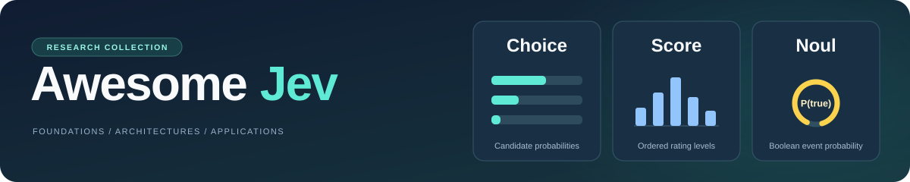

# Awesome Jev

  

> [!NOTE]
> **Survey paper: Coming soon...**
>
> A Survey of Jev-Style Decision Models: Foundations, Architectures, and Applications

------

### ✨总览

[Jev](https://docs.typesafe.ai/introduction) 是 TypeSafe AI 推出的决策模型。用户提供待分析的内容、问题和判断标准，模型返回选择结果、评分或概率，可用于分类、筛选、排序和流程控制。

Awesome Jev 围绕 Jev 及具有相近决策接口的模型，整理相关论文、模型资源、API 和开发工具。列表按研究主题和应用领域分类，方便研究者查找方法与评测工作，也方便开发者选择模型和集成工具。主要内容分为以下六个部分：

- **[闭源API](#闭源api)**：列出了支持结构化决策相关功能的商业 API。
- **[模型与架构](#模型与架构)**：整理决策模型的结构与实现方式，涵盖语言概率读出、候选评分和原生决策建模等技术路线。
- **[训练与推理](#️训练与推理)**：收集训练与适配、知识蒸馏、循环推理、搜索与级联、状态复用及推理服务优化等研究。
- **[评测与可靠性](#评测与可靠性)**：汇集评测基准与分析工作，覆盖准确率、概率校准、候选答案设置、稳健性、隐私、延迟与成本等。
- **[应用领域](#应用领域)**：按检索、金融、安全、医疗、推荐和工业监测等领域整理研究与项目，介绍决策模型在具体任务中的用途。
- **[Agent 生态与工具](#agent-生态与工具)**：整理开发接口、Agent 运行与路由、安全检查、业务自动化和运行评测等工具，支持决策模型的系统集成。

文末另列[其他综述与 Awesome 列表](#️其他综述与-awesome-列表)，供延伸阅读和资源查找。

> [!IMPORTANT]
> **欢迎作者提供官方简介**
>
> - **简介要求**：用 **1–2 句话**概括论文或项目的主要贡献。
> - **联系方式**：邮箱 `hanboyu23z@ict.ac.cn`、**Issues** 或 **Pull requests**。
> - **条目更新**：我们会据此更新简介，并添加  标记。
>
> 让您的工作得到准确介绍，也帮助更多读者发现值得关注的研究与项目。

------

### 📚目录

- [✨总览](#总览)
- [🔧闭源API](#闭源api)
- [⭐模型与架构](#模型与架构)
  - [语言概率读出](#语言概率读出-14)
  - [候选评分](#候选评分-14)
  - [原生决策建模](#原生决策建模-7)
- [🖥️训练与推理](#️训练与推理)
  - [训练与适配](#训练与适配-15)
  - [循环推理与序列决策](#循环推理与序列决策-9)
  - [搜索与级联](#搜索与级联-6)
  - [状态复用与推理服务](#状态复用与推理服务-6)
- [📏评测与可靠性](#评测与可靠性)
  - [基准与通用能力](#基准与通用能力-19)
  - [候选语义与接口敏感性](#候选语义与接口敏感性-26)
  - [校准、偏差与概率一致性](#校准偏差与概率一致性-26)
  - [效率与部署测量](#效率与部署测量-7)
  - [稳健性与隐私](#稳健性与隐私-6)
- [🌐应用领域](#应用领域)
  - [检索与结构化数据](#检索与结构化数据-27)
  - [模型评审与证据核验](#模型评审与证据核验-6)
  - [Agent、工具与记忆](#agent工具与记忆-40)
  - [多模态感知与具身决策](#多模态感知与具身决策-26)
  - [医学与临床决策](#医学与临床决策-18)
  - [法律与合规决策](#法律与合规决策-6)
  - [推荐与个性化](#推荐与个性化-5)
  - [金融与经济决策](#金融与经济决策-4)
  - [安全筛查与授权](#安全筛查与授权-33)
  - [通信控制与边缘服务](#通信控制与边缘服务-6)
  - [时间序列与异常检测](#时间序列与异常检测-5)
  - [工业监测与证据获取](#工业监测与证据获取-6)
  - [社会模拟与行为分析](#社会模拟与行为分析-8)
  - [文本分类与科学分析](#文本分类与科学分析-29)
- [🤖Agent 生态与工具](#agent-生态与工具)
  - [服务与开发接口](#服务与开发接口-14)
  - [Agent 运行、路由与记忆](#agent-运行路由与记忆-13)
  - [安全门与执行治理](#安全门与执行治理-7)
  - [领域工作流与业务自动化](#领域工作流与业务自动化-13)
  - [评测与运行可观测性](#评测与运行可观测性-14)
- [✒️其他综述与 Awesome 列表](#️其他综述与-awesome-列表)
  - [其他综述](#其他综述-6)
  - [其他 Awesome 列表](#其他-awesome-列表-20)

------

### 🔧闭源API

| 公司 | API | 能力 |
|:---|:---|:---|
| TypeSafe AI | **[Jev](https://docs.typesafe.ai/introduction)** | 可从给定选项中选择答案（Choice）、按指定量表评分（Score），或判断陈述是否成立（Noul），并返回相应概率。 |
| OpenAI | **[Responses API](https://developers.openai.com/api/docs/guides/structured-outputs)** | Structured Outputs 通过 JSON Schema 约束生成的决策字段，支持枚举、数值和布尔值。 |
| Anthropic | **[Claude API](https://platform.claude.com/docs/en/build-with-claude/structured-outputs)** | 通过 JSON Schema 输出结构化分类结果，并通过 strict tool use 约束工具参数。 |
| Google | **[Gemini API](https://ai.google.dev/gemini-api/docs/structured-output)** | 通过结构化输出完成枚举类别分类，并为 Agent 工作流生成结构化输入。 |

------

### ⭐模型与架构

#### 语言概率读出 (14)

| 标题 | 来源 | 时间 | 简介 | 代码 |
|:---|:---:|:---:|:---|:---|
| **[The top ranked decision models in the world: mammoth-1 and elephant-1](https://baseten.co/blog/the-best-decision-models-in-the-world-mammoth-1-and-elephant-1)** | Blog | [2026-10-21](https://baseten.co/blog/the-best-decision-models-in-the-world-mammoth-1-and-elephant-1) | 介绍用于单次前向类型化决策的 Mammoth-1 与 Elephant-1 模型。 | [Huggingface](https://huggingface.co/baselabs) |
| **[Intern-Decision: Efficient Multimodal Decision Making with Autoregressive Masked Language Modeling](https://arxiv.org/abs/2610.22131)** | arXiv | [2026-10-15](https://arxiv.org/abs/2610.22131v1) | 并行读取合法标签词元，再确定性构造多模态结构化输出。 | [GitHub](https://github.com/InternLM/Intern-Decision)  |
| **[Prism-1: Position- and Rival-Independent Scoring for System One Models](https://arxiv.org/abs/2610.22066)** | arXiv | [2026-10-15](https://arxiv.org/abs/2610.22066v1) | 从语言模型输出层读取 Yes/No 概率，对相互隔离的候选块进行评分。 | — |
| **[StartLux-Decision: AutoThink Decision Models with Reinforcement Learning for Calibrated Deliberative Decisions](https://arxiv.org/abs/2610.17309)** | arXiv | [2026-10-12](https://arxiv.org/abs/2610.17309v1) | 结合即时概率读出与按需显式推理。 | [GitHub](https://github.com/StartLuxLabs/StartLux-Decision)  |
| **[LLM-as-Jev: LLMs Are Already Jev-Style Decision Models -- When and How to Fine-Tune Them](https://arxiv.org/abs/2610.02076)** | arXiv | [2026-10-01](https://arxiv.org/abs/2610.02076v1) | 用可变长度数字标识符的后缀似然计算候选概率。 | [GitHub](https://github.com/Athe-kunal/llm-as-jev)  |
| **[AnyJev Technical Report](https://arxiv.org/abs/2610.00831)** | arXiv | [2026-09-30](https://arxiv.org/abs/2610.00831v1) | 结合标签先验修正与循环排列聚合的冻结模型读出。 | [GitHub](https://github.com/nokia-applied-research/AnyJev)  |
| **[From Text Decisions to Pixels: An Study of Jev-Style Visual Choice Model](https://arxiv.org/abs/2609.29283)** | arXiv | [2026-09-24](https://arxiv.org/abs/2609.29283v1) | 研究 Jev 风格视觉候选模型的适配与概率读出。 | — |
| **[OmniJev 技术报告](https://github.com/shapsider/OmniJev/blob/main/docs/TECHNICAL_REPORT.md)** | Technical Report | [2026-09-24](https://github.com/shapsider/OmniJev/commit/6cf572a2f440fe14bd43a29a7046eabfff36820e) | 结合字母概率读出、残差修正、LoRA 与 Brier 训练。 | [GitHub](https://github.com/shapsider/OmniJev)  |
| **[Visual Jev: Accurate and Efficient Decisions from Shared Visual Context](https://arxiv.org/abs/2609.25845)** | arXiv | [2026-09-22](https://arxiv.org/abs/2609.25845v1) | 共享视觉上下文，并从语言输出层直接读取候选概率。 | [GitHub](https://github.com/guanxuyu-sv/Visual-Jev)  |
| **[this-that-model-1.0: A typed decision model that decides in 30 ms, for a millionth of a cent](https://arxiv.org/abs/2609.23886)** | arXiv | [2026-09-20](https://arxiv.org/abs/2609.23886v1) | 共享状态与答案槽，通过单词元概率完成多问题决策。 | [GitHub](https://github.com/FLock-io/this-that-model)  |
| **[Bespoke Nimble](https://github.com/bespokelabsai/nimble/blob/main/README.md)** | — | [2026-09-18](https://github.com/bespokelabsai/nimble/commit/95aa24c35865dfd91e9dbd31a3595afe6fa4fe19) | 通过 LoRA 与决策任务监督适配语言模型的答案词元读出。 | [GitHub](https://github.com/bespokelabsai/nimble)  |
| **[decider: one-pass typed decisions with calibrated probabilities](https://github.com/Mapika/decider/blob/main/README.md)** | — | [2026-09-16](https://github.com/Mapika/decider/commit/325155771c77562ed362a2ca6bcae1f0499dd9c5) | 统一训练后检查点与冻结指令模型的类型化决策读出。 | [GitHub](https://github.com/Mapika/decider)  |
| **[SemIf (formerly OpenJev)](https://github.com/TheoLeeCJ/SemIf-OpenJev/blob/master/README.md)** | — | [2026-09-16](https://github.com/TheoLeeCJ/SemIf-OpenJev/commit/5508e7b0227bb4505e2a1d6ac88846760199f0e9) | 从冻结语言模型的选项概率构造类型化决策接口。 | [GitHub](https://github.com/TheoLeeCJ/SemIf-OpenJev)  |
| **[Mammoth-1 and Elephant-1: frontier decision models](https://labs.baseten.co/articles/mammoth-1-and-elephant-1-frontier-decision-models)** | Technical Report | — | 通过块注意力与可共享状态前缀读取答案字母概率。 | [Huggingface](https://huggingface.co/baselabs) |

#### 候选评分 (14)

| 标题 | 来源 | 时间 | 简介 | 代码 |
|:---|:---:|:---:|:---|:---|
| **[Improving JEV Entailment Reranking with Span Readouts and Selective Adaptation](https://arxiv.org/abs/2610.35654)** | arXiv | [2026-10-26](https://arxiv.org/abs/2610.35654v1) | 利用跨度读出与选择性适配进行蕴含重排。 | [GitHub](https://github.com/Mei-TN/Jev-reranking)  |
| **[RubriX: A Fast, Fine-Tunable Non-Autoregressive Rubric Judge](https://arxiv.org/abs/2610.34875)** | arXiv | [2026-10-26](https://arxiv.org/abs/2610.34875v1) | 复用量表等级嵌入的非自回归评分模型。 | — |
| **[Decision-Native Recommendation with Large Language Models](https://arxiv.org/abs/2610.34124)** | arXiv | [2026-10-25](https://arxiv.org/abs/2610.34124v1) | 用共享评分头独立评估历史与候选表示。 | — |
| **[MJev-Spatial: System One Spatial Intelligence via Native Attention Matching](https://arxiv.org/abs/2610.22276)** | arXiv | [2026-10-15](https://arxiv.org/abs/2610.22276v1) | 复用预训练模型的查询与键投影，对层次化空间候选进行匹配。 | [GitHub](https://github.com/Fr0zenCrane/MJev-Spatial)  |
| **[Jeva: System One Models from First Principles](https://arxiv.org/abs/2610.18773)** | arXiv | [2026-10-13](https://arxiv.org/abs/2610.18773v1) | 在类型化决策架构中分离语义编码、决策模块与候选覆盖检测。 | [GitHub](https://github.com/LiQiiiii/Jeva)  |
| **[FunDM: Cheap & Label-Free Decision Models from Frozen Language Models](https://arxiv.org/abs/2610.17175)** | arXiv | [2026-10-12](https://arxiv.org/abs/2610.17175v1) | 从冻结语言模型的中间层蒸馏轻量候选评分投影。 | [GitHub](https://github.com/Ujjawal-K-Panchal/FunDM)  |
| **[MetaEncoder: Exploring the Limit of Bi-Encoders for Multimodal System One Decision Making with Natural Language Interface](https://arxiv.org/abs/2610.11316)** | arXiv | [2026-10-08](https://arxiv.org/abs/2610.11316v1) | 利用多模态双编码器的状态与候选相似度进行候选评分。 | [GitHub](https://github.com/meta/meta-encoder-eval)  |
| **[ufakzeka-karar: An Open Turkish Typed-Decision Model with Order-Invariant Option Scoring](https://arxiv.org/abs/2610.06744)** | arXiv | [2026-10-05](https://arxiv.org/abs/2610.06744v1) | 用隔离候选块与共享评分器进行土耳其语决策。 | [GitHub](https://github.com/ufakai/ufakzeka-karar)  |
| **[Bongard: Training Machine Intuition](https://arxiv.org/abs/2609.39111)** | arXiv | [2026-09-30](https://arxiv.org/abs/2609.39111v1) | 结合共享证据编码与候选交互进行问题条件化决策。 | [GitHub](https://github.com/AgentBull/bongard)  |
| **[JevAny: Toward General Decision Intelligence. A calibrated decision layer for models, agents, and environments](https://raw.githubusercontent.com/SimpleJev/JevAny/7832fd7ba3b0ba4205bf9f6d3457a7256e11e24e/reports/JevAny_Tech_Report.pdf)** | Technical Report | [2026-09-30](https://github.com/SimpleJev/JevAny/commit/b6a3780b6513e58bced10e95aae80272d77c5ba0) | 统一残差指针头与词元概率读出的模型接口。 | [GitHub](https://github.com/SimpleJev/JevAny)  |
| **[Can a Cacheable Decision Model Follow Rules?](https://arxiv.org/abs/2609.37832)** | arXiv | [2026-09-29](https://arxiv.org/abs/2609.37832v1) | 研究可缓存决策模型的规则敏感性与反事实训练。 | — |
| **[Dyad: Extending Large Language Models with Native Typed Decision-Making](https://arxiv.org/abs/2609.36116)** | arXiv | [2026-09-28](https://arxiv.org/abs/2609.36116v1) | 在预训练语言策略上加入候选动作匹配分支，对当前可用动作进行选择。 | — |
| **[MoJev: Schema-Conditioned Causal Decision Learning with Large Language Models](https://raw.githubusercontent.com/molemo-lab/mojev/a74d58cd19ec573e83e8e27f9fecd837b8d830fb/paper/mojev-preprint.pdf)** | Technical Report | [2026-09-23](https://github.com/MoLeMo-Lab/mojev/commit/a74d58cd19ec573e83e8e27f9fecd837b8d830fb) | 结合分支注意力、类型化决策头与偏好监督。 | [GitHub](https://github.com/MoLeMo-Lab/mojev)  |
| **[Kev](https://github.com/jaredpalmer/kev/blob/main/README.md)** | — | [2026-09-17](https://github.com/jaredpalmer/kev/commit/a0cc50e8526e72fce6333f8b99182192403791f0) | 利用可训练的指针读出在动态指定的候选中进行选择。 | [GitHub](https://github.com/jaredpalmer/kev)  |

#### 原生决策建模 (7)

| 标题 | 来源 | 时间 | 简介 | 代码 |
|:---|:---:|:---:|:---|:---|
| **[Narrow Decision Models: A System-1 Architecture for Calibrated, Typed Decisions](https://arxiv.org/abs/2610.25553)** | arXiv | [2026-10-18](https://arxiv.org/abs/2610.25553v1) | 组合集合条件评分与独立候选适用性判断。 | — |
| **[Verdict: Encode Once, Decide Many](https://arxiv.org/abs/2610.20778)** | arXiv | [2026-10-14](https://arxiv.org/abs/2610.20778v1) | 结合共享状态编码、结构化注意力与专用评分头进行候选判断。 | — |
| **[Chinese-Jev: Bringing System One Model to Chinese-Language Tasks](https://arxiv.org/abs/2609.36965)** | arXiv | [2026-09-29](https://arxiv.org/abs/2609.36965v1) | 面向中文任务的类型化决策、领域模型与候选标记头。 | [GitHub](https://github.com/gulucaptain/Chinese-Jev)  |
| **[Decima: A Small, Calibrated, Permutation-Invariant Decision Model via Late-Interaction Distillation](https://github.com/amyrmahdy/decima/blob/main/docs/TECHNICAL-REPORT.md)** | Technical Report | [2026-09-27](https://github.com/amyrmahdy/decima/commit/4b0bea4ff327c0c81453102e50baf2ad343c9b75) | 通过后交互与蒸馏训练编码器式决策模型，并保持候选排列等变性。 | [GitHub](https://github.com/amyrmahdy/decima)  |
| **[LAVOIR: Teaching a Single-Pass Decision Encoder When and What to Ask with Amortized Value of Information](https://arxiv.org/abs/2609.30706)** | arXiv | [2026-09-25](https://arxiv.org/abs/2609.30706v1) | 学习决策编码器何时以及应当追问哪些缺失信息。 | — |
| **[Laya](https://github.com/NandhaKishorM/laya/blob/main/README.md)** | — | [2026-09-18](https://github.com/NandhaKishorM/laya/commit/136910c549eb54b05112b806d4d92cbba39ceb57) | 以编码器和专用决策头训练模型，直接输出类型化决策概率。 | [GitHub](https://github.com/NandhaKishorM/laya)  |
| **[WaterSheep 0.1.0: Typed Decisions with Calibrated Probabilities from a Single Encoder Pass](https://doi.org/10.13140/rg.2.2.28606.45122)** | ResearchGate | — | 为 ModernBERT 配置专用决策头以进行类型化概率预测。 | [GitHub](https://github.com/SamratDuttaOfficial/WaterSheep)  |

------

### 🖥️训练与推理

#### 训练与适配 (15)

| 标题 | 来源 | 时间 | 简介 | 代码 |
|:---|:---:|:---:|:---|:---|
| **[Predict the Reward, Not the World: World Reward Models for ML Agents](https://arxiv.org/abs/2610.38439)** | arXiv | [2026-10-28](https://arxiv.org/abs/2610.38439v1) | 依据已执行程序对训练类型化奖励选择器。 | — |
| **[Decision Model Factory: Building Specialized Sovereign Decision Models](https://arxiv.org/abs/2610.34956)** | arXiv | [2026-10-26](https://arxiv.org/abs/2610.34956v1) | 从明确任务需求构建专用、可自主部署的决策模型。 | — |
| **[Jev-DLC: Decision-Level Continual Learning from Typed Feedback](https://arxiv.org/abs/2610.31521)** | arXiv | [2026-10-22](https://arxiv.org/abs/2610.31521v1) | 在冻结评分器之上用类型化纠正更新有界偏好状态。 | — |
| **[Our Own Jev: Typed Decisions in One Forward Pass, from an In-House Judge to Open LoRA Models](https://arxiv.org/abs/2610.29052)** | arXiv | [2026-10-21](https://arxiv.org/abs/2610.29052v1) | 通过 LoRA 适配评审模型以进行单次前向类型化预测。 | — |
| **[Releasing the Inner Jev: A Simple Recipe for Open Decision Models](https://arxiv.org/abs/2610.17205)** | arXiv | [2026-10-12](https://arxiv.org/abs/2610.17205v1) | 比较决策读出适配与骨干参数适配。 | [GitHub](https://github.com/j-geuter/Jeff)  |
| **[Large Decision Models: Repurposing Large Language Models as Single-Pass Decision Makers](https://arxiv.org/abs/2610.15501)** | arXiv | [2026-10-11](https://arxiv.org/abs/2610.15501v1) | 从推理模型的答案分布训练单次前向决策模型。 | [GitHub](https://github.com/JianhuiWei7/LDM)  |
| **[From Probabilities to Decisions: Search and Multi-Teacher Distillation with Jev](https://arxiv.org/abs/2610.09188)** | arXiv | [2026-10-06](https://arxiv.org/abs/2610.09188v1) | 通过搜索与多教师蒸馏将 Jev 判断移出在线循环。 | — |
| **[From Retrieval to Typed Decisions: Calibrated System One Models from Biomedical Sentence Encoders](https://arxiv.org/abs/2610.02486)** | arXiv | [2026-10-01](https://arxiv.org/abs/2610.02486v1) | 将生物医学句向量模型适配为类型化概率决策模型。 | [GitHub](https://github.com/pritamdeka/sbert2s1)  |
| **[OpenJev-RLCD: A Working RLCD Implementation](https://arxiv.org/abs/2609.38850)** | arXiv | [2026-09-30](https://arxiv.org/abs/2609.38850v1) | 将强化学习用于类型化决策概率的校准。 | [GitHub](https://github.com/ZimmyGao/openjev-rlcd)  |
| **[Koa-decision: Fast and Consistent Structured Decision Making with Generative LLMs](https://arxiv.org/abs/2609.36115)** | arXiv | [2026-09-28](https://arxiv.org/abs/2609.36115v1) | 在匹配任务上比较生成式骨干的结构化决策与 Jev。 | — |
| **[JET: Justification Evaluation in Transformer](https://arxiv.org/abs/2609.33874)** | arXiv | [2026-09-27](https://arxiv.org/abs/2609.33874v1) | 通过共享前缀与候选似然实现本地决策推理。 | — |
| **[You Only Edit Once: Incentivizing In-Context Capability of LLMs via Local Demonstration Refinement](https://arxiv.org/abs/2609.33609)** | arXiv | [2026-09-27](https://arxiv.org/abs/2609.33609v1) | 依据下游任务反馈学习局部示例保留、删除与替换。 | — |
| **[PACT: Pairwise-Anchored Calibrated Tuning for Single-Token Typed Decisions](https://arxiv.org/abs/2609.35865)** | arXiv | [2026-09-26](https://arxiv.org/abs/2609.35865v1) | 以配对关系、有序约束与扰动监督校准单词元决策。 | [GitHub](https://github.com/BennyLinntu/PACT-Pairwise-Anchored-Calibrated-Tuning-for-Single-Token-Typed-Decisions)  |
| **[JevSoup: System-One Routing for Training-Free LoRA Composition](https://arxiv.org/abs/2609.30922)** | arXiv | [2026-09-25](https://arxiv.org/abs/2609.30922v1) | 在免训练 LoRA 组合前由 Jev 选择描述对应的专家。 | [GitHub](https://github.com/Leowang980/JevSoup)  |
| **[NeoHorse-1: Towards Recursive Self-Improvement via Agentic Post-Training with Routing Harness](https://arxiv.org/abs/2609.08183)** | arXiv | [2026-09-08](https://arxiv.org/abs/2609.08183v1) | 分阶段 Agent 后训练，并增加只做预填充的决策分支。 | [GitHub](https://github.com/TokenRhythm/NeoHorse)  |

#### 循环推理与序列决策 (9)

| 标题 | 来源 | 时间 | 简介 | 代码 |
|:---|:---:|:---:|:---|:---|
| **[ThinkJev: One Thought, Every Budget for Calibrated Typed Decisions](https://arxiv.org/abs/2610.37732)** | arXiv | [2026-10-27](https://arxiv.org/abs/2610.37732v1) | 复用同一推理轨迹以适配不同类型化决策预算。 | — |
| **[Truncated Reasoning Under a Budget: Evaluating System-1 Models as Decision-Makers](https://arxiv.org/abs/2610.25768)** | arXiv | [2026-10-19](https://arxiv.org/abs/2610.25768v1) | 通过离线回放评测决策模型对截断推理轨迹的利用。 | — |
| **[LEV: Thinking Fast and Deep with Looped Decision Models](https://arxiv.org/abs/2610.20951)** | arXiv | [2026-10-14](https://arxiv.org/abs/2610.20951v1) | 带共享指针读出与自适应退出的循环决策模型。 | [GitHub](https://github.com/OpenLAIR/lev)  |
| **[Selective Reasoning for Typed Decision Models: When to Start, Read, and Stop](https://arxiv.org/abs/2610.19644)** | arXiv | [2026-10-14](https://arxiv.org/abs/2610.19644v1) | 分别决定何时开始推理、读取概率以及停止。 | — |
| **[JevCascade: Readout Stability and Inference-Time Compute Allocation for Prefill-Only Decision Models](https://arxiv.org/abs/2610.07716)** | arXiv | [2026-10-06](https://arxiv.org/abs/2610.07716v1) | 研究候选菜单变化下的读出稳定性与推理预算分配。 | [GitHub](https://github.com/rlisml/jev-cascade)  |
| **[SanSi: A Looped Typed Decision Model for System 1.5 Thinking](https://arxiv.org/abs/2610.07730)** | arXiv | [2026-10-06](https://arxiv.org/abs/2610.07730v1) | 结合循环决策计算、选项词元读出与逐轮概率修正。 | — |
| **[NumericJev: Jev-like LLM Numerical Decoding with Multiway Decision Trees](https://arxiv.org/abs/2609.28587)** | arXiv | [2026-09-23](https://arxiv.org/abs/2609.28587v1) | 通过多路候选树逐步细化数值答案。 | [GitHub](https://github.com/Bring-AI/JevNext)  |
| **[Language Modeling without Generation: Decoding a System One Model](https://raw.githubusercontent.com/adhyaay-karnwal/jev-chat/fb92fd33ddd6603aa544fe4988dd8e918f91d6ca/paper/main.pdf)** | Technical Report | [2026-09-17](https://github.com/adhyaay-karnwal/jev-chat/commit/fb92fd33ddd6603aa544fe4988dd8e918f91d6ca) | 通过反复有限选择构造语言输出。 | [GitHub](https://github.com/adhyaay-karnwal/jev-chat)  |
| **[Generation is Classification: a conversational agent built from a model that can only choose](https://doi.org/10.5281/zenodo.22940945)** | Zenodo | [2026-09](https://doi.org/10.5281/zenodo.22940945) | 用反复有限选择组合回复、句子、词与字符。 | — |

#### 搜索与级联 (6)

| 标题 | 来源 | 时间 | 简介 | 代码 |
|:---|:---:|:---:|:---|:---|
| **[SOMA: Continuous Monitoring and Intervention for System Two Reasoning with System One Models](https://arxiv.org/abs/2610.26793)** | arXiv | [2026-10-19](https://arxiv.org/abs/2610.26793v1) | 在慢速模型推理过程中持续监测并按规则接管。 | — |
| **[P(Yes): 15$\\times$ Improvements via Test-Time Scaling of Decision Models](https://arxiv.org/abs/2610.25474)** | arXiv | [2026-10-18](https://arxiv.org/abs/2610.25474v1) | 将决策概率用于候选评分与测试时搜索。 | [GitHub](https://github.com/tear-labs/pyes-search)  |
| **[System Switch: When Should a Fast Decision Model Stop and Think?](https://arxiv.org/abs/2610.09683)** | arXiv | [2026-10-07](https://arxiv.org/abs/2610.09683v1) | 通过离线决策与 Doom 闭环控制评测研究模型升级策略。 | — |
| **[JEV-as-a-Judge: Accept When Confident, Escalate When Unsure](https://arxiv.org/abs/2609.26550)** | arXiv | [2026-09-22](https://arxiv.org/abs/2609.26550v1) | 利用置信阈值在 Jev 与回退评审器之间分配判断任务。 | — |
| **[REFLEX with Jev for Efficient Selective Control in LLM Agents](https://arxiv.org/abs/2609.26532)** | arXiv | [2026-09-22](https://arxiv.org/abs/2609.26532v1) | 结合有界动作选择与生成模型回退进行选择性 Agent 控制。 | — |
| **[ChoiceSpec 验证报告 v3：Qwen3.8-27B（bf16 / FP8 / NVFP4）与 MTP、DFlash2 联用](https://github.com/genai-craft/openvons/blob/main/docs/jevpick/phase3_27b_report.md)** | Technical Report | [2026-09-19](https://github.com/genai-craft/openvons/commit/28a0f2bfbf19a3300569c6867e7013d781590744) | 比较有限候选评分、量化与推测解码配置。 | [GitHub](https://github.com/genai-craft/openvons)  |

#### 状态复用与推理服务 (6)

| 标题 | 来源 | 时间 | 简介 | 代码 |
|:---|:---:|:---:|:---|:---|
| **[DFIP: Decision-Focused Inference Path for System One Models](https://arxiv.org/abs/2610.36804)** | arXiv | [2026-10-27](https://arxiv.org/abs/2610.36804v1) | 针对候选投影、图回放与批处理优化决策推理路径。 | [GitHub](https://github.com/superagent-ai/dfip)  |
| **[System X: An LLM Decision Model That Replies from Its Own KV Cache](https://arxiv.org/abs/2610.25456)** | arXiv | [2026-10-18](https://arxiv.org/abs/2610.25456v1) | 在同一 KV 缓存上完成候选决策与后续语言回复。 | [GitHub](https://github.com/Turinglogicuk/system-x)  |
| **[FastJEV: Understanding Redundancy for Compact JEV Inference](https://arxiv.org/abs/2610.11379)** | arXiv | [2026-10-08](https://arxiv.org/abs/2610.11379v1) | 通过上下文和候选冗余分析压缩 Jev 推理。 | [GitHub](https://github.com/JieMaMagic/FastJEV)  |
| **[SharedKV-BT: Node-Local Typed Decisions for Behavior-Tree Agents](https://arxiv.org/abs/2610.07327)** | arXiv | [2026-10-05](https://arxiv.org/abs/2610.07327v1) | 在行为树 Agent 中共享 KV 状态并限制节点局部问题。 | — |
| **[OpenJev-Fast: 6× Faster Open-Jev-27B Inference with Specialized CUDA Kernels](https://raw.githubusercontent.com/lyuyiqi/open-jev-fast/c52b8bb958c1f0d241d4eb7fce4ecd8d885bf1e4/docs/report.pdf)** | Technical Report | [2026-09-27](https://github.com/lyuyiqi/open-jev-fast/commit/6a5d7488407606accf768f5b0c809b5cc7346c7b) | 利用专用 GPU 内核与前缀共享优化类型化决策推理。 | [GitHub](https://github.com/lyuyiqi/open-jev-fast)  |
| **[Nemotron diffusion decision-serving optimization](https://github.com/pst2154/Nemotron_Jev/blob/perf/nemotron-diffusion-8b/OPTIMIZATION_REPORT.md)** | Technical Report | [2026-09-22](https://github.com/pst2154/Nemotron_Jev/commit/66b19e885e2f330711f69983ab9f5d182630ca26) | 研究扩散模型类型化决策服务的推理配置。 | [GitHub](https://github.com/pst2154/Nemotron_Jev)  |

------

### 📏评测与可靠性

#### 基准与通用能力 (19)

| 标题 | 来源 | 时间 | 简介 | 代码 |
|:---|:---:|:---:|:---|:---|
| **[Jev, job by job: what it does, what it doesn't, and when to reach for it](https://github.com/WeBuildDatabases/jev-job-by-job/blob/main/ARTICLE.md)** | Technical Report | [2026-10-29](https://github.com/WeBuildDatabases/jev-job-by-job/commit/1d3c485af1c5b38f56450b608cdc2d3d32318955) | 固定示例、模型版本和预期答案，审计官方 cookbook 工作流。 | [GitHub](https://github.com/WeBuildDatabases/jev-job-by-job)  |
| **[Which Differences Matter? Controlled Tests of Rule Transfer, Joint Reliability, and Information Use in Decision Models](https://arxiv.org/abs/2610.30045)** | arXiv | [2026-10-21](https://arxiv.org/abs/2610.30045v1) | 控制规则迁移、联合正确性与信息利用条件。 | — |
| **[DecisionPivot: A Diagnostic Benchmark for Decision Models in LLM Systems](https://arxiv.org/abs/2610.28522)** | arXiv | [2026-10-20](https://arxiv.org/abs/2610.28522v1) | 诊断 LLM 系统中的决策质量与成组可靠性。 | [GitHub](https://github.com/StartLuxLabs/DecisionPivot)  |
| **[System1-Arena: Which Decisions Can Be Left to System 1?](https://arxiv.org/abs/2610.21244)** | arXiv | [2026-10-15](https://arxiv.org/abs/2610.21244v1) | 提出覆盖静态、闭环与实时决策任务的评测基准。 | [GitHub](https://github.com/TianyuCodings/S1-Arena)  |
| **[Typed Decision Models on Tabular Data](https://arxiv.org/abs/2610.19536)** | arXiv | [2026-10-14](https://arxiv.org/abs/2610.19536v1) | 比较表格布局与问题改写对类型化决策的影响。 | — |
| **[Jev-ToM: Evaluating Theory of Mind in Typed Decision Models](https://arxiv.org/abs/2610.18610)** | arXiv | [2026-10-13](https://arxiv.org/abs/2610.18610v1) | 将信念、意图与情绪理解表述为有限候选决策。 | [GitHub](https://github.com/HKUST-KnowComp/Jev-ToM)  |
| **[Scoring Explanations Without Reading Them: Structural Shortcuts in Automated-Interpretability Evaluation Data](https://arxiv.org/abs/2610.37676)** | arXiv | [2026-10-10](https://arxiv.org/abs/2610.37676v1) | 将 Jev 可解释性评分与不读取解释的捷径基线比较。 | — |
| **[Modular Decision Models: Typed Interfaces, Orchestration, and Reproducible Evaluation. Evidence from CPU Baselines, Partial Local Model Studies, and a Hosted Capability Pilot](https://raw.githubusercontent.com/docxology/daf-jev/b8523b9ceaefa5e46fee29c39517c1d7d38cded7/output/pdf/daf-jev-0.7.2-manuscript.pdf)** | Technical Report | [2026-10-09](https://github.com/docxology/daf-jev/commit/46cc9f76b898845c00f9da7f29b501b7a3764750) | 定义类型化请求与编排协议以追踪概率来源和执行成本。 | [GitHub](https://github.com/docxology/daf-jev)  |
| **[Specialized Decision Models vs. General-Purpose LLMs: Benchmarking Jev Across Knowledge, Reasoning, and Multilingual Tasks](https://arxiv.org/abs/2610.11978)** | arXiv | [2026-10-08](https://arxiv.org/abs/2610.11978v1) | 在知识、推理和多语言任务中比较 Jev 与通用 LLM。 | — |
| **[TypedBench: A Benchmark for Calibration, Framing Sensitivity, and Cost in System One Decision Models](https://arxiv.org/abs/2610.11392)** | arXiv | [2026-10-08](https://arxiv.org/abs/2610.11392v1) | 联合诊断概率校准、问题表述敏感性与决策成本。 | — |
| **[JevBench: An Open Evaluation Framework for Typed Decision Models](https://www.preprints.org/manuscript/202610.0181)** | Preprints.org | [2026-10-05](https://www.preprints.org/manuscript/202610.0181/v1) | 提供覆盖多个任务领域的类型化决策模型统一评测框架。 | [GitHub](https://github.com/Leanmcp/jevbench)  |
| **[General Decision Models: Benchmarking and Insights Beyond Jev](https://arxiv.org/abs/2610.03935)** | arXiv | [2026-10-02](https://arxiv.org/abs/2610.03935v1) | JEVal 跨领域基准、系统测试与推理到读出的自蒸馏。 | [GitHub](https://github.com/amazingljy1206/SII-Decision)  |
| **[Benchmarking System One decision models against trained classifiers and language models for automated decision gates](https://arxiv.org/abs/2610.00346)** | arXiv | [2026-09-29](https://arxiv.org/abs/2610.00346v1) | 在相同决策门任务中比较训练分类器、Jev 与 LLM。 | — |
| **[Evaluating and Benchmarking the System One Model Jev](https://arxiv.org/abs/2609.37647)** | arXiv | [2026-09-29](https://arxiv.org/abs/2609.37647v1) | 系统评测 Jev 的任务准确率、概率表现与推理效率。 | [GitHub](https://github.com/AppliedMachineLearning-Lab/jev-benchmarking)  |
| **[MAD-Guard: Controlled Study of Autoregressive Generation versus Direct Decision Interfaces for Closed Multimodal Forensic Tasks](https://arxiv.org/abs/2609.33683)** | arXiv | [2026-09-27](https://arxiv.org/abs/2609.33683v1) | 在相同多模态骨干上比较生成、标签读出与专用决策头。 | [GitHub](https://github.com/moyuan10086/MAD-Guard)  |
| **[Jev v4 规范报告（公开版）](https://github.com/lexingtonhibiki/judgekit/blob/main/docs/jev-v4-report.md)** | Technical Report | [2026-09-23](https://github.com/lexingtonhibiki/judgekit/commit/a16c92c635650e41caae8d21796d483634d356c2) | 制定包含标签泄漏控制与评测成本核算的 Jev 评审协议。 | [GitHub](https://github.com/lexingtonhibiki/judgekit)  |
| **[Jev evaluation report](https://github.com/willkelly/jev-evaluation/blob/main/runs/full-20260919/report.md)** | Technical Report | [2026-09-20](https://github.com/willkelly/jev-evaluation/commit/103147fd646a276ec1c158ecbbd3bf7c5c559176) | 按照预先制定的实验方案评测 Jev 的决策行为。 | [GitHub](https://github.com/willkelly/jev-evaluation)  |
| **[发明 RLHF 的人，这次做了个不会说话的模型：两千多万人围观的 Jev，我用中文测了 50 条。便宜 200 倍，代价是什么](https://raw.githubusercontent.com/hacksing/jev-report/3e630a6c8d4d1b3b030f810ae7026d2b7a1d8424/%E5%8F%91%E6%98%8ERLHF%E7%9A%84%E4%BA%BA%E8%BF%99%E6%AC%A1%E5%81%9A%E4%BA%86%E4%B8%AA%E4%B8%8D%E4%BC%9A%E8%AF%B4%E8%AF%9D%E7%9A%84%E6%A8%A1%E5%9E%8B.pdf)** | Technical Report | [2026-09-17](https://github.com/HackSing/jev-report/commit/1f582b08e6ecf16dc62bd82790552e78ccef6c54) | 在中文决策场景中评测 Jev。 | [GitHub](https://github.com/HackSing/jev-report)  |
| **[Artificial Analysis Decision Index Benchmarking Methodology](https://artificialanalysis.ai/methodology/decision-index)** | Blog | — | 定义综合决策模型评测指数的任务范围与聚合方法。 | — |

#### 候选语义与接口敏感性 (26)

| 标题 | 来源 | 时间 | 简介 | 代码 |
|:---|:---:|:---:|:---|:---|
| **[When the Top Answer Decides: Gender Bias in Decision Models](https://arxiv.org/abs/2610.39747)** | arXiv | [2026-10-29](https://arxiv.org/abs/2610.39747v1) | 分别分析性别对概率、首选答案及置信筛选结果的影响。 | — |
| **[Cross-Primitive Consistency in Jev](https://arxiv.org/abs/2610.38623)** | arXiv | [2026-10-28](https://arxiv.org/abs/2610.38623v1) | 检验等价 Choice、Score 与 Noul 问题之间的一致性。 | [GitHub](https://github.com/67L1/PrimaCons-CRPR)  |
| **[Understanding Jev-Style System One Models: Does Structure Reduce Selection Bias?](https://arxiv.org/abs/2610.35826)** | arXiv | [2026-10-26](https://arxiv.org/abs/2610.35826v1) | 比较结构选择、排列干预与候选选择偏置。 | [GitHub](https://github.com/nick7nlp/Jev-Selection-Bias)  |
| **[When Multiple Choices Are Correct: Asymmetric Probability Allocation in Jev and Other Decision Models](https://arxiv.org/abs/2610.29217)** | arXiv | [2026-10-21](https://arxiv.org/abs/2610.29217v1) | 研究多个候选同时正确时的概率分配。 | — |
| **[JevBench Multilingual: Do Typed Decision Models Keep Their Safety Decisions Across Languages?](https://github.com/Leanmcp/jevbench/blob/main/paper_multilingual/latex/main.pdf)** | Technical Report | [2026-10-16](https://github.com/Leanmcp/jevbench/commit/6954ce9d98d81210d043ca0e94bc72bff6443140) | 检验安全决策跨语言的一致性与阈值变化。 | [GitHub](https://github.com/Leanmcp/jevbench)  |
| **[Literal Lock-In: How Test Language Shifts Literal Attraction in Typed Decision Models on Bengali Idioms](https://arxiv.org/abs/2610.22526)** | arXiv | [2026-10-15](https://arxiv.org/abs/2610.22526v1) | 研究孟加拉语习语判断中随语言变化的字面吸引。 | [GitHub](https://github.com/sakhadib/literal-lock-in)  |
| **[Lost in the Fallback: How Reliably Do Typed Decision Models Use Fallback Options?](https://arxiv.org/abs/2610.19856)** | arXiv | [2026-10-14](https://arxiv.org/abs/2610.19856v1) | 分析决策模型能否正确使用回退选项。 | — |
| **[Consider, Then Choose: Order-Invariant Decisions in System One Models](https://arxiv.org/abs/2610.18233)** | arXiv | [2026-10-13](https://arxiv.org/abs/2610.18233v1) | 通过逐项评估构造规范化短名单以进行候选聚合。 | — |
| **[Correct Choices, Failed Sequences: Choice2Seq Benchmarks Correctness Retention Across Output Interfaces](https://arxiv.org/abs/2610.16191)** | arXiv | [2026-10-12](https://arxiv.org/abs/2610.16191v1) | 比较完整答案选择与逐步构造的正确性保留。 | — |
| **[Does a Hosted Decision Model Respect Irrelevant Alternatives? A Pre-Registered Test of Option-Set Dependence in Jev](https://arxiv.org/abs/2610.16655)** | arXiv | [2026-10-12](https://arxiv.org/abs/2610.16655v1) | 预注册检验无关候选对正确答案赔率的影响。 | — |
| **[Jev vs OpenAI Decisions vs Microsoft Decision-1](https://github.com/kartikanand73/decision-api-benchmark/blob/1ffa4d5b95de29c1d42602a63e25566d6b152ddd/README.md)** | — | [2026-10-10](https://github.com/kartikanand73/decision-api-benchmark/commit/5aa68aeb543f5c9448c4bc219fe7c7ce0a6ae989) | 在路由候选的不同排列下比较三种类型化 API。 | [GitHub](https://github.com/kartikanand73/decision-api-benchmark)  |
| **[Luna Decisions vs Jev: the same 1,000 questions](https://github.com/etsabary/luna-decisions-benchmark/blob/7a5ea1371905c1e680f936d0a2ac1862b9039ca8/README.md)** | — | [2026-10-10](https://github.com/etsabary/luna-decisions-benchmark/commit/136860bf25f455042608cdcbe06142a766dcdb44) | 在固定逻辑问题集上比较 Luna Decisions 与 Jev。 | [GitHub](https://github.com/etsabary/luna-decisions-benchmark)  |
| **[SubQ Snap vs Jev](https://github.com/jcarlosrodicio/subq-vs-jev/blob/c0379052376f3531b54d49350365ed07fe6424c5/README.md)** | — | [2026-10-10](https://github.com/jcarlosrodicio/subq-vs-jev/commit/5bf1d7316b873b2405469e6339ab5b5a06c5d11b) | 基于长上下文事件日志比较 Jev 与 SubQ Snap。 | [GitHub](https://github.com/jcarlosrodicio/subq-vs-jev)  |
| **[The Company a Question Keeps: Auditing Open Jev-Style Models for Retrieval](https://arxiv.org/abs/2610.14631)** | arXiv | [2026-10-10](https://arxiv.org/abs/2610.14631v1) | 审计邻近问题对检索判断独立性的影响。 | — |
| **[Adversarial Cues in Decision Models Used as Judges: The Role of Request Presentation](https://arxiv.org/abs/2610.11436)** | arXiv | [2026-10-08](https://arxiv.org/abs/2610.11436v1) | 研究输入呈现顺序对决策评审抗攻击能力的影响。 | — |
| **[Benchmarking candidate coverage and rejection policy transfer in typed decision models](https://arxiv.org/abs/2610.03387)** | arXiv | [2026-10-02](https://arxiv.org/abs/2610.03387v1) | 评测候选覆盖与拒答规则的跨任务迁移。 | [GitHub](https://github.com/luckykevvv/Decision_Model_Benchmark)  |
| **[Labels Override Definitions in Jev-Style Typed Decision Models](https://arxiv.org/abs/2610.02586)** | arXiv | [2026-10-01](https://arxiv.org/abs/2610.02586v1) | 控制候选标签与定义绑定，检验名称偏置。 | — |
| **[Permutation-Robust Decision Modeling with Candidate-Independent Block-Causal Attention](https://arxiv.org/abs/2610.01601)** | arXiv | [2026-10-01](https://arxiv.org/abs/2610.01601v1) | 通过候选独立的块因果注意力处理选项顺序敏感性。 | [GitHub](https://github.com/guyAmit/ci-decision-models)  |
| **[More Choices, Fewer Decisions: Ordinal-Scale Bias in JEV-like Direct-Decision Models](https://arxiv.org/abs/2609.38827)** | arXiv | [2026-09-30](https://arxiv.org/abs/2609.38827v1) | 研究序数量表级数与有效分辨率之间的关系。 | — |
| **[When the Right Answer Is Missing: An Arithmetic-Dependent Rejection Bottleneck in Jev](https://arxiv.org/abs/2609.39496)** | arXiv | [2026-09-30](https://arxiv.org/abs/2609.39496v1) | 研究算术任务缺少正确选项时的拒答行为。 | — |
| **[The Argument and the Letterhead: Source-Position Coherence in AI Evaluation](https://arxiv.org/abs/2609.35286)** | arXiv | [2026-09-28](https://arxiv.org/abs/2609.35286v1) | 研究来源署名对模型判断的影响。 | — |
| **[Jev Black-Box Research Archive — Master Report](https://github.com/g0runmezadam/jev-architecture-research/blob/main/docs/MASTER_REPORT.md)** | Technical Report | [2026-09-22](https://github.com/g0runmezadam/jev-architecture-research/commit/76858556ca171474927505c0fceee1e863b7e1d2) | 通过黑盒实验研究 Jev 的决策行为与概率输出。 | [GitHub](https://github.com/g0runmezadam/jev-architecture-research)  |
| **[Type-Safe Is Not Error-Free: Typed Decision Models Follow the Option Name, Not the Definition Bound to It](https://arxiv.org/abs/2609.26758)** | arXiv | [2026-09-22](https://arxiv.org/abs/2609.26758v1) | 分析候选名称与定义冲突时模型依赖哪种信息。 | — |
| **[Jev 1.13.0 behavior study: wording, prerequisites, and long context](https://github.com/RINNECODER/jev-behavior-study/blob/main/JEV_BEHAVIOR_REPORT.md)** | Technical Report | [2026-09-16](https://github.com/RINNECODER/jev-behavior-study/commit/866d136c284bcdd10992768bcef7bb5c03802603) | 检验措辞、前置条件与长上下文敏感性。 | [GitHub](https://github.com/RINNECODER/jev-behavior-study)  |
| **[Jev 1.13.0: everyday reasoning and exactness extension](https://github.com/RINNECODER/jev-behavior-study/blob/main/EVERYDAY_REASONING_REPORT.md)** | Technical Report | [2026-09-16](https://github.com/RINNECODER/jev-behavior-study/commit/fe0693af32cda15f3e2fa1008aff1fd97dcfe0b7) | 扩展版本化行为研究中的日常推理和精确性测试。 | [GitHub](https://github.com/RINNECODER/jev-behavior-study)  |
| **[Jev: decision workflows, answer order and reasoning limits](https://github.com/RINNECODER/jev-behavior-study/blob/main/DECISION_AND_LIMITS_REPORT.md)** | Technical Report | [2026-09-16](https://github.com/RINNECODER/jev-behavior-study/commit/3c04eb143dcc2ecd09b1627bfd9f97f0159f95dd) | 测试工作流组合、答案顺序和推理能力限制。 | [GitHub](https://github.com/RINNECODER/jev-behavior-study)  |

#### 校准、偏差与概率一致性 (26)

| 标题 | 来源 | 时间 | 简介 | 代码 |
|:---|:---:|:---:|:---|:---|
| **[Confidence Is Not a Promise: A Reference Audit of Typed Decision Models](https://arxiv.org/abs/2610.36311)** | arXiv | [2026-10-26](https://arxiv.org/abs/2610.36311v1) | 在任务、语言与输入变化下审计置信阈值的可靠性。 | — |
| **[SHIFT-JEV: Certified Abstention and Gain-Gated Continual Adaptation for LLM-Based Decision Models under Distribution Shift](https://arxiv.org/abs/2610.34329)** | arXiv | [2026-10-25](https://arxiv.org/abs/2610.34329v1) | 结合拒答、风险认证与持续适配处理分布变化下的决策。 | — |
| **[What does Jev assume about people? A counterfactual bias audit of TypeSafe's jev-1.13.0 and jev-1.14.0](https://github.com/isaacbitran/jev-bias-audit/blob/main/REPORT.md)** | Technical Report | [2026-10-20](https://github.com/isaacbitran/jev-bias-audit/commit/337ea261189f5f4f478b5e0112b3c9c8b0700043) | 以反事实配对输入审计 Jev 1.13 与 1.14 的偏差。 | [GitHub](https://github.com/isaacbitran/jev-bias-audit)  |
| **[Teacher Supervision, Fixed Representations and Calibration: Exact Risk Calculations for Candidate-Scoring Decision Models](https://arxiv.org/abs/2610.26797)** | arXiv | [2026-10-19](https://arxiv.org/abs/2610.26797v1) | 分析候选评分中教师偏差、表示与概率校准之间的风险关系。 | — |
| **[Typed Decision Models under Prevalence Shift: Decision Training, Calibration, and Implicit Priors](https://arxiv.org/abs/2610.26325)** | arXiv | [2026-10-19](https://arxiv.org/abs/2610.26325v1) | 在控制类别先验变化的条件下研究决策训练、隐式先验与概率校准。 | [GitHub](https://github.com/AbdulRahmanIqbal/tdm-prevalence-shift)  |
| **[One Confidence Threshold, Unequal Coverage: Language Gaps in Typed Decision Interfaces and How Translating Inputs Reduces Them](https://arxiv.org/abs/2610.37688)** | arXiv | [2026-10-17](https://arxiv.org/abs/2610.37688v1) | 检验统一置信阈值下不同语言获得自动处理的比例差异。 | — |
| **[Are AI Decision Models Biased? A Case Study of Jev](https://arxiv.org/abs/2610.19619)** | arXiv | [2026-10-14](https://arxiv.org/abs/2610.19619v1) | 通过认知偏差与定价实验分析 Jev 的决策偏差。 | — |
| **[Calibration and Risk-Budgeted Decisions with System One Models](https://arxiv.org/abs/2610.19811)** | arXiv | [2026-10-14](https://arxiv.org/abs/2610.19811v1) | 依据显式风险预算制定保守回退与自动决策规则。 | — |
| **[PRISM: Calibrating Black-Box Judges with Counterfactual Probes](https://arxiv.org/abs/2610.18389)** | arXiv | [2026-10-13](https://arxiv.org/abs/2610.18389v1) | 通过反事实探测与人类标签修正黑盒评审分数。 | — |
| **[Recalibrating Many Questions with Few Labels: Minimax Rates and Identification Limits](https://arxiv.org/abs/2610.18488)** | arXiv | [2026-10-13](https://arxiv.org/abs/2610.18488v1) | 分析关联问题共享校准标签的统计条件与可识别性。 | — |
| **[ProbabilityBench: Model Evaluation and Calibration with Exact Ground-Truth Uncertainty](https://arxiv.org/abs/2610.17016)** | arXiv | [2026-10-12](https://arxiv.org/abs/2610.17016v1) | 提供精确真实概率的合成决策与校准基准。 | [GitHub](https://github.com/ishida-lab/ProbabilityBench)  |
| **[DoubtBench](https://github.com/deeplearningguy/doubtbench/blob/main/README.md)** | — | [2026-10-04](https://github.com/deeplearningguy/doubtbench/commit/d5345eef7848bdd29de81db216414005f7ff0623) | 以人类标注分布为参照评测决策概率。 | [GitHub](https://github.com/deeplearningguy/doubtbench)  |
| **[Maximum Effort, Minimum Reward](https://maximumeffort.substack.com/p/jev-is-poorly-calibrated)** | Blog | [2026-10-02](https://maximumeffort.substack.com/p/jev-is-poorly-calibrated) | 分析 Jev 概率输出在具体任务中的可靠性。 | — |
| **[Beyond Answer Confidence: A Controlled Audit of Self-Knowledge in a Black-Box Decision Model](https://arxiv.org/abs/2610.01006)** | arXiv | [2026-10-01](https://arxiv.org/abs/2610.01006v1) | 通过答案置信度之外的查询检验 Jev 对自身知识边界的判断。 | [GitHub](https://github.com/Syntheme/beyond-answer-confidence)  |
| **[Calibrated to Whom? Persona and Language Effects on Cultural Values in JEV](https://arxiv.org/abs/2609.36399)** | arXiv | [2026-09-28](https://arxiv.org/abs/2609.36399v1) | 分析语言和角色设定对文化价值判断的影响。 | — |
| **[Jev thinks "I don't know'', but doesn't say it: Introducing Sys1Cal-v1 Dataset for Probability Calibration](https://arxiv.org/abs/2609.35342)** | arXiv | [2026-09-28](https://arxiv.org/abs/2609.35342v1) | 构建 Sys1Cal-v1 数据集以研究不同类型化接口下的概率校准。 | — |
| **[Beyond Calibration: Do a Typed-Decision Model's Probabilities Obey the Probability Axioms?](https://arxiv.org/abs/2609.33209)** | arXiv | [2026-09-27](https://arxiv.org/abs/2609.33209v1) | 检验相关问题的概率是否满足否定与聚合关系。 | — |
| **[Do System One Decisions Add Up? A Study of Probabilistic Coherence](https://arxiv.org/abs/2609.33971)** | arXiv | [2026-09-27](https://arxiv.org/abs/2609.33971v1) | 检验直接查询与层次分解查询的概率一致性。 | [GitHub](https://github.com/samanjoy2/system-one-coherence)  |
| **[Laya as a Typed Probabilistic Assessor: An Independent Reproduction and a Preregistered Study of Calibration and Selective Escalation](https://arxiv.org/abs/2609.33843)** | arXiv | [2026-09-27](https://arxiv.org/abs/2609.33843v1) | 依据预注册协议评测 Laya 的概率校准与选择性升级策略。 | — |
| **[Probability Contracts: Accuracy, Coherence, and Decisions Across LLM Interfaces](https://arxiv.org/abs/2609.37470)** | arXiv | [2026-09-27](https://arxiv.org/abs/2609.37470v1) | 在精确概率世界中比较准确率、一致性与决策损失。 | — |
| **[Confident Where People Disagree: A preregistered, bias-corrected test of whether TypeSafe AI's Jev lowers its confidence when humans disagree, on ChaosNLI](https://doi.org/10.5281/zenodo.23032384)** | Zenodo | [2026-09-26](https://doi.org/10.5281/zenodo.23032384) | 预注册研究 Jev 置信度能否反映人类标注分歧。 | — |
| **[Jev 1.13.0 域校准实测报告：自报置信 vs 实际能力，七域扫描](https://raw.githubusercontent.com/chunxiaoxx/nautilus-compass/bba5afc0fccc6e7f3f09fec14b555b595883568d/docs/marketing/jev_calibration_report_20260926.pdf)** | Technical Report | [2026-09-26](https://github.com/chunxiaoxx/nautilus-compass/commit/f7f44ab276a3ead572e788940a90922e18c3d130) | 检验 Jev 置信度与跨领域任务准确率之间的对应关系。 | [GitHub](https://github.com/chunxiaoxx/nautilus-compass)  |
| **[Jev on finite-horizon Bayesian decisions](https://github.com/TomRichner/can-jev-bayes/blob/main/research_report.md)** | Technical Report | [2026-09-21](https://github.com/TomRichner/can-jev-bayes/commit/b972ba107070dfe908514477f2b7c66f8b61e3a1) | 在有限时域贝叶斯任务中检验概率与行动一致性。 | [GitHub](https://github.com/TomRichner/can-jev-bayes)  |
| **[Does Jev know when it doesn't know?](https://github.com/scienthoon/jev-ood-calibration/blob/main/README.md)** | — | [2026-09-19](https://github.com/scienthoon/jev-ood-calibration/commit/601db6ef9d3dbcb104363a3a13229723ff315776) | 在公开任务和合成规则任务上检查分布外置信度。 | [GitHub](https://github.com/scienthoon/jev-ood-calibration)  |
| **[Getting Calibrated Confidence from Jev](https://github.com/AnthusAI/Jev-Calibration/blob/main/README.md)** | — | [2026-09-19](https://github.com/AnthusAI/Jev-Calibration/commit/50a6483fd3d2f77eb0b17097acb1fb2ff9a910a1) | 在分离情感数据上比较 Platt 与保序校准。 | [GitHub](https://github.com/AnthusAI/Jev-Calibration)  |
| **[Calibration Does Not Compose, Types Destroy Vagueness: The Hidden-Markov and Fuzzy Primitives Missing from System-One Decision Models](https://raw.githubusercontent.com/dnakhoa/jev-deferred-crispification/076669e4c02068e528e1561a4f0944d7097f9695/paper.pdf)** | Technical Report | [2026-09-16](https://github.com/dnakhoa/jev-deferred-crispification/commit/2b6eba280fcab5611c5c52703ae9e1248f2cb514) | 分析组合决策中不确定状态与延迟离散化的作用。 | [GitHub](https://github.com/dnakhoa/jev-deferred-crispification)  |

#### 效率与部署测量 (7)

| 标题 | 来源 | 时间 | 简介 | 代码 |
|:---|:---:|:---:|:---|:---|
| **[Agent in a Bottle: Can LLM Agents Turn Their Capabilities Into Cheap, Scalable Artifacts?](https://arxiv.org/abs/2610.08775)** | arXiv | [2026-10-06](https://arxiv.org/abs/2610.08775v1) | 比较 Agent 构建可复用程序与重复调用 Jev 的成本。 | [GitHub](https://github.com/aktsonthalia/bottled)  |
| **[Jev (TypeSafe) vs Laya (laya-mlx): speed and accuracy on synthetic typed-decision tasks](https://github.com/harrymunro/jev-laya-benchmark/blob/main/REPORT.md)** | Technical Report | [2026-09-21](https://github.com/harrymunro/jev-laya-benchmark/commit/0f977d20641e347bffee05745fed265858930489) | 在合成任务上比较托管 Jev 与本地 Laya 的速度和准确率。 | [GitHub](https://github.com/harrymunro/jev-laya-benchmark)  |
| **[Jev Engineering: Typed Decision Systems for Reliable Agent Workflows](https://raw.githubusercontent.com/codejunkie99/jev-engineering/d938c516df5d82f1492501902ed8c434cd91158c/jev-engineering.pdf)** | Technical Report | [2026-09-21](https://github.com/codejunkie99/jev-engineering/commit/d938c516df5d82f1492501902ed8c434cd91158c) | 将类型化决策与执行规则、授权及工作流核验相结合。 | [GitHub](https://github.com/codejunkie99/jev-engineering)  |
| **[Jev plugin effectiveness: an A/B pilot on real DeepSWE tasks](https://github.com/zhangxaochen/dsh-jev/blob/master/docs/pier-ab-report.md)** | Technical Report | [2026-09-20](https://github.com/zhangxaochen/dsh-jev/commit/5e83a0afb42342f7f14849dd78969553a5ecfb70) | 在真实 DeepSWE 任务上进行 Jev 插件 A/B 试验。 | [GitHub](https://github.com/zhangxaochen/dsh-jev)  |
| **[JEV-CPU: Running Semantic-If Decisions on a CPU](https://leesk212.github.io/JEV-CPU/)** | Technical Report | [2026-09-19](https://leesk212.github.io/JEV-CPU/) | 通过单词元候选读出研究语义决策的 CPU 推理。 | [GitHub](https://github.com/leesk212/JEV-CPU)  |
| **[jev-measured](https://github.com/WallerChen/jev-measured)** | Technical Report | [2026-09-19](https://github.com/WallerChen/jev-measured/commit/1524ee2963aef8d9f9441aad70110d397695880f) | 围绕结构化输出基线评测 Jev 的决策质量、时延与成本。 | [GitHub](https://github.com/WallerChen/jev-measured)  |
| **[When a Judgment Layer's Self-Reported Fields Lie: Cost, Latency and the Failure Boundary of Three Judgment Layers on the Same Items](https://doi.org/10.5281/zenodo.22901853)** | Zenodo | — | 通过独立测量审查判断服务自报成本与时延的准确性。 | — |

#### 稳健性与隐私 (6)

| 标题 | 来源 | 时间 | 简介 | 代码 |
|:---|:---:|:---:|:---|:---|
| **[FlipJev: Fast Black-Box Red Teaming Finds Universal Adversarial Suffixes for Typed Decision Models](https://arxiv.org/abs/2610.38895)** | arXiv | [2026-10-28](https://arxiv.org/abs/2610.38895v1) | 通过自适应黑盒后缀搜索攻击类型化决策接口。 | [GitHub](https://github.com/SaFo-Lab/FlipJev)  |
| **[TUPLE-Bench: Evaluating and Mitigating Privacy-Utility Trade-offs in Typed Decision Models](https://arxiv.org/abs/2610.23668)** | arXiv | [2026-10-16](https://arxiv.org/abs/2610.23668v1) | 评测概率输出带来的隐私泄露与任务效用权衡。 | [GitHub](https://github.com/qiaoyuan667/tuple-bench)  |
| **[DecisionRobust: Benchmarking Robustness for JEV Style Decision Models Across Text and Vision](https://arxiv.org/abs/2610.19118)** | arXiv | [2026-10-13](https://arxiv.org/abs/2610.19118v1) | 覆盖文本、结构化输入和图像的决策稳健性基准。 | [GitHub](https://github.com/Yifan-Lan/DecisionRobust)  |
| **[DICE: Tilting the Odds through Interface Attacks on System One Model](https://arxiv.org/abs/2610.14404)** | arXiv | [2026-10-09](https://arxiv.org/abs/2610.14404v1) | 研究针对类型化决策概率的接口层攻击。 | — |
| **[JevOut: Natural Context Can Flip Decision Models](https://arxiv.org/abs/2609.30243)** | arXiv | [2026-09-24](https://arxiv.org/abs/2609.30243v1) | 分析自然语言背景干扰对类型化决策的影响。 | [GitHub](https://github.com/xzx34/JevOut)  |
| **[Decision Hijacking: Prompt Injection Attacks on Jev's Typed Probabilistic Decisions](https://arxiv.org/abs/2609.28613)** | arXiv | [2026-09-23](https://arxiv.org/abs/2609.28613v1) | 针对类型化概率决策的提示注入攻击。 | — |

------

### 🌐应用领域

#### 检索与结构化数据 (27)

| 标题 | 来源 | 时间 | 简介 | 代码 |
|:---|:---:|:---:|:---|:---|
| **[Predicting What Answer Engines Cite: Open Decision Models, Rerankers and a Distilled 4B Student on Ten Engines under Controlled Retrieval](https://arxiv.org/abs/2610.38090)** | arXiv | [2026-10-28](https://arxiv.org/abs/2610.38090v1) | 控制检索候选后，用决策模型与重排器预测答案引擎引用。 | — |
| **[Do We Need an LLM to Know Why Sources Conflict? Decision Models for Knowledge-Conflict Typing in RAG](https://arxiv.org/abs/2610.36915)** | arXiv | [2026-10-27](https://arxiv.org/abs/2610.36915v1) | 利用决策模型区分检索知识来源发生冲突的原因。 | [GitHub](https://github.com/Parv17k/decision-models-conflict-typing)  |
| **[Can System-1-Style Decision Models Replace Dedicated Rerankers in RAG? A Systems Evaluation](https://arxiv.org/abs/2610.34816)** | arXiv | [2026-10-26](https://arxiv.org/abs/2610.34816v1) | 从系统层面比较 System One 模型与专用 RAG 重排器。 | — |
| **[Retriever-Free Retrieval: Navigating Documents with Decision Models](https://arxiv.org/abs/2610.35868)** | arXiv | [2026-10-26](https://arxiv.org/abs/2610.35868v1) | 利用决策模型判断在检索过程中遍历文档分支。 | — |
| **[Entity Matching using Decision Models](https://arxiv.org/abs/2610.34626)** | arXiv | [2026-10-25](https://arxiv.org/abs/2610.34626v1) | 利用直接概率决策进行实体匹配。 | [GitHub](https://github.com/wbsg-uni-mannheim/decision-models-4-entity-matching)  |
| **[System One models Are Not Better Rerankers](https://arxiv.org/abs/2610.32318)** | arXiv | [2026-10-23](https://arxiv.org/abs/2610.32318v1) | 比较决策模型与专用重排器的任务质量和成本。 | [GitHub](https://github.com/KanishkaGD/decision-rerank)  |
| **[Multimodal Reranking Is a System One Decision](https://arxiv.org/abs/2610.28435)** | arXiv | [2026-10-20](https://arxiv.org/abs/2610.28435v1) | 将多模态重排表述为 System One 候选决策。 | [GitHub](https://github.com/Ryenhails/rerank-as-decision)  |
| **[Scan or Index? large Evidence Coverage, Answer Quality, and Cost in Long-Document RAG](https://arxiv.org/abs/2610.28957)** | arXiv | [2026-10-20](https://arxiv.org/abs/2610.28957v1) | 比较长文档检索中的证据保留、答案质量与复用成本。 | — |
| **[Jev-as-a-Judge for Brazilian Portuguese Information Retrieval: Relevance Assessment and Reranking](https://arxiv.org/abs/2610.23346)** | arXiv | [2026-10-16](https://arxiv.org/abs/2610.23346v1) | 面向巴西葡萄牙语检索的相关性判断与重排。 | — |
| **[SAG2: Embedding-Free Multi-Hop Retrieval with BM25 and JEV](https://arxiv.org/abs/2610.22588)** | arXiv | [2026-10-15](https://arxiv.org/abs/2610.22588v1) | 结合 BM25 与 Jev 证据判断进行无嵌入多跳检索。 | [GitHub](https://github.com/Zleap-AI/SAG-Benchmark)  |
| **[Jev handed our LLM the wrong page a tenth as often as our embeddings](https://sayora.ai/many-hands/jev-vs-embeddings)** | Blog | [2026-10-12](https://sayora.ai/many-hands/jev-vs-embeddings) | 在已部署检索流程中比较 Jev 页面选择。 | — |
| **[When Plans Change Answers: Formalizing Cost-Accuracy Optimization for Semantic Queries](https://arxiv.org/abs/2610.08089)** | arXiv | [2026-10-06](https://arxiv.org/abs/2610.08089v1) | 形式化基于决策模型概率的语义查询成本质量优化。 | — |
| **[Pseudo-relevances with Jev](https://iwhalen.com/jev-pseudo-relevance)** | Blog | [2026-10-05](https://iwhalen.com/) | 利用 Jev 伪相关性判断评估检索系统。 | [GitHub](https://github.com/iwhalen/relevance-bench)  |
| **[SearchJev: A Calibrated System-1 Model for Search Agents](https://arxiv.org/abs/2610.05107)** | arXiv | [2026-10-04](https://arxiv.org/abs/2610.05107v1) | 为研究 Agent 提供校准的相关性与搜索动作判断。 | [GitHub](https://github.com/EvoScientist/SearchJev)  |
| **[Jev Pulse: can a decision model replace an LLM?](https://github.com/mugunthank7/jev-pulse/blob/a1e796f834b37a81e42e7135db8be852c87e9646/README.md)** | — | [2026-10-02](https://github.com/mugunthank7/jev-pulse/commit/23c1a30fe1862e03bf2e0149af8895f3b5bf0b7a) | 以人类标注为参照评测 Jev 的购物搜索相关性判断。 | [GitHub](https://github.com/mugunthank7/jev-pulse)  |
| **[Prune First, Decide Fast: Scalable Semantic Query Processing with JEVDB](https://arxiv.org/abs/2610.02046)** | arXiv | [2026-10-01](https://arxiv.org/abs/2610.02046v1) | 通过语义判断前的候选剪枝组织 SQL 查询处理。 | — |
| **[Evaluating TypeSafe Jev on SciFact scientific claim verification](https://github.com/cjgunase/jev-scifact-eval/blob/main/README.md)** | — | [2026-09-29](https://github.com/cjgunase/jev-scifact-eval/commit/924843ee54f673f83572d696bf5aa8a5b51ce00c) | 在 SciFact 上预注册评测 Jev 科学声明核验。 | [GitHub](https://github.com/cjgunase/jev-scifact-eval)  |
| **[Decide, Don’t Generate: Grounded Information Extraction with Typed Decisions, and What It Costs in Quality](https://raw.githubusercontent.com/gabazureus/jevextract/b13a30a4741e75b7c24e65bc8f6b81afee2d2314/paper/main.pdf)** | Technical Report | [2026-09-25](https://github.com/gabazureus/jevextract/commit/7d3b4b50014c188c1e8d322302fccbf77aea84ec) | 将有来源依据的信息抽取表述为候选选择。 | [GitHub](https://github.com/gabazureus/jevextract)  |
| **[Reranking benchmark results](https://github.com/lancedb/research/blob/4616259eb0c5a266c9c03bc133ff3600e05c19a3/reranking/benchmark/results/README.md)** | — | [2026-09-25](https://github.com/lancedb/research/commit/b2cced35cb81cde0f762dcd3f0a14cf9f87810ff) | 评测不同首阶段检索配置下的 Jev 重排。 | [GitHub](https://github.com/lancedb/research)  |
| **[Jev vs. LLM-as-a-Judge: Accuracy and cost benchmarks](https://arize.com/blog/jev-as-a-judge)** | Blog | [2026-09-23](https://arize.com/blog/jev-as-a-judge) | 在分别调节阈值后比较 Jev 与生成式评审。 | — |
| **[Calibrated Decisions at Scale: Converting Police Crash Narratives into Probabilistic Crash Variables with a System One Model (Jev)](https://arxiv.org/abs/2609.24052)** | arXiv | [2026-09-21](https://arxiv.org/abs/2609.24052v1) | 将事故叙述转换为布尔、类别与序数三类决策问题。 | — |
| **[jev-reranker: Relevance Filtering & Reranking for RAG](https://github.com/hotchpotch/jev-reranker/blob/d58594b393b29b7ee6398cc9337dc5e9d6c6691e/README.md)** | — | [2026-09-19](https://github.com/hotchpotch/jev-reranker/commit/eccf036e0a2e4a38e12fcfa40b1972f54943686d) | 在检索流程中结合 Jev 相关性过滤与重排。 | [GitHub](https://github.com/hotchpotch/jev-reranker)  |
| **[# Testing out Jev: real-world developer experience](https://parallel.ai/blog/testing-jev)** | Blog | [2026-09-18](https://parallel.ai/blog/testing-jev) | 在真实开发任务中比较 Jev、重排器与嵌入方法。 | — |
| **[Jev graph synthesis: current research map](https://github.com/Jev-Engineering/paper-package/blob/main/manuscript/paper-current.md)** | Technical Report | [2026-09-18](https://github.com/Jev-Engineering/paper-package/commit/51c81dae35910f662e8b7161160b7c7cadd5bb75) | 研究基于 Jev 的图构建中的实体匹配、关系判断与结构约束。 | [GitHub](https://github.com/Jev-Engineering/paper-package)  |
| **[Jev vs Claude: Who Wins?](https://dev.to/bengreenberg/jev-vs-claude-who-wins-4mln)** | Blog | [2026-09-18](https://dev.to/bengreenberg/jev-vs-claude-who-wins-4mln) | 在人类审阅流程中用 Jev 判断证据是否充分。 | — |
| **[jev-rerank-bench](https://github.com/anessbelbati/jev-rerank-bench/blob/fecba75a443c580a8979ce2587e2d452d4d8e511/README.md)** | — | [2026-09-16](https://github.com/anessbelbati/jev-rerank-bench/commit/0dfc408c649d8b33667d19133577ed5769ec6cd8) | 比较量表、布尔和列表式 Jev 重排请求。 | [GitHub](https://github.com/anessbelbati/jev-rerank-bench)  |
| **[Jev is NOT a state-of-the-art reranker (but it's close)](https://kapa.ai/blog/jev-reranker-benchmark)** | Blog | — | 在企业知识问题上比较 Jev 与专用重排器。 | — |

#### 模型评审与证据核验 (6)

| 标题 | 来源 | 时间 | 简介 | 代码 |
|:---|:---:|:---:|:---|:---|
| **[Decision Models as Judges for Hallucination Detection](https://arxiv.org/abs/2610.37229)** | arXiv | [2026-10-27](https://arxiv.org/abs/2610.37229v1) | 评测决策模型在幻觉判断、置信估计与模型级联中的作用。 | — |
| **[Cheap, Consistent, Calibrated, but Biased? Typed Decision Models as Judges](https://arxiv.org/abs/2610.18122)** | arXiv | [2026-10-13](https://arxiv.org/abs/2610.18122v1) | 比较类型化评审的偏差、一致性、校准和成本。 | [GitHub](https://github.com/fabian-lu/TDM_as_a_Judge)  |
| **[Judges Follow the Reference: The Derivation Gap in Verifying Tool-Call Arguments](https://arxiv.org/abs/2610.18497)** | arXiv | [2026-10-13](https://arxiv.org/abs/2610.18497v1) | 研究参考信息与推导要求对工具参数核验的影响。 | [GitHub](https://github.com/SarielMa/DeRef_release)  |
| **[CLM-as-a-Judge: Evaluating an Open Contrastive Decision Model on Public Judge Benchmarks](https://arxiv.org/abs/2610.07177)** | arXiv | [2026-10-05](https://arxiv.org/abs/2610.07177v1) | 在带参考标签的评审任务上评测对比式决策模型。 | — |
| **[Jev-as-a-Judge for RAG Claim Verification: Confidence-Gated Cascading Between a Non-Generative Verifier and a Frontier LLM](https://arxiv.org/abs/2610.20634)** | arXiv | [2026-09-30](https://arxiv.org/abs/2610.20634v1) | 通过基于置信度的升级策略组合 Jev 与语言模型核验器。 | — |
| **[Decision Models vs. LLMs as Rubric Judges: Cheaper, Faster, and Wrong in the Same Places](https://arxiv.org/abs/2609.29769)** | arXiv | [2026-09-24](https://arxiv.org/abs/2609.29769v1) | 比较决策模型与生成式语言模型的序数量表评审。 | — |

#### Agent、工具与记忆 (40)

| 标题 | 来源 | 时间 | 简介 | 代码 |
|:---|:---:|:---:|:---|:---|
| **[OneCodeReviewBench: Typed Decisions for Code Review and Search](https://arxiv.org/abs/2610.33389)** | arXiv | [2026-10-24](https://arxiv.org/abs/2610.33389v1) | 面向多编程语言代码审查和搜索的类型化决策基准。 | — |
| **[Claim Laundering: When Agent Decision Models Trust Records Over Reality](https://arxiv.org/abs/2610.25947)** | arXiv | [2026-10-19](https://arxiv.org/abs/2610.25947v1) | 研究以误导性执行记录为通道的 Agent 决策攻击。 | — |
| **[NIOCIS: Typed-Decision Next-Hop Routing with Node-Conditioned Option Spaces for Tool-Use Agents](https://arxiv.org/abs/2610.25985)** | arXiv | [2026-10-19](https://arxiv.org/abs/2610.25985v1) | 在节点条件化动作图上进行下一步工具路由。 | [GitHub](https://github.com/geilihan/niocis)  |
| **[What Can't Jev Decide? Probing the Limits of One-Pass Decision Models](https://arxiv.org/abs/2610.24929)** | arXiv | [2026-10-18](https://arxiv.org/abs/2610.24929v1) | 通过状态更新和干扰控制分析单次前向决策的局限。 | — |
| **[Good Judgment, Bad Advice: Decision-Model Controllers Raise Agent Cost Without Improving Success](https://arxiv.org/abs/2610.24649)** | arXiv | [2026-10-17](https://arxiv.org/abs/2610.24649v1) | 研究决策控制器对 Agent 成功率和总成本的影响。 | [GitHub](https://github.com/namanvats/decision-model-controllers)  |
| **[Jarvis: Coordination Deserves a Brain of Its Own in Agentic Interactive Models](https://arxiv.org/abs/2610.23804)** | arXiv | [2026-10-16](https://arxiv.org/abs/2610.23804v1) | 在交互音频与视觉系统中对运行中的任务进行类型化协调。 | [GitHub](https://github.com/JensenYX/Jarvis)  |
| **[Jev-LiteMAS: Separating Decisions from Generation in Multi-Agent Workflows](https://arxiv.org/abs/2610.21411)** | arXiv | [2026-10-15](https://arxiv.org/abs/2610.21411v1) | 在多 Agent 工作流中分离有限协调决策与语言生成。 | — |
| **[JevAgentHarness: Benchmarking, Deploying and Training Decision Models That Share Control with LLMs](https://arxiv.org/abs/2610.21412)** | arXiv | [2026-10-15](https://arxiv.org/abs/2610.21412v1) | 比较决策模型在 Agent 替换、辅助、守卫和级联中的作用。 | [GitHub](https://github.com/JevAgentHarness/JevAgentHarness)  |
| **[JevCoder: When Does Decision Delegation Pay Off in Code Repair?](https://arxiv.org/abs/2610.19596)** | arXiv | [2026-10-14](https://arxiv.org/abs/2610.19596v1) | 研究代码修复工作流中的 Jev 决策委托机制。 | — |
| **[Prune the Summary, Not the History: Source-Judged Compaction for Long-Horizon Agents](https://arxiv.org/abs/2610.20927)** | arXiv | [2026-10-14](https://arxiv.org/abs/2610.20927v1) | 用 Jev 清理 Agent 上下文压缩摘要中缺乏来源的条目。 | [GitHub](https://github.com/GuanghuiMin/sjc)  |
| **[The World Won't Wait: Evaluating and Teaching Agents Under a Live Clock](https://arxiv.org/abs/2610.20665)** | arXiv | [2026-10-14](https://arxiv.org/abs/2610.20665v1) | 在持续运行环境的时限约束下评测和训练 Agent。 | — |
| **[BLADE: Auditing Information Use for Failure Attribution in LLM Multi-Agent Systems](https://arxiv.org/abs/2610.18780)** | arXiv | [2026-10-13](https://arxiv.org/abs/2610.18780v1) | 利用 Jev 审计信息使用并定位多 Agent 轨迹中的错误。 | [GitHub](https://github.com/GXG-CS/BLADE)  |
| **[JevGPT: Thinking Fast and Slow in Autonomous Research](https://arxiv.org/abs/2610.18272)** | arXiv | [2026-10-13](https://arxiv.org/abs/2610.18272v1) | 在自主研究工作流中结合决策模型判断与审慎推理。 | — |
| **[Reading Right, Acting Wrong: Diagnosing Decision Failures of System One Models in Agent Loops](https://arxiv.org/abs/2610.18579)** | arXiv | [2026-10-13](https://arxiv.org/abs/2610.18579v1) | 配对事实识别与行动选择问题，定位 Agent 决策错误。 | — |
| **[codeforces-tags](https://github.com/msobroza/codeforces-tag-prediction/blob/main/README.md)** | — | [2026-10-12](https://github.com/msobroza/codeforces-tag-prediction/commit/82df6e647e12dbf623047d2f74fb20363eb24aaf) | 比较 Jev、训练模型与零样本模型的 Codeforces 多标签分类。 | [GitHub](https://github.com/msobroza/codeforces-tag-prediction)  |
| **[Decision Layer Benchmark](https://github.com/GOhaike/decision-layer-benchmark/blob/main/README.md)** | — | [2026-10-12](https://github.com/GOhaike/decision-layer-benchmark/commit/fba769b5508970649996c1c59b8a0316bf749774) | 计算 Agent 工作流中有限决策步骤的实际费用。 | [GitHub](https://github.com/GOhaike/decision-layer-benchmark)  |
| **[snap-vs-jev-swe](https://github.com/kprzybys/snap-vs-jev-swe/blob/b754c446986aacb14ea5857c75ad2db2c739f6e7/README.md)** | — | [2026-10-12](https://github.com/kprzybys/snap-vs-jev-swe/commit/b754c446986aacb14ea5857c75ad2db2c739f6e7) | 在文件选择与软件工程任务上比较决策模型。 | [GitHub](https://github.com/kprzybys/snap-vs-jev-swe)  |
| **[Suggested Is Not Superseded: A Pre-Registered Evaluation of a System-One Model as a Memory-Retirement Gate](https://arxiv.org/abs/2610.15710)** | arXiv | [2026-10-11](https://arxiv.org/abs/2610.15710v1) | 通过预注册实验评测 Jev 对记忆更新与失效条件的判断。 | — |
| **[jev-judge — cheap, calibrated LLM evaluation with a one-pass decision model](https://github.com/arghya05/jev-boundary-study/blob/main/README.md)** | — | [2026-10-10](https://github.com/arghya05/jev-boundary-study/commit/bfaf1246df0cfdf2cc90fb3f6735af629d89b496) | 在计入全部成本的条件下分析单次判断何时可替代推理。 | [GitHub](https://github.com/arghya05/jev-boundary-study)  |
| **[When Faster Decisions Do Not Make Better Agents: An Empirical Study of Jev in Agent Workflows](https://arxiv.org/abs/2610.13092)** | arXiv | [2026-10-09](https://arxiv.org/abs/2610.13092v1) | 研究局部决策时延与 Agent 端到端任务表现之间的关系。 | — |
| **[Can Jev be Your Q or Policy in Reinforcement Learning?](https://arxiv.org/abs/2610.11692)** | arXiv | [2026-10-08](https://arxiv.org/abs/2610.11692v1) | 研究 Jev 在强化学习中作为参考策略、探索评审器与回放评分器的作用。 | — |
| **[Token-Efficient Multi-Agent Collaboration via System One-Guided Computational Division of Labor](https://arxiv.org/abs/2610.08155)** | arXiv | [2026-10-06](https://arxiv.org/abs/2610.08155v1) | 在多 Agent 协作中由 System One 负责协调与证据读取。 | — |
| **[Evaluating Non-Generative Decision Models in Sequential Gridworld Tasks](https://raw.githubusercontent.com/exemocaro/system-one-control-bench/6e2efa8ab91e5a70ac13f538e28634c5cff6edcb/paper/main.pdf)** | Technical Report | [2026-10-04](https://github.com/Exemocaro/System-One-Control-Bench/commit/7f2b222ea83fa3f028ca2d37ad68711a639d61fe) | 在精确可解的网格任务中评测非生成式控制器。 | [GitHub](https://github.com/Exemocaro/System-One-Control-Bench)  |
| **[Code Owns the Simulation, Jev Owns the Evaluation](https://arxiv.org/abs/2610.01834)** | arXiv | [2026-10-01](https://arxiv.org/abs/2610.01834v1) | 将外部仿真、搜索与 Jev 评价明确分工。 | — |
| **[Fast Models, Slow Evidence: A Paired and Self-Audited Evaluation of System-1 Decision Models for LLM Agent Harnesses](https://arxiv.org/abs/2610.02267)** | arXiv | [2026-10-01](https://arxiv.org/abs/2610.02267v1) | 通过配对比较与自审计评测 Agent 框架中的决策模型。 | [GitHub](https://github.com/David-DL-Space/sys1-eval)  |
| **[JevSpawn: Adaptive Agentic Inference through Compositional Action Spaces](https://arxiv.org/abs/2610.00437)** | arXiv | [2026-09-30](https://arxiv.org/abs/2610.00437v1) | 组合有限动作字段以支持自适应 Agent 推理。 | [GitHub](https://github.com/Hoyant-Su/JevSpawn)  |
| **[jev-router](https://github.com/rishirajFS/jev-router/blob/main/README.md)** | — | [2026-09-29](https://github.com/rishirajFS/jev-router/commit/b4ec9dbe146db472ad4884c0ef8d2ba075d6fc79) | 利用任务样本评测基于 Jev 难度判断的成本感知模型路由。 | [GitHub](https://github.com/rishirajFS/jev-router)  |
| **[Mnemon: Raw Records, Fast Judgments, Slow Thoughts](https://arxiv.org/abs/2609.36059)** | arXiv | [2026-09-28](https://arxiv.org/abs/2609.36059v1) | 结合原始记录记忆、Jev 判断与语言模型检索规划。 | — |
| **[SeLMRoute: Probabilistic Semantic Evidence for Large Language Model Routing](https://arxiv.org/abs/2609.34736)** | arXiv | [2026-09-28](https://arxiv.org/abs/2609.34736v1) | 利用语义概率特征与候选性能估计实现质量成本路由。 | [GitHub](https://github.com/Indigma-Innovations/SeLMRoute)  |
| **[When Does Selection Replace Extraction? A Pre-Registered Test of Agent Memory with a Typed Decision Model](https://arxiv.org/abs/2609.34227)** | arXiv | [2026-09-28](https://arxiv.org/abs/2609.34227v1) | 预注册比较原始轮次选择与抽取式 Agent 记忆。 | — |
| **[Harness Tokenomics: A Router for the Enterprise Agentic Control Plane](https://arxiv.org/abs/2609.28919)** | arXiv | [2026-09-24](https://arxiv.org/abs/2609.28919v1) | 在考虑缓存的企业编码工作流边界进行 Jev 路由。 | — |
| **[Jev-Mobile: Jev as an Executor for Mobile GUI Agents](https://arxiv.org/abs/2609.30186)** | arXiv | [2026-09-24](https://arxiv.org/abs/2609.30186v1) | 在 Agent 执行流程中利用 Jev 选择移动 GUI 动作。 | — |
| **[JEV-Star: Fast, Low-Cost StarCraft II Control with Language-Model Planning](https://arxiv.org/abs/2609.27331)** | arXiv | [2026-09-23](https://arxiv.org/abs/2609.27331v1) | 结合 Jev 动作选择与语言模型规划进行星际争霸控制。 | [GitHub](https://github.com/sc2musa/Jev_Star)  |
| **[Jev-Mem: System-One-Controlled Agentic Memory for Efficient AI Agents](https://arxiv.org/abs/2609.23986)** | arXiv | [2026-09-21](https://arxiv.org/abs/2609.23986v1) | 利用 System One 决策控制 Agent 工作流中的记忆操作。 | [GitHub](https://github.com/libingzheren/Jev-Mem)  |
| **[Classic Snake: diagnosing Jev, improving the controller, and testing the limits](https://github.com/RINNECODER/jev-behavior-study/blob/main/snake_demo/research/REPORT.md)** | Technical Report | [2026-09-17](https://github.com/RINNECODER/jev-behavior-study/commit/99b1e97bbbece5645ca6c31cb5136c736c0d06df) | 通过控制器修改诊断 Jev 辅助贪吃蛇的能力边界。 | [GitHub](https://github.com/RINNECODER/jev-behavior-study)  |
| **[Improving unassisted Jev at Classic Snake](https://github.com/RINNECODER/jev-behavior-study/blob/main/snake_demo/unassisted/REPORT.md)** | Technical Report | [2026-09-17](https://github.com/RINNECODER/jev-behavior-study/commit/0b8fc8d2f5e97792f9290ba0d61ec32fdda38985) | 研究无辅助规划条件下贪吃蛇任务中的 Jev 动作选择。 | [GitHub](https://github.com/RINNECODER/jev-behavior-study)  |
| **[Jev as an LLM router on RouterArena](https://github.com/TokenTrim/jev-routing-experiment/blob/main/README.md)** | — | [2026-09-17](https://github.com/TokenTrim/jev-routing-experiment/commit/29326b44ff3f99043d5454be568e6661744ce6ab) | 通过路由消融分析 Jev 难度信号的增量价值。 | [GitHub](https://github.com/TokenTrim/jev-routing-experiment)  |
| **[Jev City lab: exploratory driving results](https://github.com/RINNECODER/jev-behavior-study/blob/main/city_demo/REPORT.md)** | Technical Report | [2026-09-17](https://github.com/RINNECODER/jev-behavior-study/commit/e4a1d7ec691a91f33d3b5879a780e6f27328f173) | 在模拟城市中探索 Jev 驾驶控制。 | [GitHub](https://github.com/RINNECODER/jev-behavior-study)  |
| **[Jev plays Snake: what actually happened](https://github.com/RINNECODER/jev-behavior-study/blob/main/snake_demo/SNAKE_REPORT.md)** | Technical Report | [2026-09-17](https://github.com/RINNECODER/jev-behavior-study/commit/20b76a64a3e2ccd6e6cff9eb2d745389757a0ced) | 研究贪吃蛇任务中的 Jev 动作选择。 | [GitHub](https://github.com/RINNECODER/jev-behavior-study)  |
| **[Redundant or Necessary? A Benchmark for Detecting Redundant Steps in Agent Trajectories](https://arxiv.org/abs/2605.29893)** | arXiv | [2026-05-28](https://arxiv.org/abs/2605.29893v1) | 比较 Jev 与 LLM 检测 Agent 轨迹中的冗余步骤。 | — |

#### 多模态感知与具身决策 (26)

| 标题 | 来源 | 时间 | 简介 | 代码 |
|:---|:---:|:---:|:---|:---|
| **[Learning to Formalize: Bridging Open-Ended Workloads and Fast Decision Models](https://arxiv.org/abs/2610.36595)** | arXiv | [2026-10-27](https://arxiv.org/abs/2610.36595v1) | 学习将开放任务转换为类型化决策模型可执行的形式。 | — |
| **[JevVLA: Jev-Inspired Energy-Based Adaptation for Vision-Language-Action Policies](https://arxiv.org/abs/2610.35010)** | arXiv | [2026-10-26](https://arxiv.org/abs/2610.35010v1) | 通过条件能量评分适配离散与连续 VLA 动作。 | [GitHub](https://github.com/ZJU4EmbodiedAI/JevVLA)  |
| **[RoboJev: An Open Vision-Language Judge for Robot Success Detection](https://arxiv.org/abs/2610.33718)** | arXiv | [2026-10-24](https://arxiv.org/abs/2610.33718v1) | 利用视觉语言判断检测机器人任务完成情况。 | [GitHub](https://github.com/josefchen/robojev)  |
| **[Seeing the Options: Typed Decisions over Visual Candidates with Reusable Option Memory](https://arxiv.org/abs/2610.33702)** | arXiv | [2026-10-24](https://arxiv.org/abs/2610.33702v1) | 结合可复用视觉候选记忆、候选评分与覆盖检测进行决策。 | — |
| **[EditJev: System One Routing for Image Editing Models](https://arxiv.org/abs/2610.32635)** | arXiv | [2026-10-23](https://arxiv.org/abs/2610.32635v1) | 利用 System One 决策在图像编辑模型之间路由。 | — |
| **[CovNav: Conformal Prediction-Guided Adaptive Inference for Object Goal Navigation](https://arxiv.org/abs/2610.27677)** | arXiv | [2026-10-20](https://arxiv.org/abs/2610.27677v1) | 利用保形不确定性在导航任务的空间模型与推理模型之间分配判断。 | — |
| **[UniJev: Separating Accuracy from Calibration in Trimodal System One Decision Models](https://arxiv.org/abs/2610.25784)** | arXiv | [2026-10-19](https://arxiv.org/abs/2610.25784v1) | 研究三模态决策模型中的准确率监督与概率校准。 | [GitHub](https://github.com/wjnwjnwj/UniJev)  |
| **[Qwen-Audio-Jev: A Unified Interface for Audio Decisions](https://arxiv.org/abs/2610.21614)** | arXiv | [2026-10-15](https://arxiv.org/abs/2610.21614v1) | 统一音频条件下的类型化概率决策接口。 | — |
| **[Audio System One Model: Typed Probabilistic Perception of Emotion in Speech](https://arxiv.org/abs/2610.22401)** | arXiv | [2026-10-14](https://arxiv.org/abs/2610.22401v1) | 对语音情绪执行运行时选择、评分与布尔概率判断。 | — |
| **[VideoJev: System One Model for Video Understanding and Interaction](https://arxiv.org/abs/2610.18615)** | arXiv | [2026-10-13](https://arxiv.org/abs/2610.18615v1) | 通过候选投影与任务对应的事件归一化进行视频决策。 | [GitHub](https://github.com/MCG-NJU/VideoJev)  |
| **[Decision Model Arena](https://github.com/dante01yoon/decision-model-arena/blob/285c8036e1e40696fd3be7ceadc141e0635a80d6/README.md)** | — | [2026-10-12](https://github.com/dante01yoon/decision-model-arena/commit/fa6d7b3d5f9fed38df600c68cdfa1b4315d9d596) | 统一托管与本地决策模型的评测界面。 | [GitHub](https://github.com/dante01yoon/decision-model-arena)  |
| **[Embodied Skill Bench: Benchmarking How Well Agents with Embodied Skills Perform on Physical Tasks](https://arxiv.org/abs/2610.16238)** | arXiv | [2026-10-12](https://arxiv.org/abs/2610.16238v1) | 将 Jev 运动方向与夹爪决策作为具身技能进行评测。 | [GitHub](https://github.com/HanZhi306/EmbodiedSkill-Bench)  |
| **[Proactive Physical AI through Continuous Observation and Timely Intervention](https://arxiv.org/abs/2610.16967)** | arXiv | [2026-10-12](https://arxiv.org/abs/2610.16967v1) | 由 StreamingJev 判断物理 Agent 是否需要及时干预。 | — |
| **[RSAJEV: Training-Free Abstaining Prototype Memory for Eliminating Silent Hallucination in JEV-Based Remote Sensing Classification](https://arxiv.org/abs/2610.15742)** | arXiv | [2026-10-11](https://arxiv.org/abs/2610.15742v1) | 结合原型记忆与拒答机制进行遥感图像候选判断。 | — |
| **[LLM Invaders](https://github.com/alexcpn/llm-invaders/blob/main/README.md)** | — | [2026-10-10](https://github.com/alexcpn/llm-invaders/commit/c324385c546eb4c7ba65429b2741b7bab76a2a8d) | 在实时太空侵略者环境中比较决策模型控制。 | [GitHub](https://github.com/alexcpn/llm-invaders)  |
| **[Jev vs Decisions API: NPCs that show their hesitation](https://github.com/komzweb/jev-vs-decisions-rpg/blob/f81c004d85c4b1dc240bd00e1c10d17476f040ba/README.md)** | — | [2026-10-09](https://github.com/komzweb/jev-vs-decisions-rpg/commit/f81c004d85c4b1dc240bd00e1c10d17476f040ba) | 用 Jev 与决策 API 控制回合制游戏中的 NPC 选择。 | [GitHub](https://github.com/komzweb/jev-vs-decisions-rpg)  |
| **[Visual Jev Rewards: Reference-Bound Verification for Multi-Subject Image Generation](https://arxiv.org/abs/2610.09328)** | arXiv | [2026-10-07](https://arxiv.org/abs/2610.09328v1) | 将有参考图约束的视觉判断转化为多主体图像生成奖励。 | — |
| **[JevMan](https://github.com/opper-ai/jevman-benchmark/blob/fd465f02bc0066688f57b02ab5df7ec0245e0fa2/README.md)** | — | [2026-10-04](https://github.com/opper-ai/jevman-benchmark/commit/c395b3f601e0820e9f0f08a9ac0c266bba6248e5) | 面向决策模型的实时吃豆人基准。 | [GitHub](https://github.com/opper-ai/jevman-benchmark)  |
| **[Decision Readouts for Text-Mediated Video Anomaly Detection: An Exploratory Evaluation of Jev and Qwen](https://arxiv.org/abs/2609.34180)** | arXiv | [2026-09-28](https://arxiv.org/abs/2609.34180v1) | 基于视频摘要和字幕比较 Jev 与其他异常判断读出。 | — |
| **[NavJev: Efficient Vision-Language Navigation via Action-Centric Visual Compression and Discriminative Action-Semantic Memory](https://arxiv.org/abs/2609.34969)** | arXiv | [2026-09-28](https://arxiv.org/abs/2609.34969v1) | 结合视觉压缩和动作语义记忆支持 Jev 导航。 | — |
| **[RoboICL: Embodied In-Context Learning with GPT-6 Astra](https://arxiv.org/abs/2609.34261)** | arXiv | [2026-09-28](https://arxiv.org/abs/2609.34261v1) | 在具身上下文学习系统中用 Jev 门控动作复用。 | [GitHub](https://github.com/Mosi-AI/RoboICL)  |
| **[LeJudge: Natural-Language Constraints for Latent World-Model Planning. A pre-registered study on PushT with LeWorldModel and the Jev decision model](https://raw.githubusercontent.com/abdelstark/lejudge-jev-jepa/b2e578fb4d0ca0826ca1669bbd4bd73cdbca8ec5/paper/LeJudge-natural-language-constraints-for-latent-world-model-planning.pdf)** | Technical Report | [2026-09-23](https://github.com/AbdelStark/lejudge-jev-jepa/commit/656515d7debd3dd2581d8e3b2cfa1fa5cbed6fc0) | 用 Jev 判断世界模型想象状态是否满足语言约束。 | [GitHub](https://github.com/AbdelStark/lejudge-jev-jepa)  |
| **[JEV 是否能直接理解 GUI 截图？awesome-jev 中的“多模态应用”实际怎样接入？递归切图 Harness 应如何分工、拒绝和验收？](https://github.com/ZihuaEvan/GUI_JEV/blob/main/docs/technical-report.zh-CN.md)** | Technical Report | [2026-09-21](https://github.com/ZihuaEvan/GUI_JEV/commit/c58578c56c2f05f3e38655d503b384281ecca4e8) | 评测 GUI 截图与递归裁图的决策控制流程。 | [GitHub](https://github.com/ZihuaEvan/GUI_JEV)  |
| **[JEVQA - Video Quality from Metadata, Bitstream, and Pixel Features with a General-Purpose Decision Model](https://arxiv.org/abs/2609.24395)** | arXiv | [2026-09-21](https://arxiv.org/abs/2609.24395v1) | 从元数据、码流和像素特征判断视频质量。 | — |
| **[Jev vs LLM: robot arm control](https://github.com/FazalAAli/jev-robotics-demo/blob/531de61a75f386b0847f5f6f809a11424a75c29b/README.md)** | — | [2026-09-19](https://github.com/FazalAAli/jev-robotics-demo/commit/531de61a75f386b0847f5f6f809a11424a75c29b) | 在机械臂仿真中比较 Jev 与生成式控制。 | [GitHub](https://github.com/FazalAAli/jev-robotics-demo)  |
| **[imajev 1.0: Typed Decisions from Photos and App State](https://mohit67890.github.io/imajev/report/)** | Technical Report | — | 从照片与应用记录输出带缺失候选处理的类型化决策。 | [GitHub](https://github.com/mohit67890/imajev)  |

#### 医学与临床决策 (18)

| 标题 | 来源 | 时间 | 简介 | 代码 |
|:---|:---:|:---:|:---|:---|
| **[Decision and System One models in rheumatology: accuracy and calibration on specialty-training examination questions and diagnostic case vignettes](https://arxiv.org/abs/2610.40318)** | arXiv | [2026-10-29](https://arxiv.org/abs/2610.40318v1) | 在风湿病专科试题与诊断病例中比较准确率和校准。 | — |
| **[Radiology Guideline-derived Decision Graph for Efficient Clinical Decision Support](https://arxiv.org/abs/2610.40327)** | arXiv | [2026-10-29](https://arxiv.org/abs/2610.40327v1) | 结合局部 System One 判断与确定性临床指南图遍历。 | — |
| **[Benchmarking decision models against generative large language models on medical multiple-choice questions](https://arxiv.org/abs/2610.38448)** | arXiv | [2026-10-28](https://arxiv.org/abs/2610.38448v1) | 在相同 MedQA 题目上比较决策模型与生成式模型。 | — |
| **[Can JEV Support Clinical Trial Criteria Assessment?](https://arxiv.org/abs/2610.35721)** | arXiv | [2026-10-26](https://arxiv.org/abs/2610.35721v1) | 利用 Jev 原生概率评估临床试验纳入标准。 | — |
| **[MedJev: Evaluating Zero-Shot System-One Decision Making in Medicine](https://arxiv.org/abs/2610.36006)** | arXiv | [2026-10-26](https://arxiv.org/abs/2610.36006v1) | 评测 System One 模型在医疗任务中的零样本决策能力。 | [GitHub](https://github.com/Simonlee711/MedJev)  |
| **[RetiJev: Fast and Source-Grounded Ophthalmic Decision Models](https://arxiv.org/abs/2610.30947)** | arXiv | [2026-10-22](https://arxiv.org/abs/2610.30947v1) | 面向眼科任务的有来源依据的直接候选评分。 | [GitHub](https://github.com/Awenbocc/RetiJev)  |
| **[The Value of System 1 Models in Medicine](https://arxiv.org/abs/2610.31315)** | arXiv | [2026-10-22](https://arxiv.org/abs/2610.31315v1) | 分离医疗知识、文本理解、临床判断与成像任务。 | — |
| **[Decision language models as affordable and rapid alternatives to LLM judges of clinical generative AI](https://arxiv.org/abs/2610.28826)** | arXiv | [2026-10-20](https://arxiv.org/abs/2610.28826v1) | 比较不同临床生成任务及参考标准下的评审模型。 | — |
| **[A general-purpose System One decision model for clinical records](https://arxiv.org/abs/2610.27099)** | arXiv | [2026-10-19](https://arxiv.org/abs/2610.27099v1) | 利用临床记录阅读和外部评测检验试验筛查决策。 | — |
| **[Native Probability Outputs for Clinical Triage: An Evaluation of Calibration and Decision Accuracy](https://arxiv.org/abs/2610.24692)** | arXiv | [2026-10-17](https://arxiv.org/abs/2610.24692v1) | 比较临床分诊原生概率的校准与动作准确率。 | — |
| **[How Reliable Are System-One Decisions in Medicine? A Comparative Study of Jev, Jev-like Models, and LLMs](https://arxiv.org/abs/2610.18529)** | arXiv | [2026-10-13](https://arxiv.org/abs/2610.18529v1) | 比较 Jev、开放决策模型及医疗语言模型的可靠性。 | — |
| **[Can Multimodal Decision Models Classify Breast Ultrasound Images? Benchmarking CLEF and CLEF-Flash Across Prompts and Datasets](https://arxiv.org/abs/2610.13675)** | arXiv | [2026-10-09](https://arxiv.org/abs/2610.13675v1) | 在不同提示与数据集上评测乳腺超声 CLEF 决策。 | — |
| **[OmniMed-Jev: Calibrating LVLM Confidence for Trustworthy Medical Multimodal Decisions via System One](https://arxiv.org/abs/2610.00381)** | arXiv | [2026-09-30](https://arxiv.org/abs/2610.00381v1) | 面向医学多模态任务的运行时类型化候选与概率输出。 | [GitHub](https://github.com/lytang63/OmniMed-Jev)  |
| **[TITAN-SR 外部验证：TypeSafe jev-1.13.0](https://github.com/youkiti/tiab-review-plugin/blob/main/experiments/typesafe-jev/titan-external/report.md)** | Technical Report | [2026-09-30](https://github.com/youkiti/tiab-review-plugin/commit/12e33d89fff4dac87177a24bcab2493736d82b81) | 在 TITAN-SR 上外部验证题名摘要筛查。 | [GitHub](https://github.com/youkiti/tiab-review-plugin)  |
| **[Jev in Medicine: A Benchmark Evaluation](https://arxiv.org/abs/2609.34024)** | arXiv | [2026-09-27](https://arxiv.org/abs/2609.34024v1) | 在医学选择题上对 Jev 进行基准评测。 | — |
| **[Jev Matches 7B Language Models for Speech-Neuroprosthesis Rescoring](https://arxiv.org/abs/2609.33538)** | arXiv | [2026-09-27](https://arxiv.org/abs/2609.33538v1) | 利用 Jev 对语音神经假体的候选转录进行重评分。 | [GitHub](https://github.com/gabrycina/how-much-language-model)  |
| **[Can Jev Judge Radiology Reports? Evaluating a System One Model for Clinical Factuality](https://arxiv.org/abs/2609.27607)** | arXiv | [2026-09-23](https://arxiv.org/abs/2609.27607v1) | 利用参考报告评估放射学描述的临床事实一致性。 | — |
| **[TypeSafe jev-1.14.0 基准评测](https://github.com/youkiti/tiab-review-plugin/blob/main/experiments/typesafe-jev/report.md)** | Technical Report | [2026-09-17](https://github.com/youkiti/tiab-review-plugin/commit/b6acdcb0a149adf4c6176e6c9dab876fea28a5e3) | 对特定 Jev 版本进行文献题名摘要筛查评测。 | [GitHub](https://github.com/youkiti/tiab-review-plugin)  |

#### 法律与合规决策 (6)

| 标题 | 来源 | 时间 | 简介 | 代码 |
|:---|:---:|:---:|:---|:---|
| **[Commit or Abstain? System One Decision Models, LLMs, and Missing Legal Authority](https://arxiv.org/abs/2610.29961)** | arXiv | [2026-10-21](https://arxiv.org/abs/2610.29961v1) | 在相关法律依据保留或缺失时比较承诺与拒答。 | — |
| **[DKnown-Jev: Fine-Tuning and Evaluation of a JEV-Style Model for Tasks Involving Normative Knowledge](https://arxiv.org/abs/2610.24358)** | arXiv | [2026-10-17](https://arxiv.org/abs/2610.24358v1) | 将 Jev 风格模型适配到需要规范性知识的判断任务。 | — |
| **[Law as a Verifiable Domain: Using Real-World Judicial Outcomes to Evaluate AI Legal Reasoning](https://www.legalforecastbench.org/paper/)** | Technical Report | [2026-10-13](https://www.legalforecastbench.org/paper/) | 以司法裁判作为参照评估法律推理，并考察 Jev 对文档摘要的判断。 | [GitHub](https://github.com/johnhughes3/LegalForecastBench)  |
| **[An Independent Evaluation of TypeSafe's Jev](https://vals.ai/blogs/independent-evaluation-of-jev)** | Blog | [2026-10-06](https://vals.ai/blogs/independent-evaluation-of-jev) | 在法律证据任务上独立评测 Jev。 | — |
| **[Same Scores, Different Decisions: Evaluating JEV and Language Models for Legal Document Understanding](https://arxiv.org/abs/2609.27678)** | arXiv | [2026-09-23](https://arxiv.org/abs/2609.27678v1) | 通过量表评分与最终决策评测法律文档理解。 | [GitHub](https://github.com/ZF-Utokyo/Jev-Benchmark)  |
| **[Jev versus LLMs generativos na anotação de sentenças judiciais: Qualidade, tempo e custo de outputs estruturados em 120 sentenças do TJSP](https://raw.githubusercontent.com/lab-dados/jev-anotacao-sentencas/fe10f3347ed7220d11321aab94f9206fdc21eddf/docs/relatorio.pdf)** | Technical Report | [2026-09-16](https://github.com/lab-dados/jev-anotacao-sentencas/commit/fe10f3347ed7220d11321aab94f9206fdc21eddf) | 评测类型化决策模型对巴西裁判文书的结构化标注。 | [GitHub](https://github.com/lab-dados/jev-anotacao-sentencas)  |

#### 推荐与个性化 (5)

| 标题 | 来源 | 时间 | 简介 | 代码 |
|:---|:---:|:---:|:---|:---|
| **[JevRec: Linguistic Encoding with Jev-like Decision Modeling for LLM-based Generative Recommendation](https://arxiv.org/abs/2610.36937)** | arXiv | [2026-10-27](https://arxiv.org/abs/2610.36937v1) | 在生成式推荐中用 Jev 启发的独立决策头预测标识符长度。 | — |
| **[A Cue's Hidden Price: Auditing Seller Influence on AI Shoppers](https://arxiv.org/abs/2610.25843)** | arXiv | [2026-10-19](https://arxiv.org/abs/2610.25843v1) | 分析商家提供的线索对 AI 购物决策的影响。 | [GitHub](https://github.com/Flexxbo/price-equivalent-auditing)  |
| **[Decision4Rec: A Jev-Inspired Framework of Decision Models on Knowledge and Active Graphs for Multi-Agent Recommender Systems](https://arxiv.org/abs/2610.26035)** | arXiv | [2026-10-19](https://arxiv.org/abs/2610.26035v1) | 将图推荐、残差排序与类型化语义选择结合。 | [GitHub](https://github.com/marcopoli/decision4rec)  |
| **[Decision-Oriented Recommendation Reranking: An Empirical Study of Its Promise and Limitations](https://arxiv.org/abs/2609.40241)** | arXiv | [2026-09-30](https://arxiv.org/abs/2609.40241v1) | 在控制候选构造与读出方式的条件下研究推荐重排。 | — |
| **[Whom Do AI Agents Serve? Role-Induced Sponsorship Bias in Decision Models and Generative LLMs](https://arxiv.org/abs/2609.17989)** | arXiv | [2026-09-16](https://arxiv.org/abs/2609.17989v1) | 研究购物决策中的赞助偏差与委托方角色效应。 | — |

#### 金融与经济决策 (4)

| 标题 | 来源 | 时间 | 简介 | 代码 |
|:---|:---:|:---:|:---|:---|
| **[Decision-model ratings of 8-K filings and short-term stock returns](https://github.com/magilliam27/sec-8k-filings-and-decision-models/blob/main/docs/REPORT.md)** | Technical Report | [2026-10-18](https://github.com/magilliam27/sec-8k-filings-and-decision-models/commit/05bbea3d01806e928b0928be258c865a464b04aa) | 对 SEC 8-K 文本进行决策评分并分析短期收益关系。 | [GitHub](https://github.com/magilliam27/sec-8k-filings-and-decision-models)  |
| **[jev-polymarket-test](https://github.com/truongxxxx/jev-polymarket-test/blob/main/README.md)** | — | [2026-10-10](https://github.com/truongxxxx/jev-polymarket-test/commit/641432176efedf267620fb67388fbd64036f439b) | 将 Jev 判断与预测市场价格进行比较。 | [GitHub](https://github.com/truongxxxx/jev-polymarket-test)  |
| **[A Thermometer, Not an Analyst: Lawful Uses of a Text Judge in a Live Trading Lab](https://alexvidovich.com/papers/text-judge)** | Technical Report | [2026-10-09](https://alexvidovich.com/papers/text-judge) | 讨论文本评审在实时交易实验中的用途与操作边界。 | — |
| **[Same-Number Citation Swaps: Stress-Testing Jev as a Financial Evidence Judge](https://arxiv.org/abs/2610.08675)** | NeurIPS 2026 Workshop | [2026-10-06](https://arxiv.org/abs/2610.08675v1) | 通过数值相同但来源错配的引用检验金融证据判断。 | — |

#### 安全筛查与授权 (33)

| 标题 | 来源 | 时间 | 简介 | 代码 |
|:---|:---:|:---:|:---|:---|
| **[ReDence: A Hybrid Agentic and Decision-Model Framework for Rapid, Evidence-Grounded Detection of Modern Social Engineering Scams](https://arxiv.org/abs/2610.30963)** | arXiv | [2026-10-22](https://arxiv.org/abs/2610.30963v1) | 结合 Agent 取证与决策模型检测社会工程骗局。 | — |
| **[Diagnose Before You Refine: Multi-Dimensional Judge Feedback for Query-Efficient Jailbreak Attacks](https://arxiv.org/abs/2610.19971)** | arXiv | [2026-10-14](https://arxiv.org/abs/2610.19971v1) | 用 Jev 概率反馈指导有限查询预算下的越狱优化。 | — |
| **[From Detection to Decision: Calibration and Deferral for Prompt-Injection Detection](https://arxiv.org/abs/2610.20907)** | arXiv | [2026-10-14](https://arxiv.org/abs/2610.20907v1) | 结合校准和升级策略评测提示注入检测。 | — |
| **[Decision models as AI safety gates — a benchmark](https://github.com/golipraneetha/decision-model-safety-gates/blob/main/README.md)** | — | [2026-10-13](https://github.com/golipraneetha/decision-model-safety-gates/commit/eb50b2905990e69b4e8ce098473dde455e8df1ae) | 评测决策模型作为执行前安全门的表现。 | [GitHub](https://github.com/golipraneetha/decision-model-safety-gates)  |
| **[Jev-Guard: Fast Routing and Auditing Agent Actions over Editable Policy Trees](https://arxiv.org/abs/2610.18326)** | arXiv | [2026-10-13](https://arxiv.org/abs/2610.18326v1) | 在可编辑策略树上进行 Agent 动作审计与路由。 | — |
| **[Nudge the Judge: Uncovering Program Decision Hijacking in Real-World Jev Applications](https://arxiv.org/abs/2610.18612)** | arXiv | [2026-10-13](https://arxiv.org/abs/2610.18612v1) | 研究 Jev 应用中的程序决策劫持攻击。 | [GitHub](https://github.com/xiaoxiaohg8d/JevProbe-)  |
| **[Same Attack, Different Judge: A First Controlled Adversarial Comparison of Jev, LLM Judges, and Purpose-Built Safety Classifiers](https://arxiv.org/abs/2610.17820)** | arXiv | [2026-10-13](https://arxiv.org/abs/2610.17820v1) | 控制攻击条件，比较 Jev、生成式评审和安全分类器。 | — |
| **[SkillScreen: High-Recall Screening of Malicious Agent Skills with Decision Models](https://arxiv.org/abs/2610.17727)** | arXiv | [2026-10-13](https://arxiv.org/abs/2610.17727v1) | 利用蕴含判断与固定复核阈值筛查恶意 Agent 技能。 | — |
| **[Poisoned into Action: Context Attacks on Typed Decision Workflows](https://arxiv.org/abs/2610.15537)** | arXiv | [2026-10-11](https://arxiv.org/abs/2610.15537v1) | 研究检索证据污染对 Agent 持久状态与类型化决策的影响。 | [GitHub](https://github.com/WuXixiong/jev-poisoning-bench)  |
| **[One Word Opens the Gate: The Option-Channel Attack on Typed Decision Models as Agent Guardrails](https://arxiv.org/abs/2610.12292)** | arXiv | [2026-10-08](https://arxiv.org/abs/2610.12292v1) | 通过候选名称通道攻击决策模型安全守卫。 | [GitHub](https://github.com/ArminAzizi98/option-channel-attack)  |
| **[Probabilistic Sensing, Deterministic Authority: Admitting Model-Produced Observations into Sufficiency-Checked Governance Contracts](https://arxiv.org/abs/2610.10978)** | arXiv | [2026-10-07](https://arxiv.org/abs/2610.10978v1) | 将 Jev 概率观察接入确定性授权与充分性检查。 | — |
| **[Benchmarking System One Models in Online Moderation](https://arxiv.org/abs/2610.07953)** | arXiv | [2026-10-06](https://arxiv.org/abs/2610.07953v1) | 比较在线内容审核中的准确率、时延与自动化比例。 | — |
| **[Hidden Risks of Jev: An Empirical Study of Security, Privacy, and Dual Use](https://arxiv.org/abs/2610.04985)** | arXiv | [2026-10-04](https://arxiv.org/abs/2610.04985v1) | 研究应用操纵、训练供应链攻击与受限输出泄露。 | [GitHub](https://github.com/shihe98/Security_Privacy_Jev)  |
| **[system-one-security](https://github.com/ankushchadha/system-one-security/blob/main/README.md)** | — | [2026-10-04](https://github.com/ankushchadha/system-one-security/commit/ecdda3654cb86a029c3dfb319ec3512245e184de) | 利用 Jev 与 CLEF 类决策模型评测状态输入的安全判断。 | [GitHub](https://github.com/ankushchadha/system-one-security)  |
| **[Benchmarking AI decision models against traditional guardrails](https://developers.redhat.com/articles/2026/10/02/benchmarking-ai-decision-models-against-traditional-guardrails)** | Blog | [2026-10-02](https://developers.redhat.com/articles/2026/10/02/benchmarking-ai-decision-models-against-traditional-guardrails) | 比较决策模型与传统安全守卫系统。 | [GitHub](https://github.com/sheltoncyril/NeMo-Guardrails/tree/feat/jev-rail)  |
| **[SecJev: Bringing Security Expertise to System One Decision Models](https://arxiv.org/abs/2610.03073)** | arXiv | [2026-10-02](https://arxiv.org/abs/2610.03073v1) | 为 System One 决策模型注入网络安全领域能力。 | [GitHub](https://github.com/UESTC1010/SecJev)  |
| **[To Jev or Not? Evaluating the Accuracy and Efficiency of Structured Decision Models for Hate-Speech Moderation](https://arxiv.org/abs/2610.03324)** | arXiv | [2026-10-02](https://arxiv.org/abs/2610.03324v1) | 比较结构化决策模型在仇恨言论审核中的质量与效率。 | — |
| **[Jev-IDS: System One Models for Network Intrusion Detection](https://arxiv.org/abs/2610.01079)** | arXiv | [2026-10-01](https://arxiv.org/abs/2610.01079v1) | 在标签不足条件下评测 Jev 网络入侵检测。 | — |
| **[A First Glance at Jev for Network Traffic Classification: Accuracy, Processing Time, and Cost](https://arxiv.org/abs/2610.00376)** | arXiv | [2026-09-30](https://arxiv.org/abs/2610.00376v1) | 利用前若干数据包特征进行 Jev 网络流量分类。 | — |
| **[decision-models-as-guardrails](https://github.com/raxITlabs/decision-models-as-guardrails)** | Technical Report | [2026-09-28](https://github.com/raxITlabs/decision-models-as-guardrails/commit/26b578fea60ce1b755066d39c75637af2e639287) | 在固定阈值与后续压力测试下比较多套安全守卫。 | [GitHub](https://github.com/raxITlabs/decision-models-as-guardrails)  |
| **[JEV as a Judge for Agent Trace Security: An Empirical Comparison with Generative LLM Judges](https://arxiv.org/abs/2609.34862)** | arXiv | [2026-09-28](https://arxiv.org/abs/2609.34862v1) | 对 Agent 执行轨迹进行回顾性安全判断。 | — |
| **[Jev vs. Claude vs. GPT: Your “Critical” Findings Are Stealing Your Sprint](https://casco.com/blog/jev-cvss-benchmark)** | Blog | [2026-09-28](https://casco.com/blog/jev-cvss-benchmark) | 比较 Jev、Claude 与 GPT 的 CVSS 严重性判断。 | — |
| **[JevVibe: Efficient Classification-Guided Secure Code Generation](https://arxiv.org/abs/2609.34963)** | arXiv | [2026-09-28](https://arxiv.org/abs/2609.34963v1) | 用 Jev 漏洞分类判断指导安全代码生成。 | — |
| **[Evaluating System One Models for Agent Security Decisions: Reliability, Calibration, and Selective Automation](https://arxiv.org/abs/2609.33401)** | arXiv | [2026-09-27](https://arxiv.org/abs/2609.33401v1) | 分别评测安全检测、概率校准和选择性自动化。 | — |
| **[JevAdvBench: A Benchmark and Black-Box Attacks for Reinforcement Learning for Calibrated Decisions Models](https://arxiv.org/abs/2609.31142)** | arXiv | [2026-09-25](https://arxiv.org/abs/2609.31142v1) | 面向决策模型的基准与保持事实不变的黑盒攻击。 | — |
| **[Auditing System-1 Models on Biosecurity-Relevant Benchmarks: Calibration, Selective Prediction, and Permutation Instability in a Non-Generative Model](https://arxiv.org/abs/2609.30454)** | arXiv | [2026-09-24](https://arxiv.org/abs/2609.30454v1) | 在生物安全相关任务中检验选择性预测与选项排列。 | — |
| **[Calibrated Decision Models for Autonomous Penetration-Testing Harnesses: JEV and Laya as System One Decision Layers for LLM-Driven Pentest Agents](https://arxiv.org/abs/2609.28940)** | arXiv | [2026-09-24](https://arxiv.org/abs/2609.28940v1) | 将类型化核验、剪枝与严重性判断接入自主渗透测试流程。 | — |
| **[Just Ask Jev: Reinforcement Learning for Calibrated Decisions as a Zero-Shot Detector of AI Alignment Failures](https://arxiv.org/abs/2609.29429)** | arXiv | [2026-09-24](https://arxiv.org/abs/2609.29429v1) | 利用类型化决策零样本检测多种对齐失败。 | [GitHub](https://github.com/sumleo/RLCDAlignBench)  |
| **[Open-Jev Judgments on CallScreenBench: Calibrated One-Pass Scam Screening with a Small Language Model](https://arxiv.org/abs/2609.23959)** | arXiv | [2026-09-21](https://arxiv.org/abs/2609.23959v1) | 在诈骗电话筛查中评测单次前向的开放决策模型。 | — |
| **[Jev Choice with richer email evidence](https://github.com/bitnovus/jev-spam-eval/blob/main/experiments/jev-context/REPORT.md)** | Technical Report | [2026-09-18](https://github.com/bitnovus/jev-spam-eval/commit/a3757a1b3412177a686c1b4d95227b50a8f73537) | 向 Jev 提供更丰富邮件证据后的垃圾邮件判断。 | [GitHub](https://github.com/bitnovus/jev-spam-eval)  |
| **[Matched-evidence comparison: Jev versus logistic regression](https://github.com/bitnovus/jev-spam-eval/blob/main/experiments/jev-context/REGRESSION_REPORT.md)** | Technical Report | [2026-09-18](https://github.com/bitnovus/jev-spam-eval/commit/a3757a1b3412177a686c1b4d95227b50a8f73537) | 在相同邮件证据下比较 Jev 与逻辑回归。 | [GitHub](https://github.com/bitnovus/jev-spam-eval)  |
| **[Agent Tool-Call Firewall — Shadow-Mode Validation Report](https://github.com/AnshChoudhary/typesafe-ai-firewall/blob/main/report.md)** | Technical Report | [2026-09-17](https://github.com/AnshChoudhary/typesafe-ai-firewall/commit/d7082b4febb393ffd044aa201f252251956fff19) | 在影子模式下验证 Agent 工具调用防火墙。 | [GitHub](https://github.com/AnshChoudhary/typesafe-ai-firewall)  |
| **[Evaluating Jev, a Non-Generative System One Model, as a Monitor for Agent Sabotage in SHADE-Arena](https://raw.githubusercontent.com/nican2018/shade-arena-jev-monitor/9db4d741ecb8431e3da671f00d8dd7ae40dd2682/docs/report/jev_monitor_report.pdf)** | Technical Report | [2026-09-17](https://github.com/nican2018/shade-arena-jev-monitor/commit/928b222702460a7610da55517d2c91f158235d38) | 在 SHADE-Arena 中以非生成式模型检测 Agent 破坏行为。 | [GitHub](https://github.com/nican2018/shade-arena-jev-monitor)  |

#### 通信控制与边缘服务 (6)

| 标题 | 来源 | 时间 | 简介 | 代码 |
|:---|:---:|:---:|:---|:---|
| **[SatOps-Decision: Low-Latency Discriminative Decisions for Onboard Satellite Communication Operations](https://arxiv.org/abs/2610.38697)** | arXiv | [2026-10-28](https://arxiv.org/abs/2610.38697v1) | 在卫星通信操作中评测低时延判别式决策。 | — |
| **[System One Models for Wireless Decision-Making:Applications and Performance Evaluation](https://arxiv.org/abs/2610.04345)** | arXiv | [2026-10-03](https://arxiv.org/abs/2610.04345v1) | 在无线控制与资源分配中评测 System One 决策模型。 | — |
| **[Type-Safe Decision Frameworks for Agentic 5G Control: A Theory-Driven Testbed Characterization of Where They Can Be Applied](https://arxiv.org/abs/2609.33689)** | arXiv | [2026-09-27](https://arxiv.org/abs/2609.33689v1) | 在 5G 测试床中比较托管、开放与改造式决策接口。 | — |
| **[Universal Fractal Natural Language Decision Map: Real-Time Edge Triage Across Heterogeneous Domains](https://arxiv.org/abs/2609.25498)** | arXiv | [2026-09-21](https://arxiv.org/abs/2609.25498v1) | 提出面向异构领域的非神经语义决策引擎与类型化接口。 | [GitHub](https://github.com/pCwOrM/werr)  |
| **[Intent Interpretation at RIC Timescales: Jev Decision Models versus Large Language Models in 6G Open RAN](https://arxiv.org/abs/2609.23136)** | arXiv | [2026-09-19](https://arxiv.org/abs/2609.23136v1) | 面向 Open RAN 控制时限的意图解释与策略字段决策。 | [GitHub](https://github.com/OniReimu/6G-JEV)  |
| **[Replacing Large Language Models with Jev Decision Models for Low-Latency Edge Service Orchestration](https://arxiv.org/abs/2609.22753)** | arXiv | [2026-09-19](https://arxiv.org/abs/2609.22753v1) | 在统一调度逻辑下研究边缘服务编排中的类型化意图解释。 | [GitHub](https://github.com/OniReimu/Edge-Computing-JEV)  |

#### 时间序列与异常检测 (5)

| 标题 | 来源 | 时间 | 简介 | 代码 |
|:---|:---:|:---:|:---|:---|
| **[Benchmarking System One Models for Time-Series Decision Making: A Case Study of Jev](https://arxiv.org/abs/2610.33410)** | arXiv | [2026-10-24](https://arxiv.org/abs/2610.33410v1) | 比较 Jev 在时间序列任务及不同输入表示下的决策表现。 | — |
| **[One Pretrained Decision Model Is Enough for Training-Free Generalist Graph Anomaly Detection](https://arxiv.org/abs/2610.30777)** | arXiv | [2026-10-22](https://arxiv.org/abs/2610.30777v1) | 利用冻结通用决策模型进行跨图异常检测。 | — |
| **[TimesJev: Thinking Fast on Time Series with System 1 Sufficiency](https://arxiv.org/abs/2610.26002)** | arXiv | [2026-10-19](https://arxiv.org/abs/2610.26002v1) | 通过特征压缩与充分性分析支持时间序列决策。 | [GitHub](https://github.com/coenliu/TimesJev)  |
| **[GraphDecisionBench: Benchmarking System One Models on Graph Tasks](https://arxiv.org/abs/2610.06354)** | arXiv | [2026-10-05](https://arxiv.org/abs/2610.06354v1) | 在图理解与推理任务中评测类型化决策模型。 | [GitHub](https://github.com/VictorYXL/GraphDecisionBench)  |
| **[More Features Are Not More Evidence: Limits of Training-Free Human Activity Recognition with Jev](https://arxiv.org/abs/2609.36154)** | arXiv | [2026-09-28](https://arxiv.org/abs/2609.36154v1) | 检验零样本人体活动识别中输入特征是否足够支持 Jev 决策。 | — |

#### 工业监测与证据获取 (6)

| 标题 | 来源 | 时间 | 简介 | 代码 |
|:---|:---:|:---:|:---|:---|
| **[Lev-3B: A Data Recipe for Compact Probabilistic Log Decision Models](https://arxiv.org/abs/2610.38915)** | arXiv | [2026-10-28](https://arxiv.org/abs/2610.38915v1) | 研究紧凑型日志概率决策模型的数据配方。 | — |
| **[AgriJev: Efficient Agricultural Candidate Scoring with Multi-Scale Adapted Models](https://arxiv.org/abs/2610.19478)** | arXiv | [2026-10-14](https://arxiv.org/abs/2610.19478v1) | 面向农业任务适配多尺度候选评分模型。 | — |
| **[JevForest: Path Voting for Budgeted Feature Acquisition](https://arxiv.org/abs/2610.10615)** | arXiv | [2026-10-07](https://arxiv.org/abs/2610.10615v1) | 通过树路径投票选择向 Jev 查询哪些语义特征。 | [GitHub](https://github.com/qzqdz/jevforest)  |
| **[Where Can a Decision Model Diagnose HVAC Faults? Reasoning Demand, Physical Representation, and Robustness Under Shift](https://arxiv.org/abs/2610.09937)** | arXiv | [2026-10-07](https://arxiv.org/abs/2610.09937v1) | 在推理需求、物理表示和分布变化下评测空调故障诊断。 | — |
| **[HydroJEV: A one-second, training-free screen for cyber-attack and fault attribution in water distribution networks](https://arxiv.org/abs/2610.02048)** | arXiv | [2026-10-01](https://arxiv.org/abs/2610.02048v1) | 利用 Jev 零样本筛查供水网络攻击与故障。 | — |
| **[Jev versus Large Language Models for Energy-Audit Recommendations: Accuracy, Calibration, and Cost](https://papers.ssrn.com/sol3/papers.cfm?abstract_id=7612779)** | SSRN | — | 在能效审计建议中比较 Jev、LLM 与楼宇级训练基线。 | — |

#### 社会模拟与行为分析 (8)

| 标题 | 来源 | 时间 | 简介 | 代码 |
|:---|:---:|:---:|:---|:---|
| **[PsyJev: Psychological Analysis via System-1 Judgment](https://arxiv.org/abs/2610.36689)** | arXiv | [2026-10-27](https://arxiv.org/abs/2610.36689v1) | 为心理分析任务直接预测答案分布。 | — |
| **[WorldStream: Streaming Interactive 3D Worlds with Hierarchical Planning and Persistent State](https://arxiv.org/abs/2610.28827)** | arXiv | [2026-10-20](https://arxiv.org/abs/2610.28827v1) | 用类型化层次规划与持久状态构建交互式三维世界。 | — |
| **[Towards Adaptive and Real-Survey-Aligned Simulated Urban Mobility Behaviour of Generative Agents](https://arxiv.org/abs/2610.22407)** | arXiv | [2026-10-14](https://arxiv.org/abs/2610.22407v1) | 根据真实出行调查比较 Jev 与生成式 Agent 的行为。 | — |
| **[Jevolution: A Framework for Studying Communication and Collective Dynamics in AI Agents](https://arxiv.org/abs/2610.14449)** | arXiv | [2026-10-10](https://arxiv.org/abs/2610.14449v1) | 利用 Jev 控制 Agent 通信与集体动力学实验。 | [GitHub](https://github.com/utkarshg20-org/jevolution)  |
| **[Probable but Not Valid: A Psychometric Audit of Decision Models as Synthetic Survey Respondents](https://arxiv.org/abs/2610.14912)** | arXiv | [2026-10-10](https://arxiv.org/abs/2610.14912v1) | 审计决策模型作为合成调查受访者的心理测量有效性。 | — |
| **[Estimating Uncoded Crash Factors with Tabular Foundation and System One Models: Kumo Tabular and Jev](https://arxiv.org/abs/2610.10321)** | arXiv | [2026-10-07](https://arxiv.org/abs/2610.10321v1) | 结合表格模型、Jev 叙述判断与人工再校准估计事故因素。 | [GitHub](https://github.com/pozapas/kumo-jev-crash-records)  |
| **[KITE: Scaling Jev Population Experiments with Sparse Flagship Calibration](https://arxiv.org/abs/2609.27535)** | arXiv | [2026-09-23](https://arxiv.org/abs/2609.27535v1) | 缓存 Jev 行为决策以扩展群体模拟。 | — |
| **[Counting the Uncounted: Population-Level Surveillance of Documented Pregnancy and Fetal Harm in Police Crash Narratives with a System One Model (Jev)](https://arxiv.org/abs/2610.00213)** | arXiv | [2026-09-21](https://arxiv.org/abs/2610.00213v1) | 用类型化 Jev 问题抽取事故叙述中的妊娠与胎儿伤害证据。 | [GitHub](https://github.com/pozapas/pregnancy-crash-narratives)  |

#### 文本分类与科学分析 (29)

| 标题 | 来源 | 时间 | 简介 | 代码 |
|:---|:---:|:---:|:---|:---|
| **[Measure Before You Train: Typed Decision Models vs. a Classical Baseline vs. a Generative LLM for Routing a Personal Multilingual Inbox](https://arxiv.org/abs/2610.32955)** | arXiv | [2026-10-23](https://arxiv.org/abs/2610.32955v1) | 在多语言邮箱中比较决策模型、传统分类器与生成模型。 | — |
| **[How Well Do Decision Models Transfer to Vietnamese? An Empirical Study of Text Classification](https://arxiv.org/abs/2610.31422)** | arXiv | [2026-10-22](https://arxiv.org/abs/2610.31422v1) | 评测决策模型向越南语分类任务的迁移。 | — |
| **[Decision bench](https://github.com/gbolask24/decision-bench/blob/e5b72020617bf08958813fa3ee54e4384d66b69b/README.md)** | — | [2026-10-16](https://github.com/gbolask24/decision-bench/commit/028bcb826265d76d0b772f7f9cdd663db2a7d2b1) | 在五类公开数据任务上比较决策 API 与生成式基线。 | [GitHub](https://github.com/gbolask24/decision-bench)  |
| **[Business Classifier Benchmark](https://github.com/EduardoMoraga/business-classifier-benchmark/blob/main/README.md)** | — | [2026-10-12](https://github.com/EduardoMoraga/business-classifier-benchmark/commit/e8ce6874dda0181981c98f71a8a1d90ab40c570d) | 在业务分类中比较传统分类器与类型化决策模型。 | [GitHub](https://github.com/EduardoMoraga/business-classifier-benchmark)  |
| **[Jev vs open models: benchmark artifacts (6 Oct 2026)](https://github.com/Shreetej/jev-open-bench/blob/main/README.md)** | — | [2026-10-12](https://github.com/Shreetej/jev-open-bench/commit/fef713c0ea56f7eb8a98c4905fe2b031f6010e40) | 在匹配评测样本上比较 Jev 与其他决策模型。 | [GitHub](https://github.com/Shreetej/jev-open-bench)  |
| **[llm-as-decision-model](https://github.com/Suryals/llm-as-decision-model/blob/main/README.md)** | — | [2026-10-12](https://github.com/Suryals/llm-as-decision-model/commit/ae4e99d6577fc4439f1381b60fa1908044bbdb45) | 在合成告警中评测冻结 Qwen 的受限词元决策。 | [GitHub](https://github.com/Suryals/llm-as-decision-model)  |
| **[Microsoft-Decision-1 vs Jev](https://github.com/egarim/decision-1-vs-jev/blob/main/README.md)** | — | [2026-10-12](https://github.com/egarim/decision-1-vs-jev/commit/14e0b93b0e4fc67909df033930f16feea8c8ca8f) | 在客服工单分类中比较 Microsoft-Decision-1、Jev 与 open-jev。 | [GitHub](https://github.com/egarim/decision-1-vs-jev)  |
| **[Jev vs Laya vs Vega vs OpenAI — Typed-Decision Benchmark](https://github.com/janagarajsn/jev-vs-laya-vs-vega/blob/main/README.md)** | — | [2026-10-10](https://github.com/janagarajsn/jev-vs-laya-vs-vega/commit/984f6262f1634857e0956ff02698967b0379875e) | 在共同参考标签数据上比较四种类型化决策模型。 | [GitHub](https://github.com/janagarajsn/jev-vs-laya-vs-vega)  |
| **[Laya × Jev · Ticket Classification](https://github.com/Mike-Animal-Counseling/laya-jev-lab/blob/main/README.md)** | — | [2026-10-10](https://github.com/Mike-Animal-Counseling/laya-jev-lab/commit/a936c22c561ee530a535346b7a8b4dbb70b302e5) | 比较 Jev 与 Laya 的客服工单分类。 | [GitHub](https://github.com/Mike-Animal-Counseling/laya-jev-lab)  |
| **[classifier-bench](https://github.com/CMaintz/classifier-bench/blob/2bc596522f6c3a11852b79427067f5d13ebc974f/README.md)** | — | [2026-10-09](https://github.com/CMaintz/classifier-bench/commit/782e7eca6fa40fbbfabf655e347c7b8ef8919eb7) | 从预测准确率、时延与不确定性度量比较分类器。 | [GitHub](https://github.com/CMaintz/classifier-bench)  |
| **[Does System One Transfer? Calibrated Typed-Decision Models, Label Budgets, and Translation for Indonesian Regional Languages](https://arxiv.org/abs/2610.14112)** | arXiv | [2026-10-09](https://arxiv.org/abs/2610.14112v1) | 比较印尼地区语言任务中的翻译、标注预算与迁移。 | — |
| **[Can a System-One LLM Perform Knowledge Tracing When Few or No Learners Are Logged?](https://arxiv.org/abs/2610.11135)** | arXiv | [2026-10-08](https://arxiv.org/abs/2610.11135v1) | 研究少量或无学习者记录时的决策模型知识追踪。 | — |
| **[Can Decision Models Understand Stance? Evaluating Jev Against General-Purpose LLMs](https://arxiv.org/abs/2610.11901)** | arXiv | [2026-10-08](https://arxiv.org/abs/2610.11901v1) | 检验 Jev 在分类中对立场与主题线索的依赖。 | — |
| **[Classifier bakeoff](https://github.com/alpersonalwebsite/classifier-bakeoff/blob/4a1c4a020679817246c64d441ec8a5ae1bb897b4/README.md)** | — | [2026-10-07](https://github.com/alpersonalwebsite/classifier-bakeoff/commit/4a392198b26033f49900691700348c71a5c54f34) | 在相同合成销售线索任务上比较三种决策后端。 | [GitHub](https://github.com/alpersonalwebsite/classifier-bakeoff)  |
| **[DecisionBench](https://github.com/KizitoNaanma/decisionbench/blob/196e424b942155e5b1c3322638d078130c6be031/README.md)** | — | [2026-10-07](https://github.com/KizitoNaanma/decisionbench/commit/196e424b942155e5b1c3322638d078130c6be031) | 在结构化工作流中比较类型化与生成式决策。 | [GitHub](https://github.com/KizitoNaanma/decisionbench)  |
| **[openai-decisions-vs-jev-vs-laya](https://github.com/mateusfonsek/openai-decisions-vs-jev-vs-laya/blob/160e1120ab96d28926d0baca5a2e30b095e4bcf1/README.md)** | — | [2026-10-07](https://github.com/mateusfonsek/openai-decisions-vs-jev-vs-laya/commit/c1714c1209e4aafbe37e7b024234912cc28fc2c5) | 在相同葡萄牙语输入上比较托管与开放决策 API。 | [GitHub](https://github.com/mateusfonsek/openai-decisions-vs-jev-vs-laya)  |
| **[JEV versus LLMs: Accuracy, Cost and Calibration on Seven Political Science Replications](https://arxiv.org/abs/2610.06625)** | arXiv | [2026-10-05](https://arxiv.org/abs/2610.06625v1) | 在七项政治学复现研究中比较准确率、校准和成本。 | — |
| **[Traditional Chinese Evaluation and Adversarial Verification of Jev-style Decision Models](https://github.com/wuchengwei1996/jev-zh-tw-eval/blob/fe49a4a8a24004ec13b0d30de1d71322621ef1dc/README.md)** | — | [2026-10-04](https://github.com/wuchengwei1996/jev-zh-tw-eval/commit/53c709913f4f58513059f12b435addd86f79e800) | 对兼容 Jev 的开放模型进行繁体中文与对抗评测。 | [GitHub](https://github.com/wuchengwei1996/jev-zh-tw-eval)  |
| **[Your Language Model Is Not-So-Secretly a System 1 Model](https://ivnle.github.io/blog/2026/jev-vs-open-models)** | Blog | [2026-10-04](https://ivnle.github.io/blog/2026/jev-vs-open-models) | 将冻结语言模型直接作为 System One 候选评分器。 | — |
| **[HakemBench: A Turkish Benchmark of Typed Decisions](https://arxiv.org/abs/2610.02293)** | arXiv | [2026-10-01](https://arxiv.org/abs/2610.02293v1) | 提出覆盖候选选择、序数评分与布尔判断的土耳其语基准。 | [GitHub](https://github.com/ufakai/hakembench)  |
| **[A DIY Jev: typed decisions from gpt-6-luna logprobs, benchmarked head-to-head](https://dev.to/kgluszczyk/a-diy-jev-typed-decisions-from-gpt-6-luna-logprobs-benchmarked-head-to-head-1fd8)** | Blog | [2026-09-28](https://dev.to/kgluszczyk/a-diy-jev-typed-decisions-from-gpt-6-luna-logprobs-benchmarked-head-to-head-1fd8) | 利用生成模型对数概率构造类型化决策适配器。 | — |
| **[Decide, Don't Generate: Competitive Dimensional ABSA with Jev's Typed Decisions](https://arxiv.org/abs/2609.35293)** | arXiv | [2026-09-28](https://arxiv.org/abs/2609.35293v1) | 用 Jev 类型化判断与监督校准完成多维情感分析。 | [GitHub](https://github.com/ZhangYiqun018/jev-dimabsa)  |
| **[Jeff](https://github.com/firelex/jeff/blob/main/README.md)** | — | [2026-09-28](https://github.com/firelex/jeff/commit/5b98b326cc62bb8c3c870db84f1403c54faa5962) | 为共享的类型化决策模型引入任务专用适配器。 | [GitHub](https://github.com/firelex/jeff)  |
| **[Emo-Jev: Probabilistic Reasoning for Emotion Classification with Jev](https://arxiv.org/abs/2610.08829)** | arXiv | [2026-09-27](https://arxiv.org/abs/2610.08829v1) | 通过原子判断与多路径决策进行情绪分类。 | — |
| **[Jev vs Kev](https://github.com/opper-ai/jev-vs-kev/blob/main/README.md)** | — | [2026-09-24](https://github.com/opper-ai/jev-vs-kev/commit/9d24fa0d640fcbca71541123006969fbf52c0e8b) | 在匹配的类型化决策任务上比较 Jev 与 Kev。 | [GitHub](https://github.com/opper-ai/jev-vs-kev)  |
| **[Jev Alternatives Benchmarked: laya vs openjev vs NanoJev on Three Public Datasets](https://sotaaz.com/post/jev-alternatives-bench-en)** | Blog | [2026-09-23](https://sotaaz.com/post/jev-alternatives-bench-en) | 在相同硬件与数据上比较 Laya、OpenJev 和 NanoJev。 | — |
| **[Evaluating Decision Models for Text Annotation in Computational Social Science](https://arxiv.org/abs/2609.24574)** | arXiv | [2026-09-21](https://arxiv.org/abs/2609.24574v1) | 计算社会科学文本标注任务中的决策模型比较。 | — |
| **[Jev for Scientific Decisions: Evaluating Semantic Choices and Their Consequences](https://arxiv.org/abs/2609.24965)** | arXiv | [2026-09-21](https://arxiv.org/abs/2609.24965v1) | 检验科学语义选择及其对后续结论的影响。 | [GitHub](https://github.com/bydeng01/scientific-decision-eval)  |
| **[We Benchmarked Jev Directly: More Accurate, Not Cheaper, and Calibration Isn't the Moat](https://navyaai.com/blog/jev-typesafe-limitations-production)** | Blog | [2026-09-21](https://navyaai.com/blog/jev-typesafe-limitations-production) | 依据人类标签比较专用、本地与自行构建的分类方案。 | — |

------

### 🤖Agent 生态与工具

#### 服务与开发接口 (14)

| 标题 | 来源 | 时间 | 简介 | 代码 |
|:---|:---:|:---:|:---|:---|
| **[New in llama.cpp: Decision Models](https://huggingface.co/blog/ggml-org/decision-models-in-llamacpp)** | Blog | [2026-10-02](https://huggingface.co/blog/ggml-org/decision-models-in-llamacpp) | llama.cpp 通过 System One 端点支持类型化决策模型。 | [GitHub](https://github.com/ggml-org/llama.cpp/pull/29818)  |
| **[Spring Blog](https://spring.io/blog/2026/10/02/spring-ai-modular-rag-typesafe-jev)** | Blog | [2026-10-02](https://spring.io/blog/2026/10/02/spring-ai-modular-rag-typesafe-jev) | 在 Spring AI 中先检索，再由 Jev 过滤相关证据。 | — |
| **[Introducing ai\_decide: make fast decisions on your governed data](https://databricks.com/blog/introducing-aidecide-make-fast-decisions-your-governed-data)** | Blog | [2026-09-30](https://databricks.com/blog/introducing-aidecide-make-fast-decisions-your-governed-data) | 通过 ai\_decide 将类型化语义决策接入受治理数据工作流。 | — |
| **[ollaya](https://github.com/ollaya-dev/ollaya)** | — | [2026-09-23](https://github.com/ollaya-dev/ollaya/commit/a5311e67ca912919cea948c4cec7d7c4104cad01) | 管理本地开放决策模型并提供兼容 Jev 的服务接口。 | [GitHub](https://github.com/ollaya-dev/ollaya)  |
| **[Jev in 25 lines of Python](https://nobodywho.ai/posts/jev-in-25-lines)** | Blog | [2026-09-22](https://nobodywho.ai/posts/jev-in-25-lines) | 通过读取冻结语言模型的候选词元概率构造类型化决策。 | — |
| **[AnyDecisionModel](https://github.com/mattt/AnyDecisionModel)** | — | [2026-09-21](https://github.com/mattt/AnyDecisionModel/commit/3d91bb111a80a22a676c166f58ed0a4542490055) | 以 Swift 类型统一托管与本地 Choice、Score 和布尔后端。 | [GitHub](https://github.com/mattt/AnyDecisionModel)  |
| **[Jev for RAG: reranking, passage filters, and citation checks](https://refix.ai/news/jev-rag-reranking-citation-checks)** | Blog | [2026-09-18](https://refix.ai/news/jev-rag-reranking-citation-checks) | 分别用 Jev 问题判断检索相关性与引用支持。 | — |
| **[jev-mcp](https://github.com/blakestone-x/jev-mcp)** | — | [2026-09-16](https://github.com/blakestone-x/jev-mcp/commit/983b69444593d27be0c99d4ab134041929e5a55a) | 通过 MCP 暴露有限选择与评分判断。 | [GitHub](https://github.com/blakestone-x/jev-mcp)  |
| **[TypeSafe AI's Jev now available on AI Gateway](https://vercel.com/changelog/typesafe-ai-jev-now-available-on-ai-gateway)** | — | [2026-09-16](https://vercel.com/changelog/typesafe-ai-jev-now-available-on-ai-gateway) | 通过 AI Gateway 和 evaluate API 调用 Jev。 | — |
| **[System One Adapter](https://github.com/typesafe-ai/system-one-adapter-python)** | — | [2026-09-15](https://github.com/typesafe-ai/system-one-adapter-python/commit/1ed45b2b057030fc54ecfa515d2561e78c7016db) | 通过兼容 Jev 的决策接口调用语言模型判断以支持模型比较。 | [GitHub](https://github.com/typesafe-ai/system-one-adapter-python)  |
| **[TypeSafe AI JavaScript SDK](https://github.com/typesafe-ai/typesafe-sdk-js)** | — | [2026-09-12](https://github.com/typesafe-ai/typesafe-sdk-js/commit/dc2f0611592acfacf23fac857ab77217157c3ea3) | 为 JavaScript 与 TypeScript 应用提供类型化 Jev 请求接口。 | [GitHub](https://github.com/typesafe-ai/typesafe-sdk-js)  |
| **[TypeSafe AI Python SDK](https://github.com/typesafe-ai/typesafe-sdk-python)** | — | [2026-09-11](https://github.com/typesafe-ai/typesafe-sdk-python/commit/4e2be3e8ed9edaedcb1ae6ea514caa0883f969c2) | 为 Choice、Score 与 Noul 决策提供 Python 调用接口。 | [GitHub](https://github.com/typesafe-ai/typesafe-sdk-python)  |
| **[Jev](https://developers.cloudflare.com/ai/models/typesafe/jev/)** | — | — | 通过状态输入与类型化问题提供托管 Jev 推理接口。 | — |
| **[Jev-as-a-Judge for Agent Evaluations](https://academy.dair.ai/resources/jev-as-a-judge)** | Blog | — | 介绍用 Jev 评测 Agent 的实践流程。 | — |

#### Agent 运行、路由与记忆 (13)

| 标题 | 来源 | 时间 | 简介 | 代码 |
|:---|:---:|:---:|:---|:---|
| **[Inside Halv’s 57.1% cost reduction: the SWE-rebench data](https://halv.ai/blog/halv-swe-rebench-astra-42-pairs)** | Blog | [2026-09-30](https://halv.ai/blog/halv-swe-rebench-astra-42-pairs) | 在软件工程任务上评测基于 Jev 的 Agent 选择。 | — |
| **[JevLoop](https://github.com/parkavenue9639/jevloop)** | — | [2026-09-22](https://github.com/parkavenue9639/jevloop/commit/4726badcd745ce70fecbe2126ffba3839398eb73) | 在 Python Agent 运行时中组织观察、守卫、执行与日志。 | [GitHub](https://github.com/parkavenue9639/jevloop)  |
| **[Typed Judgments or Agentic Loops? Benchmarking Jev Against a GPT Agent](https://blog.r6i.it/typesafe-jev-vs-agentic-loop.html)** | Blog | [2026-09-21](https://blog.r6i.it/typesafe-jev-vs-agentic-loop.html) | 在自定义类别任务上比较类型化判断与 Agent 循环。 | — |
| **[fast-jev-compaction-pi](https://github.com/joslynsmall/fast-jev-compaction-pi)** | — | [2026-09-20](https://github.com/joslynSmall/fast-jev-compaction-pi/commit/35e882b2c31d5785807ea0dc85ed76296206f2e4) | 在上下文预算约束下选择性保留或截断工具调用内容。 | [GitHub](https://github.com/joslynSmall/fast-jev-compaction-pi)  |
| **[JevLoop](https://github.com/zjunlp/JevLoop)** | — | [2026-09-20](https://github.com/zjunlp/JevLoop/commit/681369b603a3dff6bbe49f5a1871e38151616521) | ZJUNLP 的工具选择、检查与任务完成判断框架。 | [GitHub](https://github.com/zjunlp/JevLoop)  |
| **[Pi Jev Router](https://github.com/win4r/pi-jev-router)** | — | [2026-09-20](https://github.com/win4r/pi-jev-router/commit/53da43386091813de79c328c8d85a607368e4b3d) | 在任务边界路由 Pi 模型，处理缓存、切换与继续执行。 | [GitHub](https://github.com/win4r/pi-jev-router)  |
| **[pi-jev-router: a minimal Pareto-optimal OpenRouter model router for pi, based on Jev](https://github.com/philippdubach/pi-jev-router)** | — | [2026-09-20](https://github.com/philippdubach/pi-jev-router/commit/45f5e8f541a7cd42f232f1e85057da65b0a7303e) | 按质量、价格、时延与可用性选择 Pi 模型。 | [GitHub](https://github.com/philippdubach/pi-jev-router)  |
| **[Jev × WebMCP Chrome Extension](https://github.com/sdras/jev-webmcp-extension)** | — | [2026-09-19](https://github.com/sdras/jev-webmcp-extension/commit/f227ba9655562d8ca27af63d70c168985b2c379a) | 将浏览器工具模式字段转换为类型化问题。 | [GitHub](https://github.com/sdras/jev-webmcp-extension)  |
| **[Building a Harness with Jev](https://langchain.com/blog/building-a-harness-with-jev)** | Blog | [2026-09-18](https://langchain.com/blog/building-a-harness-with-jev) | LangChain 将 Jev 判断接入 Agent 运行框架的实践。 | — |
| **[Jev Context for Pi](https://github.com/kevinpita/pi-jev-context)** | — | [2026-09-18](https://github.com/kevinpita/pi-jev-context/commit/3a6bad9e96ab68c994c4f5679c178d870841edf8) | 按相关性隐藏旧上下文，同时保留完整会话历史。 | [GitHub](https://github.com/kevinpita/pi-jev-context)  |
| **[fastbrowse](https://github.com/agent-labs-dev/fastbrowse)** | — | [2026-09-17](https://github.com/agent-labs-dev/fastbrowse/commit/f1da7b9ef02fc26741d9204d9bb90cfded10a157) | 结合页面控件选择、语义判断与确定性执行核验进行浏览器自动化。 | [GitHub](https://github.com/agent-labs-dev/fastbrowse)  |
| **[Jev Ultrafast ⚡](https://github.com/browser-use/jev-ultrafast)** | — | [2026-09-17](https://github.com/browser-use/jev-ultrafast/commit/68c077bf79caca4e817b8e8a5854b2efa0c81ff6) | 从索引页面元素中选择浏览器动作，按需交给生成模型。 | [GitHub](https://github.com/browser-use/jev-ultrafast)  |
| **[🦛 Hippo](https://github.com/kitfunso/hippo-memory)** | — | [2026-03-15](https://github.com/kitfunso/hippo-memory/commit/87290043340227b574cd93d7073cc49db7c132da) | 提供可选 Jev 重排的长期 Agent 记忆。 | [GitHub](https://github.com/kitfunso/hippo-memory)  |

#### 安全门与执行治理 (7)

| 标题 | 来源 | 时间 | 简介 | 代码 |
|:---|:---:|:---:|:---|:---|
| **[Jev in practice: typed decisions, scoped authority](https://tenuo.ai/blog/jev-scoped-authority)** | Blog | [2026-09-21](https://tenuo.ai/blog/jev-scoped-authority) | 将 Jev 语义判断与有作用域的执行授权结合。 | [GitHub](https://github.com/tenuo-ai/safe-upgrade)  |
| **[I Benchmarked Jev on Agent Tool-Call Risk. Calibration Held.](https://webofmike.com/jev-benchmark)** | Blog | [2026-09-19](https://webofmike.com/jev-benchmark) | 评测 Jev 对 Agent 工具调用的风险判断与概率校准。 | — |
| **[Pi Jev Guard](https://github.com/reindeer-ai/pi-jev-guard)** | — | [2026-09-19](https://github.com/Reindeer-AI/pi-jev-guard/commit/349e1d9be7cf111ad15a09c391c629576b28d171) | 按 Markdown 规则检查拟写入内容，保留规则来源。 | [GitHub](https://github.com/Reindeer-AI/pi-jev-guard)  |
| **[toolgate](https://github.com/riskaversetech/toolgate)** | — | [2026-09-18](https://github.com/RiskAverseTech/toolgate/commit/84f0e55ee8e02401a511c9390e518f73f7dc59b5) | RiskAverse 的执行前风险评估与允许、询问、拒绝规则。 | [GitHub](https://github.com/RiskAverseTech/toolgate)  |
| **[Jev Review](https://github.com/niazmorshed2007/jev-review)** | — | [2026-09-17](https://github.com/NiazMorshed2007/jev-review/commit/e99f1887da506b59bc68eb03ca502a77c61de461) | 通过本地 MCP 检查代码正确性、复杂度、可维护性和测试。 | [GitHub](https://github.com/NiazMorshed2007/jev-review)  |
| **[ToolGate](https://github.com/ndolinschi/toolgate)** | — | [2026-09-17](https://github.com/ndolinschi/toolgate/commit/7b68cdfbccfdfd3c941ef13e7cf95c08061ee1ba) | 通过语义检查对拟执行工具作出允许、复核或拒绝判断。 | [GitHub](https://github.com/ndolinschi/toolgate)  |
| **[Gate Agent Tool Calls with Jev](https://openrouter.ai/docs/cookbook/building-agents/gate-tool-calls-with-jev)** | — | — | 结合确定性检查与 Jev 概率控制工具执行。 | — |

#### 领域工作流与业务自动化 (13)

| 标题 | 来源 | 时间 | 简介 | 代码 |
|:---|:---:|:---:|:---|:---|
| **[How Jack & Jill Cut Candidate Screening Costs By 88% With Jev](https://typesafe.ai/blog/jack-jill-jev-case-study)** | Blog | [2026-10-07](https://typesafe.ai/blog/jack-jill-jev-case-study) | 利用 Jev 根据招聘标准进行候选人筛查。 | — |
| **[Can Jev save my inbox from the Democrats?](https://huggingface.co/blog/stephen-solka/use-jev-to-delete-fundraising-emails)** | Blog | [2026-10-06](https://huggingface.co/blog/stephen-solka/use-jev-to-delete-fundraising-emails) | 在政治募款邮件和收件箱整理中测试 Jev。 | — |
| **[Jev-Driven SRE Diagnosis: What Worked and What Failed](https://sregym.com/blog/jev-driven-sre-diagnosis)** | Blog | [2026-10-06](https://sregym.com/blog/jev-driven-sre-diagnosis) | 研究利用 Jev 语义判断进行运维故障诊断的工作流。 | [GitHub](https://github.com/SREGym/SREGym/tree/1a668ee5aab5c5622ae748fe92c51d9f80458021/clients/jev_diag)  |
| **[Q: Is Jev useful for voice agents? A: Let's benchmark it](https://veris.ai/blog/jev-turn-detection)** | — | [2026-10-05](https://veris.ai/blog/jev-turn-detection) | 评测语音会话中基于 Jev 的轮次完成判断。 | — |
| **[Document Review With Unsiloed and TypeSafe Jev](https://unsiloed.ai/blog/document-review-unsiloed-typesafe-jev)** | Blog | [2026-10-01](https://unsiloed.ai/blog/document-review-unsiloed-typesafe-jev) | 利用 Jev 根据证据核验抽取出的文档信息。 | — |
| **[Is Jev the right model for your agents? A hands-on comparison with Haiku 4.5, GPT-5.4-mini, and Gemini 3.5 Flash](https://blog.oodle.ai/is-jev-the-right-model-for-your-use-case-a-walkthrough-comparing-haiku-4-5-gpt-5-4-mini-and-gemini-3-5-flash)** | Blog | [2026-09-22](https://blog.oodle.ai/is-jev-the-right-model-for-your-use-case-a-walkthrough-comparing-haiku-4-5-gpt-5-4-mini-and-gemini-3-5-flash) | 在模型路由与客服升级任务中实际比较 Jev。 | — |
| **[JEV Classifier: 5.43x as Fast as Haiku, 96% Lower Cost](https://docs.litellm.ai/blog/jev-auto-router-benchmark)** | Blog | [2026-09-20](https://docs.litellm.ai/blog/jev-auto-router-benchmark) | 评测 LiteLLM 模型路由中的 Jev 请求分类。 | — |
| **[A SQL WHERE Clause for Taste](https://query.farm/blog/a-where-clause-for-taste)** | Blog | [2026-09-18](https://query.farm/blog/a-where-clause-for-taste) | 用 DuckDB 与 Jev 对公开帖子进行语义 SQL 评分。 | [GitHub](https://github.com/Query-farm/vgi-typesafe)  |
| **[Jev for DuckDB](https://github.com/prasanthj/duckdb-jev)** | — | [2026-09-18](https://github.com/prasanthj/duckdb-jev/commit/243187a46b39e91de3238823915f3274114d905d) | 在 DuckDB 查询中批处理类型化语义判断。 | [GitHub](https://github.com/prasanthj/duckdb-jev)  |
| **[jevQL](https://github.com/kylemclaren/jevql)** | — | [2026-09-18](https://github.com/kylemclaren/jevql/commit/64a2aab31a22fcaec248497c11c0751bfbc8707f) | 把客户端语义函数与普通数据库 SQL 结合。 | [GitHub](https://github.com/kylemclaren/jevql)  |
| **[jev — ask your Postgres tables questions in plain language](https://github.com/realzachi/pg-jev)** | — | [2026-09-17](https://github.com/realZachi/pg-jev/commit/08a913de269bc8a2c107c80893641f1c4014c69d) | 在 PostgreSQL 中语义过滤、分类和排序记录。 | [GitHub](https://github.com/realZachi/pg-jev)  |
| **[Testing TypeSafe Jev, Mistral and Gemini for local event validation](https://nearhere.events/blog/typesafe-jev-mistral-gemini-event-validation)** | Blog | [2026-09-16](https://nearhere.events/blog/typesafe-jev-mistral-gemini-event-validation) | 比较 Jev、Mistral 与 Gemini 的本地活动信息核验。 | — |
| **[How Jev Powers Chem Autocomplete](https://chemillusion.com/blog/2026-09-25-chem-autocomplete-jev)** | — | — | 由 RDKit 构造合法分子候选，再由 Jev 选择和排序。 | — |

#### 评测与运行可观测性 (14)

| 标题 | 来源 | 时间 | 简介 | 代码 |
|:---|:---:|:---:|:---|:---|
| **[Jev: Twenty Times Faster, Seven Points Behind](https://www.silt-seb.com/studies/does-jev-know)** | Blog | [2026-10-10](https://www.silt-seb.com/studies/does-jev-know) | 预注册比较 Jev 的速度、准确率和校准。 | — |
| **[JevBench — Benchmark for AI Decision Models](https://github.com/fstandhartinger/jevbench/blob/main/results/v1.4.2.2/jevbench-v1.4.2.2-results.json)** | — | [2026-09-27](https://github.com/fstandhartinger/jevbench/commit/80f14e3e66a975bee944734b1d6b6b9807deb71d) | 在版本化评测协议下比较决策模型的能力、校准、时延与成本。 | [GitHub](https://github.com/fstandhartinger/jevbench)  |
| **[Jev can't be calibrated](https://alexmolas.com/2026/09/23/jev-cant-be-calibrated.html)** | Blog | [2026-09-23](https://alexmolas.com/2026/09/23/jev-cant-be-calibrated.html) | 分析概率校准对目标人群与任务分布的依赖。 | — |
| **[Cheney Zhang](https://zc277584121.github.io/rag/2026/09/22/jev-search-deep-evaluation.html)** | Blog | [2026-09-22](https://zc277584121.github.io/rag/2026/09/22/jev-search-deep-evaluation.html) | 研究 Agent 搜索工作流中的 Jev 决策。 | [GitHub](https://github.com/zc277584121/deep-searcher/tree/experiment/jev-search-stopping/evaluation/jev_stopping)  |
| **[Jev review: I tested TypeSafe's Jev against Fable on 520 posts](https://seenpaid.com/blog/jev-review-tested-against-fable)** | Blog | [2026-09-22](https://seenpaid.com/blog/jev-review-tested-against-fable) | 以人类标签比较 Jev 与生成式评审对社交帖的判断。 | — |
| **[Auto-optimizing Jev: half the errors, 1/7 the cost](https://kiln.tech/blog/auto_optimizing_jev_with_autoresearch)** | Blog | [2026-09-21](https://kiln.tech/blog/auto_optimizing_jev_with_autoresearch) | 利用有评分的开发反馈优化 Jev 任务定义。 | — |
| **[Jev-as-a-Judge for Agent Evals](https://langchain.com/blog/jev-agent-evals-langsmith)** | Blog | [2026-09-20](https://langchain.com/blog/jev-agent-evals-langsmith) | 在 LangSmith 中接入 Jev Agent 评测。 | [GitHub](https://github.com/danielgshea/jev-as-a-judge)  |
| **[Jev Does Not Play Dice](https://kantahayashiai.github.io/posts/jev-does-not-play-dice)** | Blog | [2026-09-19](https://kantahayashiai.github.io/posts/jev-does-not-play-dice) | 用不可观察的公平骰子结果检验 Jev 的不确定性表达。 | [GitHub](https://github.com/KantaHayashiAI/jev-does-not-play-dice)  |
| **[An early-access test of TypeSafe's Jev: calibrated judgments for half a cent](https://lindfors.no/blog/a-first-look-at-typesafes-jev)** | Blog | [2026-09-18](https://lindfors.no/blog/a-first-look-at-typesafes-jev) | 在预设决策示例上研究 Jev 的概率判断。 | [GitHub](https://github.com/EmilLindfors/jev-horingssvar-eval)  |
| **[Jev, checked. Half of it holds.](https://donttrustme.ai/assay-001.html)** | Blog | [2026-09-18](https://donttrustme.ai/assay-001.html) | 在意图基准上测量 Jev 的任务校准与时延。 | [GitHub](https://github.com/jourdanlabs/assay-001)  |
| **[Jevals](https://jevals.com)** | — | [2026-09-18](https://jevals.com/) | 以参考标签评测 Noul、Choice 与 Score。 | — |
| **[Jev is the 🐠 at the poker table](https://backnotprop.com/blog/jev-poker)** | Blog | [2026-09-17](https://backnotprop.com/blog/jev-poker) | 在扑克任务中与固定规则对手比较 Jev 决策。 | — |
| **[One Jev judge call vs twelve dimension scores](https://agentjournal.dev/blog/llm-judge-vs-feature-extraction)** | Blog | [2026-09-17](https://agentjournal.dev/blog/llm-judge-vs-feature-extraction) | 比较一次整体 Jev 判断与多维分项评分。 | — |
| **[JevBench — decision model benchmark & leaderboard](https://benchmarkheaven.com/jev-models)** | Blog | — | 围绕共同任务比较 Jev 类决策模型。 | — |

------

### ✒️其他综述与 Awesome 列表

#### 其他综述 (6)

| 标题 | 来源 | 时间 | 简介 | 代码 |
|:---|:---:|:---:|:---|:---|
| **[Jev survey: structured decisions, agents, and embodied intelligence](https://github.com/ZJU-OmniAI/Awesome-Jev/blob/main/docs/report.md)** | Technical Report | [2026-10-29](https://github.com/ZJU-OmniAI/Awesome-Jev/commit/4af0af31a9634a66d7ec2e9ff9007e0954038f27) | 关注 Jev 在 Agent 和具身智能中的应用。 | [GitHub](https://github.com/ZJU-OmniAI/Awesome-Jev)  |
| **[System One Decision Models: A Survey of the Typed Decision Contract, Its Ecosystem and Its Evidence](https://pozapas.github.io/system-one-models-survey/)** | Manuscript | [2026-10-29](https://pozapas.github.io/system-one-models-survey/) | 关注决策模型的接口、模型结构、概率校准和可靠性评测。 | [GitHub](https://github.com/pozapas/system-one-models-survey)  |
| **[The Hitchhiker's Guide to System 1 Models: Fast Decision-Making Beyond LLMS](https://arxiv.org/abs/2610.33775)** | arXiv | [2026-10-24](https://arxiv.org/abs/2610.33775v1) | 关注 System 1 模型分类、训练方法及其与推理模型的配合。 | — |
| **[A Survey on Jev: Prior Research, Adaptation Costs, and Evidence of System One Models](https://evan-py-chen.github.io/jev-survey/)** | SIGKDD Explorations | [2026-10-13](https://github.com/evan-py-chen/jev-survey/commit/43ebfa45af2d83218cc8943723cbbf3ce8df0151) | 关注决策模型的技术来源，以及新模型、新任务和部署要求带来的适配成本。 | [GitHub](https://github.com/evan-py-chen/jev-survey)  |
| **[Open decision models: survey of 2026-09-27](https://huggingface.co/EryriLabs/Nev-2B-GGUF/blob/main/survey-2026-09-27.md)** | Technical Report | [2026-09-27](https://huggingface.co/EryriLabs/Nev-2B-GGUF/blob/main/survey-2026-09-27.md) | 关注本地决策模型的训练、校准和量化部署。 | [Huggingface](https://huggingface.co/EryriLabs/Nev-2B-GGUF) |
| **[Typed Decision Models: An Early Evidence Audit and Evaluation Checklist](https://arxiv.org/abs/2609.32160)** | arXiv | [2026-09-26](https://arxiv.org/abs/2609.32160v1) | 关注 Jev 的准确率、延迟、成本和概率校准评测。 | — |

#### 其他 Awesome 列表 (20)

| 标题 | 来源 | 时间 | 简介 | 代码 |
|:---|:---:|:---:|:---|:---|
| **[Awesome Jev Live](https://github.com/wh000wh000/awesome-jev-live)** | — | [2026-10-10](https://github.com/wh000wh000/awesome-jev-live/commit/963e5d7f293eb16fa289fe225366ef1a8c78e730) | 汇总 Jev 应用与工具，并标注各条目的核实情况。 | [GitHub](https://github.com/wh000wh000/awesome-jev-live)  |
| **[awesome-jev — Jev Decision Atlas](https://github.com/kydlikebtc/awesome-jev)** | — | [2026-09-22](https://github.com/kydlikebtc/awesome-jev/commit/076bb032ed40465e5b9fb88ab3f07deabd79628a) | 关注 Jev 的路由、筛选和核验等常见用法。 | [GitHub](https://github.com/kydlikebtc/awesome-jev)  |
| **[Awesome JEV](https://github.com/BeatAPI/awesome-jev)** | — | [2026-09-20](https://github.com/BeatAPI/awesome-jev/commit/27d583cef7393202e31aaf2d14bf86de8f5aa5e1) | 关注按使用场景查找 Jev 项目，包括搜索、路由和上下文压缩。 | [GitHub](https://github.com/BeatAPI/awesome-jev)  |
| **[awesome-jev](https://github.com/Promethe-us/awesome-jev)** | — | [2026-09-20](https://github.com/Promethe-us/awesome-jev/commit/8cc490060fd296c8c1304e249befa14a020c7dc9) | 关注 Jev 在 Agent 中的路由、安全检查和记忆管理。 | [GitHub](https://github.com/Promethe-us/awesome-jev)  |
| **[Awesome Jev](https://github.com/heyjunpenn/awesome-jev)** | — | [2026-09-19](https://github.com/heyjunpenn/awesome-jev/commit/ac2165a82e5020923059c36fa26d6ac577c1865b) | 汇总 Jev 应用、Agent 工具和相关模型，逐项说明 Jev 的用途。 | [GitHub](https://github.com/heyjunpenn/awesome-jev)  |
| **[Awesome Jev use cases: TypeSafe AI Jev demos, repos, limits and examples](https://github.com/walidboulanouar/awesome-jev-use-cases)** | — | [2026-09-19](https://github.com/walidboulanouar/awesome-jev-use-cases/commit/4bd913cecd8b0bce1738e0040cdae68352b1381f) | 关注 Jev 应用演示、使用案例和模型限制。 | [GitHub](https://github.com/walidboulanouar/awesome-jev-use-cases)  |
| **[awesome-jev-tools](https://github.com/v-modal/awesome-jev-tools)** | — | [2026-09-19](https://github.com/v-modal/awesome-jev-tools/commit/824af38cf30ad504f9cdf9fd11d6fedc3465d153) | 关注 Jev 在实际业务中的分类、路由、评分和核验应用。 | [GitHub](https://github.com/v-modal/awesome-jev-tools)  |
| **[Awesome Jev](https://github.com/cobanov/awesome-jev)** | — | [2026-09-18](https://github.com/cobanov/awesome-jev/commit/c8c04572b13c2de76d79802849f8f021be10ef99) | 关注 Jev 的框架集成、上下文压缩和安全检查。 | [GitHub](https://github.com/cobanov/awesome-jev)  |
| **[Awesome Jev](https://github.com/Amal-David/awesome-jev)** | — | [2026-09-18](https://github.com/Amal-David/awesome-jev/commit/a990d53ee05b8b7f332befdb02057060c1ea223f) | 关注 Jev 应用演示、Agent skill 和浏览器自动化。 | [GitHub](https://github.com/Amal-David/awesome-jev)  |
| **[Awesome Jev](https://github.com/AppitStudio/awesome-jev)** | — | [2026-09-18](https://github.com/AppitStudio/awesome-jev/commit/a30e64e72af8b91f608752962705ed5bfbcb42da) | 关注通过 Agent skill 查找 Jev 应用和上手示例。 | [GitHub](https://github.com/AppitStudio/awesome-jev)  |
| **[Awesome Jev](https://github.com/fatwang2/awesome-jev)** | — | [2026-09-18](https://github.com/fatwang2/awesome-jev/commit/ffe97c55b3980a6a73f3ead63091a71ab834c63d) | 汇总 Jev 应用，并使用 Jev 自动审核项目投稿。 | [GitHub](https://github.com/fatwang2/awesome-jev)  |
| **[Awesome Jev](https://github.com/kraayenjon/awesome-jev)** | — | [2026-09-18](https://github.com/kraayenjon/awesome-jev/commit/885e9ee1635e182623a63a7ded924bdb19c53c89) | 关注 Jev 入门，介绍三类任务、API 用法和应用示例。 | [GitHub](https://github.com/kraayenjon/awesome-jev)  |
| **[Awesome Jev](https://github.com/valentynkit/awesome-jev-typesafe)** | — | [2026-09-18](https://github.com/valentynkit/awesome-jev-typesafe/commit/a0ff109b3f0d0f607e923e34469c4cfe80eed2f3) | 关注编程 Agent 的 Jev skill 和配套工具。 | [GitHub](https://github.com/valentynkit/awesome-jev-typesafe)  |
| **[Awesome Jev ZH](https://github.com/yzfly/awesome-jev-zh)** | — | [2026-09-18](https://github.com/yzfly/awesome-jev-zh/commit/74dffd893972933e8a19269d047892d5a27a4473) | 关注 Jev 的适用场景、使用方法和能力限制。 | [GitHub](https://github.com/yzfly/awesome-jev-zh)  |
| **[Awesome Jev — System-1 Agent Architecture Radar](https://github.com/logicrw/awesome-jev-projects)** | — | [2026-09-18](https://github.com/logicrw/awesome-jev-projects/commit/cebeab0e64f5bc68053c602bfef53a3f424ccd18) | 关注 Jev 在 Agent 中的模型路由、工具选择和上下文管理。 | [GitHub](https://github.com/logicrw/awesome-jev-projects)  |
| **[Awesome Decision Models](https://github.com/AnotiaWang/awesome-decision-models)** | — | [2026-09-17](https://github.com/AnotiaWang/awesome-decision-models/commit/059b418a0d14f5154708241c3cd47bbbbfadc4e4) | 关注不同厂商和社区的决策模型、推理工具与部署平台。 | [GitHub](https://github.com/AnotiaWang/awesome-decision-models)  |
| **[Awesome JEV](https://github.com/OmniJev/awesome-jev-gallery)** | — | [2026-09-17](https://github.com/OmniJev/awesome-jev-gallery/commit/69a32849fc86844e699a5ec7141799fafd836286) | 关注 System One 模型、Jev 相关论文和独立评测。 | [GitHub](https://github.com/OmniJev/awesome-jev-gallery)  |
| **[Awesome Jev](https://github.com/hellogumbo/awesome-jev)** | — | [2026-09-17](https://github.com/hellogumbo/awesome-jev/commit/aa70a57b22b2af2ef33c7e1de2c0c34ecf8d5ab1) | 关注 Jev 的 SDK、框架集成和 Agent 工具。 | [GitHub](https://github.com/hellogumbo/awesome-jev)  |
| **[Awesome Jev / TypeSafe](https://github.com/AbdelStark/awesome-typesafe-jev)** | — | [2026-09-17](https://github.com/AbdelStark/awesome-typesafe-jev/commit/049eea1349f9d107108a9a43957bafd765e220bb) | 关注 Jev 开发入门、问题设计和决策阈值设置。 | [GitHub](https://github.com/AbdelStark/awesome-typesafe-jev)  |
| **[awesome-jev](https://github.com/yibie/awesome-jev)** | — | [2026-09-17](https://github.com/yibie/awesome-jev/commit/e45958a13999c5c53c7a5e1b1e3f400cb060b716) | 关注 Jev 的实际应用，按业务场景整理项目和使用案例。 | [GitHub](https://github.com/yibie/awesome-jev)  |
